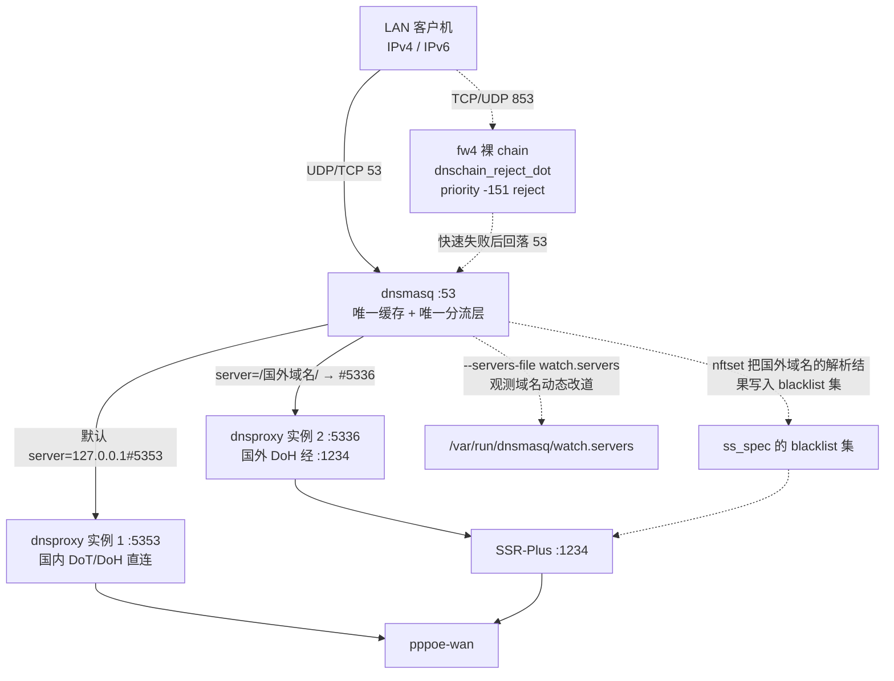

# ADR-0003：DNS 分流框架 —— dnsmasq 唯一缓存与分流 + 双 dnsproxy 实例

- 状态：**部分被取代（v0.10.0）** —— 原文的「框架自持 chinadns-ng `:5335` 策略过滤器」
  与「国外 IP 形式 DoT」已由 [ADR-0005](0005-remove-chinadns-ng.md) 取代；
  域名归属与自动改道部分由 [ADR-0006](0006-domain-routing-and-reroute.md) 扩展。
  其余章节（端口所有权、单一缓存、收敛器、自检、降级矩阵）仍有效
- 日期：2026-10-20（原始）；2026-10-23 按代码逐条更正并标注失效断言
- 取代：本文件取代已被撤回的 `0003-dns-chain-architecture.md` 与 `0004-dns-chain-framework.md`（撤回原因见 §15）
- 被取代：[ADR-0005](0005-remove-chinadns-ng.md)（2026-10-21，移除 chinadns-ng）
- 沿用：[ADR-0001](0001-filter-aaaa-semantics.md)（已失效，见其正文）、
  [ADR-0002](0002-no-ipv6-proxy.md)（已失效）
- 相关：`files/etc/config/dnschain`、`files/usr/share/dnschain/dnschain.sh`、
  `files/etc/init.d/dnschain`、`files/usr/bin/dnschain-*`、
  `files/etc/uci-defaults/99-zz-dnschain`、`package/luci-app-dnschain/`

> ## 阅读须知
>
> 本文写作时（v0.9.x）的链路是「dnsproxy 唯一路由入口 + 框架自持 chinadns-ng
> `:5335` 策略过滤器 + 单一缓存」。v0.10.0 移除了 chinadns-ng，改成
> **两个 dnsproxy 实例 + dnsmasq 分流**。
>
> 因此本文有两类内容：
>
> - **仍有效的设计约束**（单一缓存层、端口所有权、收敛器、降级矩阵、抗「改 LuCI 就坏」）
> - **已被取代的实现细节**（`:5335` 归谁、国外上游协议、端口档案）
>
> 后者一律就地标注 **【已失效】**，并写出失效原因与现行事实。逐条更正清单见 §0。

---

## 0. 本次修订记录（逐条对照代码）

下表是本文相对 v0.9.x 原文的**全部**更正。每条给出「原文说什么 / 实际是什么 / 证据」。
未列入本表的内容经核对与代码一致。

| # | 原文位置 | 原文断言 | 现行事实 | 证据 |
|---|---|---|---|---|
| 1 | §2.1、§3 第 2 条、§4.1、§5.2、§10.3 | `:5335` 是「框架自持的 chinadns-ng 策略过滤器」 | v0.10.0 已移除；`:5335` **必须无监听** | `files/usr/bin/dnschain-selftest:220-231` |
| 2 | §3 第 5 条、§4.1、§10.1 | 国外上游是 `tls://8.8.8.8` / `tls://1.1.1.1`（DoT） | 两条 DoH：`https://dns.google/dns-query`、`https://cloudflare-dns.com/dns-query`；init 硬校验「不能是 `tls://`」 | `files/etc/config/dnschain:62-68`、`files/etc/init.d/dnschain:200-212` |
| 3 | §8.2 | UCI 有 `profile` / `filter_port` / `lan_intercept` | 只有 `enabled` / `intercept` / `entry_port` / `foreign_port` / `intercept_dot` / `intercept_doh` | `files/etc/config/dnschain:42-54` |
| 4 | §7.3 | `coexist` 档案把过滤器迁到 `:5337` | 全仓库无 `5337`（只有 PO 里的历史文案残留） | `package/luci-app-dnschain/po/zh-cn/luci-app-dnschain.po:171-172` |
| 5 | §8.2 | `aaaa.foreign 'suppress'`、`filter_https_rr '1'` | `keep` / `'0'` | `files/etc/config/dnschain:78-82` |
| 6 | §8.3 | 页面 6 个 Tab | 7 个（多 `domains`） | `general.lua:98-106` |
| 7 | §8.4、§11、§13.1 | 自检 16 项 | **20 项** | `files/usr/bin/dnschain-selftest` 的 `emit 1` … `emit 20` |
| 8 | §11 第 1 项 | 判据是 `nft list chain inet fw4 dns_intercept_lan` | 该链在框架启用时**不被创建**；判据改为「LAN 地址 `:53` 能否应答」 | `files/etc/init.d/dnsproxy:280-287`、`files/usr/bin/dnschain-selftest:99-122` |
| 9 | §11 第 2/6/9/11/12/15 项 | 各项判据 | 全部与实现不符，见 §11 逐项改写 | `files/usr/bin/dnschain-selftest:124-402` |
| 10 | §9.2 | `filter_aaaa = 1` | 强制 `0` | `files/usr/bin/dnschain-reconcile:97-98`、`files/etc/uci-defaults/99-zz-dnschain:75-80` |
| 11 | §9.2 | 键名 `access_control.router_proxy` | 完整键是 `shadowsocksr.@access_control[0].router_proxy` | `files/usr/bin/dnschain-reconcile:100-112` |
| 12 | §9.2 | 触发点含 `procd_add_reload_trigger shadowsocksr dnsproxy dhcp` 与 selftest 定时任务 | 只有 `procd_add_reload_trigger "$DNSCHAIN_CONF"`；全仓库无 cron/procd 定时；`selftest.interval` 无消费者 | `files/etc/init.d/dnschain:496-498`、`general.lua:1824-1826` |
| 13 | §9.3、§10.1 | 生成 `upstreams-domains.txt`（`[/域名/]`）并作为 `--upstream <文件>` | 生成的是 `foreign-split.conf`（纯域名清单）；`--upstream` 只接 URL；`upstreams-domains.txt` 是遗留物、无消费者 | `files/usr/share/dnschain/dnschain.sh:257-326`、`:332-372`、`.github/workflows/build-openwrt.yml:1168-1176` |
| 14 | §10.1 | `--timeout 5s` | `8s` | `files/usr/share/dnschain/dnschain.sh:358-359`、`:404-405` |
| 15 | §10.3 | chinadns-ng 参数块 | 该进程已不存在；`-A` 的职责改由 dnsmasq `nftset=` 承担 | `files/usr/share/dnschain/dnschain.sh:1105-1124`、`.github/workflows/build-openwrt.yml:1147-1158` |
| 16 | §10.4、§10.6 | `files/etc/config/dnsproxy:118`、`files/etc/init.d/dnsproxy:293` | `tls.enabled` 在 `:142-145`；CA 证书 jail-mount 在 `:320-325` | 同左 |
| 17 | §10.9 | `applechina.conf` 是 173 条指向 `114.114.114.114` | 173 条全部指向 `127.0.0.1#5353`；191 行中 18 行注释，含 `114.114.114.114` 的只有 1 行注释 | `files/etc/ssrplus/applechina.conf:4`、全文件 173 条 `server=` |
| 18 | §13.1 | 修改 `99-gaming-optimize` 把 `pdnsd_enable=4 → 0` | 该文件**未被修改**，仍写 `4`；靠后执行的 `99-zz-dnschain` 覆盖 | `files/etc/uci-defaults/99-gaming-optimize:303-306`、`files/etc/uci-defaults/99-zz-dnschain:45-50` |
| 19 | §13.2 | `chmod +x` 清单在 `build-openwrt.yml:475-478` | 实际在 `:979-992`；`:475-478` 是 shadcn 主题 clone | `.github/workflows/build-openwrt.yml:962-994` |
| 20 | §2.7 D1/D5/D7 | 引用 `AGENTS.md:517`、`AGENTS.md:335`、`GLOSSARY.md:49-51`，以及「`@whitelist` 必须含代理节点 IP」 | 三处行号都对不上；`AGENTS.md` 全文无 `whitelist` 字样 | `AGENTS.md:497`、`AGENTS.md:313`、`GLOSSARY.md:51`；全仓库 grep `whitelist` 在 `AGENTS.md` 零命中 |
| 21 | §2.7 D8 | 仓库 overlay 仍生成 `dnsmasq restart` | **成立**，行号见证据 | `files/etc/uci-defaults/99-gaming-optimize:503` |
| 22 | §11 测试纪律 | 引用「AGENTS.md §6.2」 | 不存在；第 6 节只有编号项 1–12，应写「§6 第 2 项」 | `AGENTS.md:661`、`:673` |
| 23 | §13.3 | 要求 GLOSSARY 新增「策略过滤器」并保留「4 跳」 | 该要求已作废：GLOSSARY 无该条目，跳数已改 3 跳 | `GLOSSARY.md` 的「跳数」条 |

**另有一处原文未提、本次新发现的问题**（详见 §9.2 末）：

| # | 问题 | 证据 |
|---|---|---|
| N1 | 收敛器 `dnschain-reconcile` **没有任何自动触发点**：init 不调用它、无 procd 触发器、无 cron。它只在页面点「一键归一」或「手动导入名单」时被执行 | `files/etc/init.d/dnschain:383-498` 全文无 `reconcile` 调用；调用点只有 `package/luci-app-dnschain/luasrc/model/cbi/dnschain/dnschain.lua:452`、`:467` |
| N2 | 页面文件头部注释仍写「Tab 划分（6 个）」且只列 6 个（缺 `domains`），而 `TAB_LABELS` 实际有 7 个 | `general.lua:25-32` vs `general.lua:98-106` |
| N3 | 自检第 4 项算出 `v6`（`[::1]` 的探测结果）却**从不使用**，只按 `v4` 判定 —— 项名写「127.0.0.1 与 ::1」，实际只验了 v4 | `files/usr/bin/dnschain-selftest:191-198` |

---

## 1. 问题与验收标准

用户提出五项要求，以及一条贯穿性诉求。

| # | 要求 | 可判定的验收条件 |
|---|---|---|
| R1 | 由本机解析器拦截并代理**所有客户机**的 DNS，支持 DoH 与 DoT，覆盖 IPv4/IPv6 双栈 | 客户机（非 `127.0.0.1`）手工把 DNS 改成 `8.8.8.8` 仍被劫持；所有上游为 `https://` 或 `tls://` |
| R2 | 国外节点通常只有 IPv4，国内外地址要**正确分流进 SSR-Plus** | 国内域名得到真实 A + 真实 AAAA，IPv4 直连；国外域名 IPv4 经 `:1234` 出站 |
| R3 | **独立页面**集中控制整个 DNS 解析配置 | 单页可改上游、协议、双栈策略、名单源、SSR 兼容模式、DHCP 下发 DNS、拦截总开关 |
| R4 | **不要**「dnsproxy 只做国内 + SSR-Plus 查 MosDNS」 | 默认链路无 MosDNS 进程 |
| R5 | 覆盖 SSR-Plus 各 DNS 方式 | 每种模式有明确的端口所有权与行为说明；切换不产生「指向无监听端口」的空窗 |

贯穿性诉求：**改 SSR-Plus 的 LuCI 页面不得把链路改坏。**

**范围**：本 ADR 定义设计与落地清单。当前落地状态见 §13。

> R2 的验收条件在 v0.10.0 后放宽：国外 AAAA 不再要求为空，因为 IPv6 也进代理
> （见 §5.1 与 [ADR-0002](0002-no-ipv6-proxy.md) §2）。原文写「国外域名只有 A」
> 已随 AAAA 抑制一并失效。

---

## 2. 现状基线

### 2.1 当前链路（v0.10.0 起）



四条要点：

1. **`:5335` 必须无监听。** 该端口在 v0.9.x 属 chinadns-ng，现在没有任何进程该占它。
   自检第 6 项专门断言这一点（`files/usr/bin/dnschain-selftest:220-231`）。
2. **两个 dnsproxy 实例，都不缓存。** 参数由 `dc_gen_dnsproxy_args()`
   （`files/usr/share/dnschain/dnschain.sh:332-372`）与 `dc_gen_foreign_args()`
   （`:381-417`）生成，函数内明确不写 `--cache` / `--fallback` / `--ipv6-disabled`
   （`:370`）。
3. **分流由 dnsmasq 的 `server=/域名/` 承担**，不是 dnsproxy 的 `[/域名/]`。
   CI 反向断言禁止再出现 `[/域名/]` 形式（`.github/workflows/build-openwrt.yml:1168-1176`）。
4. **观测域名的去向走 `--servers-file`**，改道只改该文件 + SIGHUP
   （`files/usr/share/dnschain/dnschain.sh:1165-1245`）。

> **【已失效】** 原文 §2.1 的链路图（LAN → fw4 `dns_intercept_lan` → dnsmasq →
> `dnsproxy:5353` / `server=/域名/#5335` → `mosdns:5335`）不再成立：
> `:5335` 无监听，MosDNS 不在默认链路。

### 2.2 关键实测事实

| # | 事实 | 证据 |
|---|---|---|
| F1 | dnsproxy 支持 `[/domain/]upstream` 域名分流，但**不能用**：为每个域名各注册一条 reserved 上游，条目过多时资源耗尽 | `files/etc/init.d/dnschain:292-301` 的注释记录了实测（17767 条 → `connection timed out`） |
| F2 | dnsproxy **不能** per-domain 抑制 AAAA；`--ipv6-disabled` 是全局开关 | 自检第 5 项把 `--ipv6-disabled` 判为 FAIL（`files/usr/bin/dnschain-selftest:211-212`） |
| F3 | dnsproxy 不支持 socks5 上游，不支持 ipset/nftset 写入 | `files/etc/config/dnschain:11-12`（nftset 由 dnsmasq 承担） |
| F4 | dnsproxy 的 `--cache-size` 单位是字节 | 原文实测，保留 |
| F5 | dnsproxy 的 `--cache-min-ttl` 会人为延长 TTL | 原文实测，保留 |
| F6 | 用国内上游直答 gfw 域名会返回污染答案 | 原文 §2.3，保留（结论仍成立，是「国外必须走 DoH」的依据） |
| F7 | 124 个 `xn--` 域名曾使 dnsproxy 整体拒绝启动 | 原文 §2.4。v0.10.0 后分流改由 dnsmasq 承担，`xn--` **不再过滤**（`files/usr/share/dnschain/dnschain.sh:299-308`） |
| F8 | 上游 SSR-Plus 的 `get_filter_aaaa()` 在 `ipv6_support=1` 时返回 0 | `files/etc/config/dnschain:26-33`、`files/usr/bin/dnschain-selftest:235-252` |
| F9 | dnsmasq 的 `SIGHUP` 只清缓存、不重读 conf-dir | `AGENTS.md:497-517`；`files/etc/init.d/dnschain:319-324` 据此改用 restart |
| F10 | dnsmasq 的 `--servers-file` 在 SIGHUP 时**会被**重新读取 | `files/usr/share/dnschain/dnschain.sh:1151-1163` |
| F11 | 本固件的 dnsmasq 由 ujail 降权到 uid 453 运行，只能读白名单路径 | `files/usr/share/dnschain/dnschain.sh:589-606` |
| F12 | `pidof dnsmasq` 返回 3 个 PID，第一个是 ujail 辅助子进程，对它 SIGHUP 是空操作 | `files/usr/share/dnschain/dnschain.sh:428-491` |

> **【已失效】** 原文 F8/F9/F10 关于 chinadns-ng 的能力与默认值（`-N tag:<name>`、
> `--cert-verify` 默认关闭、`-c` 默认 `114.114.114.114`）已无对应进程，不再列出。

### 2.3 决定性证据：用国内上游答国外域名会污染

原文 §2.3 的实测保留（结论仍是「国外域名必须经加密上游从境外取答案」）：

```
直连 :5353（上游 = 国内 DoH 池）
  www.google.com     → 2001::1 + 104.244.42.197      ← 注入的 AAAA + Facebook IP
  www.youtube.com    → 2001::1 + 174.132.167.252
  www.wikipedia.org  → 2001::1 + 103.102.166.224
```

污染值判据写在自检里：`2001::1`、`31.13.*`、`157.240.*`、`104.244.*`
（`files/usr/bin/dnschain-selftest:77-84`）。

### 2.4 文档与代码不符之处（本次修正）

| # | 原说法 | 实测/现行 | 处置 |
|---|---|---|---|
| D1 | 「`grep -c 'dnsmasq restart'` 应为 0」（原文引用 `AGENTS.md:517`） | 该断言写法本身有缺陷：`grep -c` 会命中 `echolog` 里的文本。`AGENTS.md` 的这条警告在 `:497`，不是 `:517`；`:517` 是「SIGHUP 只清缓存」那段 | 行号更正；断言写法按 `AGENTS.md:497-511` 的「排除 `echolog` 行后统计」 |
| D2 | 旧 ADR「`/usr/bin/gfw2ipset.sh`」 | 脚本在 `/usr/share/shadowsocksr/gfw2ipset.sh`（属上游 SSR-Plus，不在本仓库） | 路径修正，结论保留 |
| D3 | 「`gfw_list.conf` 约 2.37 万条」 | 该文件是运行时生成物，**不在仓库**。仓库内对同一文件给出 `23614` / `23701` / `23717` / `17804` / `23714` 多个数字 | 一律当「某时点实测快照」，不写成常量；规模读运行时产物（`dnschain.lua:271-325`） |
| D4 | 「124 条 IDNA 域名」 | 124 个域名（248 行）。原文是对的 | 保持；但 v0.10.0 后不再过滤 `xn--` |
| D5 | 引用 `GLOSSARY.md:49-51`「dnsproxy 另有 24 条硬编码国外域名例外」 | `GLOSSARY.md:49-51` 现在是「整形」与「排队时延」两条，与 dnsproxy 无关。该 24 条清单在 `AGENTS.md:313` 记录为 v0.8.0 已删 | 引用作废；结论（清单已删、勿加回）保留，证据改指 `AGENTS.md:313` |
| D6 | 「`gfw2ipset.sh` 把 `ipset=` sed 成 `nftset=`」 | 原文实测：整行删除，不是转换 | 结论保留 |
| D7 | 「`@whitelist` 必须含代理节点自身 IP」 | `AGENTS.md` 全文**无 `whitelist` 字样**（grep 零命中）。仓库里也没有生成 `@whitelist` 的代码 —— 该集合属上游 SSR-Plus 运行时产物 | **删除该条**。它既无仓库侧证据，引用的行号也不存在 |
| D8 | 「两处 `restart` 已改 `reload`」 | 路由器上确是 `reload`（符合意图），但**仓库 overlay 生成的代码仍是 restart** | **成立**。证据：`files/etc/uci-defaults/99-gaming-optimize:503`（`printf '\t\t\t/etc/init.d/dnsmasq restart >/dev/null 2>&1\n'`） |

---

## 3. 核心决策

1. **单一分流层**：分流由 `dnsmasq` 的 `server=/域名/` 承担（R4）。
   框架生成 `dnschain-split.conf`，通过 conf-dir 加载
   （`files/etc/init.d/dnschain:96-118`）。
2. **两个解析实例，职责按「出口」切分**：`:5353` 只服务国内域名（直连），
   `:5336` 只服务国外域名（经 `:1234`）。两者都不缓存、都不抑制 AAAA、
   都不写 nftset（`files/usr/share/dnschain/dnschain.sh:332-417`）。
3. **单一缓存层**：缓存只在 `dnsmasq`。理由见 §10.5。
4. **dnsmasq 不做策略判断**：它只按 `server=` 转发；`nftset=` 把解析结果写进
   `ss_spec` 的集合（`files/usr/share/dnschain/dnschain.sh:1105-1124`）。
5. **国外解析必须用 DoH（443），经代理出站**。落地节点到 `853` 全部不通
   （`peer sent close notify`，只回 204 字节），`443` 正常；init 因此**硬校验**
   「国外上游不能是 `tls://`」（`files/etc/init.d/dnschain:200-212`）。
6. **端口所有权是唯一硬不变量**：`:5353` 与 `:5336` 不能相同，init 的 preflight
   直接拒绝启动（`files/etc/init.d/dnschain:186-191`）；`:5335` 必须空闲
   （自检第 6 项）。
7. **配置写入单点**：`dnschain` 是唯一写入者；SSR-Plus 与 dnsproxy 的页面降级为下游。
8. **拦截总开关**：一个滑块决定「拦不拦 LAN 的 DNS」（`files/etc/config/dnschain:46`
   的 `intercept`），关闭时只影响 `dhcp-option 6` 的下发
   （`files/usr/bin/dnschain-reconcile:316-362`）。

> **【已失效】** 原文第 2 条「per-domain AAAA/HTTPS 抑制由框架自持的 chinadns-ng
> 实例提供，端口 `:5335`」与第 5 条「国外解析用 IP 形式 DoT」已由第 2、5 条新表述取代。

---

## 4. 组件职责

| 组件 | 端口 | 职责 | 明确不做 |
|---|---|---|---|
| `fw4` 裸 chain `dnschain_reject_dot` | — | 拒绝 LAN 出向 853（TCP+UDP），`priority -151` | 不解析、不缓存 |
| `dnsmasq` | `:53` | DHCP、`/etc/hosts`、租约、**唯一缓存层**、**唯一分流层**、`nftset=` 写入 | 不持独立策略；不直接连加密上游 |
| `dnsproxy` 实例 1 | `:5353`（`127.0.0.1` + `::1`） | 国内域名 → 国内加密池（DoT/DoH，直连） | **不缓存**、不抑制 AAAA、不写 nftset |
| `dnsproxy` 实例 2 | `:5336`（`127.0.0.1`） | 国外域名 → DoH 经 `:1234` | 同上；且**不监听 `::1`** |
| `SSR-Plus` | `:1234` | 透明代理（IPv4 与 IPv6 都代理） | **不提供** DNS（模式 0） |
| `dnschain`（init + 库） | — | 生成配置、托管两个实例、fw4 片段、preflight、自检 | 不实现解析逻辑 |
| `dnschain-health` | — | 健康探测、改道、状态查询、`apply`/`reset`/`flush` | 不改静态分流片段 |
| `dnschain-reconcile` | — | 重放不变量集、名单单向导入 | 不改 `global_server`、不改 `run_mode`/`dports`/`lan_ac_mode` |
| `dnschain-selftest` | — | 20 项只读自检 | 不修任何东西 |
| `luci-app-dnschain` | — | 配置读写、校验、下发、展示 | 不实现判定逻辑（读脚本产物） |

**`dnschain-filter.json` 目前没有消费者。** 该文件
（`files/etc/capabilities/dnschain-filter.json`）声明了
`CAP_NET_ADMIN` / `CAP_NET_BIND_SERVICE` / `CAP_NET_RAW`，但两个 procd 实例都没有
引用它：`files/etc/init.d/dnschain:274-317` 只做 jail-mount，不设 capabilities；
唯一引用 `/etc/capabilities/` 的是 `files/etc/init.d/dnsproxy:319`
（用的是 `dnsproxy.json`）。它是 chinadns-ng 时代的遗留物（当年 `-A` 需要
`CAP_NET_ADMIN`），v0.10.0 后已无用途，但仍由
`tools/verify-firmware-artifact.sh:141` 检查存在性。

---

## 5. R2：国内外地址如何正确分流进 SSR-Plus

### 5.1 DNS 层

| 域名类别 | A | AAAA | 客户机行为 |
|---|---|---|---|
| 国内 | 真实（直连查） | **真实** | 优先 IPv6 直连 |
| 国外 | 真实（经代理查） | **真实**（经代理查） | IPv6 也进代理 |

**【已失效】** 原文此表写「国外 AAAA = NODATA（`rcode=0, ancount=0`），客户机立即
回落 IPv4」。v0.10.0 起国外 AAAA **保留**：

- 策略字段 `aaaa.policy.foreign` 为 `keep`（`files/etc/config/dnschain:79`）
- 自检第 11 项期望 `OK`，`EMPTY` 判 FAIL（`files/usr/bin/dnschain-selftest:282-293`）

原文那段「必须把 `EMPTY`（预期）与 `TIMEOUT`（故障）分开」的判据**仍然有效**，
只是 `EMPTY` 不再是对国外的期望值，而是判为「被抑制了」的故障形态
（`files/usr/bin/dnschain-selftest:290`）。

### 5.2 IP 层：IPv4 走不走代理

`ss_spec_wan_ac` 的判据属上游 SSR-Plus 生成，**仓库侧没有规则文件**
（全仓库对 `ss_spec` 的引用只有读取与注释）。原文列出的 13 条规则顺序、
各集合元素数（`china` 3794、`whitelist_domain` 95 等）都是某时点实测快照，
不写成常量；核对时读运行时：

```sh
nft list chain inet ss_spec ss_spec_wan_ac
for s in blacklist china whitelist_domain; do nft list set inet ss_spec $s; done
```

框架侧只做两件事：

- 生成 `nftset=` 行把国外域名的解析结果写进 `blacklist`
  （`files/usr/share/dnschain/dnschain.sh:1105-1117`）
- 生成 `nftset=` 行把自定义国内域名的解析结果写进 `china`（强制直连）
  （`:1119-1124`）

**`nftset` 目标集必须先探测再写**：SSR-Plus 未启用时 `ss_spec` 表不存在，
写 `nftset=` 会让 dnsmasq 每解析一个域名都失败刷日志
（`files/usr/share/dnschain/dnschain.sh:949-984`）。探测到表整体不在但上一版
片段有 `nftset` 行时，判定为「SSR-Plus 正在重建」，沿用上一版行
（`:1082-1103`）。

### 5.3 出站层：解析器自身的连接也要走代理

两个 dnsproxy 实例都跑在本机，它们的 DoH 连接走 **OUTPUT** 链。三个前提：

| 前提 | 现行值 | 不满足的后果 |
|---|---|---|
| `shadowsocksr.@access_control[0].router_proxy=1` | 收敛器强制为 `1`（`files/usr/bin/dnschain-reconcile:111-112`） | 路由器自身出向直连 → 国外 DoH 被墙 → 国外域名全超时 |
| `ss_spec_output` 端口集覆盖 **443** | 收敛器校验「含 853、不含 53」（`:197-207`）；443 由上游默认在表内 | 443 不在表内则 DoH 不进代理 |
| 国外上游是 `https://` | init 硬校验（`files/etc/init.d/dnschain:200-212`） | 用 `tls://`（853）→ 落地节点阻断 |

`ss_spec_output` 只匹配 TCP，所以国外上游必须是 TCP 承载。上游端口校验在
`preflight` 里做：读运行时端口集，越界即拒绝启动
（`files/etc/init.d/dnschain:164-181`、`files/usr/share/dnschain/dnschain.sh:1943-1972`）。

### 5.4 为什么不用全局 `--ipv6-disabled`

全局关 AAAA 会把国内也砍掉。自检第 5 项把 `--ipv6-disabled` 直接判 FAIL
（`files/usr/bin/dnschain-selftest:211-212`），CI 也禁止库脚本生成它
（`.github/workflows/build-openwrt.yml:1141-1144`）。

---

## 6. R1：双栈与加密

| 项 | 决策 | 证据 |
|---|---|---|
| 客户机侧 | 明文 53 由 dnsmasq 直接监听 LAN 地址提供 | `files/usr/bin/dnschain-selftest:107-122` |
| 国内上游 | `tls://223.5.5.5`、`tls://223.6.6.6`、`https://dns.alidns.com/dns-query` | `files/etc/config/dnschain:56-60` |
| 国外上游 | `https://dns.google/dns-query`、`https://cloudflare-dns.com/dns-query`（**必须是 DoH 域名形式**） | `files/etc/config/dnschain:62-68` |
| fallback | **不配**。`dc_gen_dnsproxy_args` / `dc_gen_foreign_args` 都不写 `--fallback`；自检第 5 项把它判 FAIL | `files/usr/share/dnschain/dnschain.sh:370`、`files/usr/bin/dnschain-selftest:209-210` |
| 证书校验 | 国外实例开启（有 SNI 可正常校验） | `files/etc/config/dnschain:71-72`（`cert_verify '1'`） |
| 超时 | 两个实例都是 `8s` | `files/usr/share/dnschain/dnschain.sh:358-359`、`:404-405` |
| 双栈 | 国内保留 AAAA；国外**也保留**（IPv6 经代理） | `files/etc/config/dnschain:74-82` |
| 客户机怎么知道找本机 | IPv4 走 DHCP `option:dns-server`；IPv6 走 odhcpd RDNSS | `files/usr/bin/dnschain-reconcile:316-344`（DHCP 侧） |

> **【已失效】** 原文「国外上游 `tls://8.8.8.8`、`tls://1.1.1.1`（**必须 IP 形式**）」
> 与「国外 DoT 开启 `--cert-verify`」。现行两条都是 DoH 域名形式，
> `cert_verify` 是 dnsproxy 侧配置项而非命令行 `--cert-verify`。
>
> `via_proxy` 与 `cert_verify` 这两个 UCI 键**目前没有 shell 消费者**
> （全仓库 grep `dc_get foreign via_proxy` / `cert_verify` 零命中），
> 只作记录 —— 页面应据此标注。

---

## 7. R5：SSR-Plus 各 DNS 方式的映射

**是否绑 `:5335`** 仍是唯一影响本框架的差异。

| 值 | UI 文案 | 是否绑 `:5335` | 本框架下的定位 |
|---|---|---|---|
| `0` | 使用本机端口 5335 的 DNS 服务 | **否** | ✅ **默认**（`ssr.mode '0'`） |
| `7` | 优先使用模块内置 DNS | **否** | ✅ 可选 |
| `1` | DNS2TCP | 是 | ⚠️ 会与框架争端口，自检第 7 项 FAIL |
| `2`/`3` | DNS2SOCKS / RUST | 是 | ⛔ 本固件不支持 |
| `4` | MOSDNS | 是 | ⚠️ 仅兼容；MosDNS 只在此模式存在 |
| `5` | DNSPROXY 查询并缓存 | 是 | ⚠️ 仅兼容 |
| `6` | ChinaDNS-NG | 是 | ⚠️ 仅兼容 |

自检第 7 项只接受 `0` 或 `7`，其余一律 FAIL 并给出实际值
（`files/usr/bin/dnschain-selftest:245-246`）。收敛器写入的期望值来自
`dc_ssr_mode_for_profile()`，它读的是 `dnschain.compat.mode`
（`files/usr/share/dnschain/dnschain.sh:58-95`）。

### 7.1 模式 `0` 的语义

「使用本机端口 5335 的 DNS 服务」在代码里的含义是：**SSR 自己不提供 DNS，
但它的 gfw 分流仍指向 `127.0.0.1#5335`，等着别人在那个端口上提供服务**。

v0.10.0 起 `:5335` **没人监听**，于是 SSR-Plus 生成的
`server=/域名/127.0.0.1#5335`（数量级 1.7 万）全部指向死端口。框架按
`AGENTS.md` §4.0 的约束**不删不重写** SSR-Plus 的文件；实测 dnsmasq 对同一域名的
多条 `server=` 会全部作为**候选**，`:5335` 无监听时自动重试其它候选
（`files/usr/bin/dnschain-selftest:124-135` 的注释记录了这条实测）。

**这是依赖加载顺序的隐式行为**，属已知风险（§14 R-3）。

### 7.2 端口档案（`primary` / `coexist`）已取消

**【已失效】** 原文 §7.3 定义了两套端口档案：`primary` 用 `:5335`，
`coexist` 把过滤器迁到 `:5337`。

现行事实：

- 配置里**没有** `profile` 键（`files/etc/config/dnschain:42-54` 只有
  `enabled`/`intercept`/`entry_port`/`foreign_port`/`intercept_dot`/`intercept_doh`）。
- 全仓库**没有 `5337`**。唯一残留是 PO 里的历史文案
  （`package/luci-app-dnschain/po/zh-cn/luci-app-dnschain.po:171-172`），
  而对应的页面控件已不存在（`general.lua` 无「端口档案」section）。
- `dnschain.sh:58-95` 仍保留一段 `main.profile=coexist` 的旧配置兼容分支
  （读不到 `compat.mode` 时用它决定是否强制），但配置文件里没有这个键，
  该分支实际不生效。

现行端口结构固定为 `entry_port` + `foreign_port`，两者不能相同
（`files/etc/init.d/dnschain:186-191`）。

### 7.3 切换模式时的顺序

```text
应用新配置：
  1. generate_all → /var/etc/dnschain/*（dnsproxy.args、dnsproxy-foreign.args、
     foreign-split.conf、watch.servers、lists.fingerprint）
  2. preflight（上游端口集 / 二进制 / 两端口不同 / foreign-split 非空 /
     国外上游不是 tls://）
  3. update_dnsmasq_split（写 dnschain-split.conf）
  4. update_serversfile（写 dhcp.@dnsmasq[0].serversfile）
  5. reload_dnsmasq（受标记文件抑制，末尾统一一次）
  6. 启动两个 dnsproxy 实例
  7. update_dot_reject（写 fw4 裸 chain 并 reload firewall）
  8. start_health_daemon
```

证据：`files/etc/init.d/dnschain:383-420`。

**`reload_service` 全程只重启一次 dnsmasq**：用标记文件
`/var/run/dnschain/.dnsmasq-dirty` 抑制中间步骤（`:342-352`、`:464-494`）。
原文 §7.4 写的「自检 20 项，任一 FAIL → 回滚并重放旧档案」**未实现**：
`reload_service` 在 preflight 失败时只是 `return 1`，没有快照与回滚。

---

## 8. R3：独立页面

### 8.1 定位

**只做配置读写、校验、下发、展示，不实现判定逻辑。** 页面读脚本产物
（`dnschain-health status/explain`、`dnschain-selftest`、运行时文件），
自己重算一份必然漂移（`package/luci-app-dnschain/luasrc/model/cbi/dnschain/dnschain.lua:692-699`）。

### 8.2 配置模型（`/etc/config/dnschain`，现行）

```uci
config dnschain 'main'
	option enabled '1'
	option intercept '1'              # 拦截总开关
	option entry_port '5353'          # 国内实例
	option foreign_port '5336'        # 国外实例
	option intercept_dot '1'          # 拒绝 LAN 出向 853
	option intercept_doh '0'          # 仅记录，无消费者

config upstream 'cn'
	list server 'tls://223.5.5.5'
	list server 'tls://223.6.6.6'
	list server 'https://dns.alidns.com/dns-query'

config upstream 'foreign'
	list server 'https://dns.google/dns-query'
	list server 'https://cloudflare-dns.com/dns-query'
	option via_proxy '1'              # 仅记录
	option cert_verify '1'            # 仅记录

config aaaa 'policy'
	option domestic 'keep'
	option foreign 'keep'
	option filter_https_rr '0'        # 仅记录

config lists 'lists'
	option gfw_source '/etc/ssrplus/gfw_list.conf'
	option base_source '/etc/ssrplus/gfw_base.conf'
	option black_source '/etc/ssrplus/black.list'
	option auto_import '1'
	option import_interval '60'       # 仅记录
	option restart_threshold '1'

config dhcp_dns 'dhcp_dns'
	option enabled '1'
	list server '223.5.5.5'
	list server '119.29.29.29'

config cache 'cache'
	option enabled '1'                # 仅记录（实际始终由 dnsmasq 承担）
	option size '8192'

config domains 'dom_domestic'         # 注意：名字不能是 domestic/foreign
config domains 'dom_foreign'          # 见 files/etc/config/dnschain:126-135

config health 'health'                # 见 §4.4（ADR-0006）
	option enabled '1'
	option timeout '2'
	option retries '2'
	option fail_threshold '2'
	option recover_threshold '3'
	option min_dwell '120'
	option interval '60'
	list watch 'www.baidu.com'
	…（共 8 条）

config selftest 'selftest'
	option auto_rollback '1'          # 仅记录，回滚逻辑未实现
	option interval '300'             # 仅记录，仓库里没有定时调度

config ssr 'compat'
	option mode '0'
	option enforce '1'
	option require_ipv6 '1'
```

证据：`files/etc/config/dnschain:42-204`。

**标注「仅记录」的键**在页面上有明确提示（例如
`general.lua:1824-1826` 对 `selftest.interval` 写「仓库里没有定时调度」，
`general.lua:1456-1462` 对 `filter_https_rr` 写「此项目前仅作记录，
没有运行时消费者」）。

> **【已失效】** 原文 §8.2 的 `option profile 'primary'`、`option filter_port '5335'`、
> `option lan_intercept '1'`、`option foreign 'suppress'`、`option filter_https_rr '1'`
> 均已不存在或改值。

### 8.3 页面结构

- 菜单：**服务 → DNS 分流**（`admin/services/dns_chain`），`order=20`，
  紧接在 ShadowSocksR Plus+（`order=10`）下一行
  （`package/luci-app-dnschain/root/usr/share/luci/menu.d/luci-app-dnschain.json:2-12`、
  `package/luci-app-dnschain/luasrc/controller/dnschain.lua:37-39`）。
- **7 个 Tab**：概览 / 域名 / 解析 / 分流 / 代理 / DHCP / 诊断
  （`general.lua:98-106`）。

```
服务 → DNS 分流 (admin/services/dns_chain)
├─ 概览    当前状态（结论行 + 链路图 + 指标 + 组件状态）
├─ 域名    自定义域名（国内/国外）+ 判定链路 + 改道状态 + 改道明细
│          + 观测与阈值 + 域名操作
├─ 解析    国内上游 / 国外上游 / 双栈策略 / 端口与实例 / 缓存
├─ 分流    名单规模
├─ 代理    SSR-Plus 兼容 / 拦截与框架开关
├─ DHCP    DHCP 下发 DNS（明文）
└─ 诊断    自检 + 操作（立即自检 / 一键归一 / 手动导入 / 更新 GFW / 清空缓存）
```

Section 与 Tab 的映射表在 `general.lua:113-140`，由前端按 `<h3>` 文本归组
（`general.lua:81-96` 解释了为什么不用 HTML 属性）。

### 8.4 「保存」与「保存并应用」

CBI 的两个底部按钮语义不同：`保存` 只写 UCI；`保存并应用` 会调
`apply_on_parse` → `dnschain-health apply`
（`general.lua:1896-1924`）。`apply` 内部按 MD5 比对静态片段与 `watch.servers`，
只在真变化时才 restart 或 SIGHUP（`files/usr/bin/dnschain-health:205-264`）。

`apply` 有 5 条正常出口（`DNSMASQ=restarted/skipped×2/sighup/unchanged`）
加 `ERROR=` 失败出口，页面必须全部解析
（`general.lua:1926-1978`）。

> **【已失效】** 原文 §8.4 的事务化状态图（快照 → 写入 → 重启 → **16 项自检** →
> 失败自动回滚）未实现。现行是「生成 → preflight → 应用」，preflight 失败即
> `return 1`，没有快照、没有回滚。自检项数也不是 16。

---

## 9. 抗「改 LuCI 就坏」：六道闸

| 闸 | 机制 | 拦住的真实故障 |
|---|---|---|
| G1 职责分离 | SSR 不提供 DNS；框架的解析器不依赖 SSR 的端口 | v0.8.0 的「SSR 停止 → 指向死端口 → 污染答案」 |
| G2 单一写入者 | 只有 `dnschain` 写 dnsproxy 参数与 dnsmasq 的 DNS 键 | 两个页面各写一半导致互相覆盖 |
| G3 收敛器 | 重放不变量集 | 用户改完 SSR 页面忘记归一；`ssr-switch` 写 `global_server=nil` |
| G4 端口所有权断言 | preflight 拒绝两端口相同；自检第 6 项断言 `:5335` 空闲 | 两个进程抢同一端口，一个静默失败 |
| G5 preflight + 自检 | 生成 → preflight → 20 项自检 | 「点保存后全断」 |
| G6 路径收敛 | 静态片段由唯一函数生成；观测域名单独走 servers-file | v0.8.6 的「reload 不重读 conf-dir → 分流用旧内容」 |

> **【已失效】** 原文 G5 写「事务 + 自动回滚（快照 → 应用 → 20 项自检 → FAIL 回滚）」。
> 回滚未实现：`files/etc/init.d/dnschain:464-494` 与
> `general.lua:1816-1819`（`auto_rollback` 的说明自陈「回滚逻辑尚未实现」）。

### 9.1 为什么是「收敛」而不是「删除」

**框架不删、不重写 SSR-Plus 生成的任何文件**，保留 `server=/域名/#5335`
作为旁路（`files/usr/bin/dnschain-reconcile:12-18` 的硬约束）。

代价（如实记录）：

- SSR-Plus 生成的 `#5335` 指向死端口。dnsmasq 把它当**候选**，
  实测会自动重试其它候选（`files/usr/bin/dnschain-selftest:124-135`）。
  这是隐式行为，不是契约。
- 框架自己的 `dnschain-split.conf` 才是权威分流（自检第 2 项只校验它，
  `files/usr/bin/dnschain-selftest:124-160`）。

### 9.2 收敛器的不变量集（现行）

```text
shadowsocksr.@global[0].pdnsd_enable              = <compat.mode 对应值>（默认 0）
shadowsocksr.@global[0].enable_switch             = 0
shadowsocksr.@global[0].ipv6_support              = 1        # 受 compat.require_ipv6 控制
shadowsocksr.@global[0].filter_aaaa               = 0
shadowsocksr.@access_control[0].router_proxy      = 1
shadowsocksr.@global[0].global_server             != nil     （为 nil 只告警）
dhcp.@dnsmasq[0].noresolv                         = 1
dhcp.@dnsmasq[0].dnsforwardmax                    = 1024
dhcp.@dnsmasq[0].server                           = 127.0.0.1#5353（恰好一条）
dhcp.@dnsmasq[0].cachesize                        = dnschain.cache.size（128..65536）
dnsproxy.global.lan_dns_intercept                 = 1
/etc/dnsmasq.conf 的 log-facility                 = syslog
分流片段的 nftset 行数                             > 0（ss_spec 存在时自愈）
dnsproxy.args 不得含 --cache
ss_spec_output 端口集                             含 853、不含 53（只校验不改）
```

证据：`files/usr/bin/dnschain-reconcile:51-237`。

**收敛器不得做的事**：不改 `global_server` 的节点选择、不改
`run_mode`/`dports`/`lan_ac_mode`、不重启 SSR-Plus、不删 SSR 的文件
（`files/usr/bin/dnschain-reconcile:12-18`）。

> **【已失效】** 原文此处的 `filter_aaaa = 1` 与 `access_control.router_proxy`
> 键名都已更正（见 §0 第 10、11 条）。

**触发点（重要更正）**：原文写「`/etc/init.d/dnschain start`、
`procd_add_reload_trigger shadowsocksr dnsproxy dhcp`、`dnschain-selftest`
定时任务（默认 300s）」。**三处都不存在**：

| 原文声称 | 现行事实 | 证据 |
|---|---|---|
| init start 会调收敛器 | init 全文无 `reconcile` 调用 | `files/etc/init.d/dnschain:383-498` |
| `procd_add_reload_trigger shadowsocksr dnsproxy dhcp` | 只有 `procd_add_reload_trigger "$DNSCHAIN_CONF"`（即只对 `dnschain` 自己的配置变更触发 reload） | `files/etc/init.d/dnschain:496-498` |
| selftest 定时任务 300s | 全仓库无 cron、无 procd timer；`selftest.interval` 无消费者，页面自陈「仓库里没有定时调度」 | `general.lua:1823-1828` |

**当前唯一触发点**：页面按钮。`M.reconcile_now()` 与 `M.import_lists()` 都直接
`sys.exec("/usr/bin/dnschain-reconcile")`
（`package/luci-app-dnschain/luasrc/model/cbi/dnschain/dnschain.lua:451-469`）。

即：**开机不会自动归一**。用户改了 SSR-Plus 页面之后，必须点一次「一键归一」
才会重放不变量。这与「G3 收敛器」原本的设计意图（开机、SSR 配置变更、定时三处重放）
有明显差距，属待补的实现缺口。

### 9.3 名单导入（单向）

```
源：lists.gfw_source（默认 /etc/ssrplus/gfw_list.conf）
    lists.base_source（默认 /etc/ssrplus/gfw_base.conf）
    lists.black_source（默认 /etc/ssrplus/black.list，裸域名格式）
  ↓ 单向读取，绝不回写
中间：/var/etc/dnschain/db-domains.txt（纯域名，排序去重）
     /var/etc/dnschain/custom-domestic.txt、custom-foreign.txt
产物：/tmp/dnsmasq.d/dnschain-split.conf      ← server= + nftset= 行
     /var/etc/dnschain/foreign-split.conf     ← **纯域名清单**（不是 dnsmasq 片段）
     /var/run/dnsmasq/watch.servers           ← 观测域名的动态上游
```

证据：`files/usr/share/dnschain/dnschain.sh:162-179`（提取）、`:257-326`
（`foreign-split.conf`）、`:941-947`（自定义列表落盘）、`:1046-1149`
（分流片段）、`:1165-1231`（`watch.servers`）。

- **`foreign-split.conf` 从 v0.13.0 起不再是 dnsmasq 片段**，它有两个用途：
  preflight 的「国外分流非空」判据、页面规模统计
  （`files/usr/share/dnschain/dnschain.sh:248-255`）。
- **`upstreams-domains.txt` 是遗留文件，无消费者。** 它是 v0.9.x 单实例方案的产物
  （`[/域名/]` 形式），v0.10.0 后没有任何代码生成或读取它。
  路由器上该文件可能仍存在（上一次运行留下的），但 dnsproxy 参数里没有它。
  CI 反向断言禁止库脚本再生成 `[/&/]` 形式
  （`.github/workflows/build-openwrt.yml:1168-1176`）。
- **`idna-bypass.conf` 也已不再生成**（`dnschain.lua:12` 的注释记录该删除）。
- **`import_interval` 无消费者**：`reconcile_lists` 只在被调用时比对一次指纹
  （`files/usr/bin/dnschain-reconcile:245-310`），没有轮询循环。

### 9.4 `filter_aaaa` 的处置

现行值必须是 `0`（`files/usr/bin/dnschain-reconcile:97-98`、
`files/etc/uci-defaults/99-zz-dnschain:75-80`），因为国外 IPv6 也进代理。
判据要读 `dhcp.@dnsmasq[0].filter_aaaa` 而非 `shadowsocksr` 那个键
（详见 [ADR-0001](0001-filter-aaaa-semantics.md) §4）。

### 9.5 启动时序

SSR-Plus `start()` 先装 dnsmasq 分流、约 2 秒后才拉起后端，存在约 4 秒空窗
（`AGENTS.md` §4.1）。在本设计下：

1. dnsmasq 的唯一默认上游是 `:5353`，由框架独立托管，与 SSR 生命周期无关；
2. SSR 重写 `gfw_list.conf` 不影响框架的 `dnschain-split.conf`；
3. SSR 停启期间代理本身不可用，国外 A 记录会失败 —— 这不是 DNS 故障，
   是「代理不在」的正确表现。

**dnsproxy 的启动顺序**：`dnschain` 是 `START=95`（`files/etc/init.d/dnschain:29`），
`dnsproxy` 是 `START=90`（`files/etc/init.d/dnsproxy:18`）。后者在框架启用时
直接让位（`files/etc/init.d/dnsproxy:277-287`），不起任何实例。

---

## 10. 配置要点

### 10.1 两个 dnsproxy 实例的参数

**国内实例**（`files/usr/share/dnschain/dnschain.sh:332-372`）：

```text
--listen 127.0.0.1 --listen ::1
--port <entry_port>
--upstream <cn.server 逐条>
--bootstrap 223.5.5.5 --bootstrap 223.6.6.6
--timeout 8s
--upstream-mode parallel
--hosts-file-enabled=true --hosts-files /etc/hosts
```

**国外实例**（`:381-417`）：

```text
--listen 127.0.0.1
--port <foreign_port>
--upstream <foreign.server 逐条，必须是 https://>
--bootstrap 223.5.5.5 --bootstrap 223.6.6.6
--timeout 8s
--upstream-mode parallel
--hosts-file-enabled=true --hosts-files /etc/hosts
```

**刻意不配的三项**：

| 不配 | 理由 |
|---|---|
| `--cache` 及所有 `--cache-*` | 缓存只在 dnsmasq。自检第 5/16 项与 CI 都断言 |
| `--fallback` | 全局回落会拿到污染答案（§10.2） |
| `--ipv6-disabled` | 全局开关会连国内一起砍（§5.4） |

**`--upstream` 只接 URL，不接文件路径。** 原文 §10.1 写
`--upstream /var/etc/dnschain/upstreams-domains.txt` 是错的：dnsproxy 没有
「从文件读上游」的用法；域名的分流由 dnsmasq 的 `server=/域名/` 承担。
两条硬约束因此改写为：

1. 分流规则写在 **dnsmasq** 的 `dnschain-split.conf`，不写 dnsproxy 参数。
2. **不过滤 `xn--`**：dnsmasq 原生支持 punycode，过滤会让 IDNA 域名失去分流
   （`files/usr/share/dnschain/dnschain.sh:299-308`；CI 反向断言
   `.github/workflows/build-openwrt.yml:1186-1197`）。

### 10.2 为什么不配 fallback

fallback 是**全局**的，不区分域名。任一上游不可用时，国外域名就落到 fallback，
拿到污染答案（CHANGELOG v0.8.0 的实测：`youtube.com → 31.13.92.37`）。

去掉 fallback 后，故障表现为 `SERVFAIL`：客户端立刻失败、不缓存污染答案，
自检能明确指出原因（`files/etc/config/dnsproxy:125-140` 的注释）。

### 10.3 `-A` 的职责改由 dnsmasq `nftset=` 承担

**【已失效】** 原文 §10.3 是一整段 chinadns-ng 参数（`-b 127.0.0.1 -l 5335`、
`-d gfw`、`-t tls://…`、`-N tag:gfw --filter-qtype 64,65`、`-A inet@ss_spec@blacklist`、
`--cert-verify`、`-o 5`）。**该进程已不存在**，CI 反向断言库脚本不得再定义
`dc_gen_filter_args`（`.github/workflows/build-openwrt.yml:1147-1158`）。

现行对应实现：

| 原 chinadns-ng 参数 | 现行承担者 | 证据 |
|---|---|---|
| `-d gfw` / `-N tag:gfw`（只对 gfw 域名抑制 AAAA） | **不需要** —— 国外 AAAA 不再抑制 | `files/etc/config/dnschain:78-82` |
| `-t tls://8.8.8.8,…`（国外上游） | 国外 dnsproxy 实例的 `--upstream https://…` | `files/usr/share/dnschain/dnschain.sh:394-397` |
| `-A inet@ss_spec@blacklist`（写代理 IP 集） | dnsmasq 的 `nftset=/域名/4#inet#ss_spec#blacklist` | `files/usr/share/dnschain/dnschain.sh:1105-1117` |
| `--cert-verify` | dnsproxy 的 DoH 自带 TLS 校验（有 SNI） | `files/etc/config/dnschain:71-72` |
| `-o 5`（超时） | `--timeout 8s` | `files/usr/share/dnschain/dnschain.sh:358-359` |

`nftset=` 的写入**先探测再写**，并在 SSR-Plus 重建窗口内沿用上一版行
（§5.2 末）。

### 10.4 LAN 出向 853 / 443

| 层 | 规则 | 实现 |
|---|---|---|
| T1 | LAN 的 53 → 本机 `:53` | dnsmasq 直接监听 LAN 地址；框架启用时 `dns_intercept_lan` 链**不被创建**（见 §11 第 1 项） |
| T2（默认开） | `iifname <dev> tcp/udp dport 853 reject` | `files/etc/init.d/dnschain:233-269` |
| T3（默认关） | 按 IP 集合阻断已知公共 DoH | `intercept_doh`，**无消费者**，仅记录 |

**T2 的优先级必须是 `-151`。** `ss_spec_mangle prerouting` 是 `mangle(-150)`，
fw4 的 dstnat+1 是 `-99`，tproxy 先执行，故拒绝规则要更早：

```
chain dnschain_reject_dot {
    type filter hook prerouting priority -151; policy accept;
    iifname "$dev" tcp dport 853 reject …
    iifname "$dev" udp dport 853 reject …
}
```

证据：`files/etc/init.d/dnschain:244-255`；优先级实测记录在同文件 `:226-231`。

**写法约束（AGENTS 红线 7）**：`/etc/nftables.d/*.nft` 里禁止出现 `table` 声明，
只能写裸 chain。CI 有守卫（`.github/workflows/build-openwrt.yml:1199-1205`）。

**关闭时不删文件，清成注释占位** —— fw4 对目录用 glob include，目录为空会导致
include 无匹配、fw4 reload 失败（`files/etc/init.d/dnschain:256-263`）。

**T2 与「对客户机提供 DoH/DoT」互斥**：服务端默认关闭，
`files/etc/config/dnsproxy:142-145` 的 `tls.enabled='0'` 就是现状。

> 行号更正：原文写 `files/etc/config/dnsproxy:118`，实际 `tls.enabled` 在 `:142-145`。

### 10.5 缓存：只留 dnsmasq 一层

**决策**：缓存只在 `dnsmasq`。两个 dnsproxy 实例都不缓存。

理由三条：

1. **dnsmasq 是所有客户机查询的唯一入口。** 缓存放这里，一个域名只可能有一份答案。
2. **它已经在工作**：`ubus call dnsmasq metrics` 可读插入数/本地应答数
   （`dnschain.lua:328-337`）。
3. **dnsproxy 的缓存语义有坑**：`--cache-size` 单位是字节，`--cache-min-ttl`
   会人为延长 TTL（F4/F5）。

**缓存条目数由 `dnschain.cache.size` 决定**，收敛器把它同步给
`dhcp.@dnsmasq[0].cachesize`（128..65536），并在与进程实际生效值不一致时
重启一次（`files/usr/bin/dnschain-reconcile:145-162`、`:396-406`）。

**清缓存是零中断的**：`dnschain-health flush` → `dc_flush_cache` →
`dc_dnsmasq_pid` 反查持有 `:53` socket 的进程 → SIGHUP
（`files/usr/bin/dnschain-health:309-316`、`files/usr/share/dnschain/dnschain.sh:454-503`）。

**不能用 `pidof dnsmasq` 取第一个 PID** —— 那是 ujail 辅助子进程，
对它 SIGHUP 是空操作（F12）。

**「清空指定域名」不做**：dnsmasq 与 dnsproxy 都没有按域名淘汰单条缓存的接口
（`general.lua:1879-1882`）。

### 10.6 证书校验

国外上游是 DoH（443），有 SNI 与 Host，可正常校验；`cert_verify '1'`
（`files/etc/config/dnschain:71-72`）。**但该键无 shell 消费者**：
`dc_gen_foreign_args` 不读它（`files/usr/share/dnschain/dnschain.sh:381-417`），
校验行为由 dnsproxy 自身的 DoH 实现决定。

CA 证书进 jail 的写法可参照 `files/etc/init.d/dnsproxy:320-325`
（`procd_add_jail_mount "/etc/ssl/certs/ca-certificates.crt"`）；
框架的两个实例也做了同样的 mount
（`files/etc/init.d/dnschain:286-288`、`:313-315`）。

> 行号更正：原文写 `files/etc/init.d/dnsproxy:293`，实际 CA 证书 jail-mount 在 `:320-325`。

### 10.7 拦截总开关

| 状态 | 行为 | 证据 |
|---|---|---|
| **开启**（`intercept=1`） | 清掉自定义 `dhcp-option 6`，客户机拿到路由器自身地址 | `files/usr/bin/dnschain-reconcile:321-333` |
| **关闭**（`intercept=0`） | 按 `dhcp_dns.server` 下发明文 DNS（最多 4 个） | `:334-344` |

- 关闭时**不改** dnsmasq 的 `noresolv`/`server`。
- 改 `dhcp-option` 需要 restart dnsmasq（`reload` 不重读配置），
  因此接受一次约 3 秒中断（`:355-359`）。
- 判断 `dhcp_option` 里有没有 `6,` **必须按项匹配**，不能按行首 —— `uci get`
  把 list 拼成一行空格分隔（`:324-328` 的注释记录了该坑）。

### 10.8 上游端口校验

两个实例的上游端口必须落在 `ss_spec_output` 的 TCP 端口集内，否则路由器自身
出向不进代理、静默直连后被墙（`files/etc/init.d/dnschain:164-181`）。

- 端口集读法：`dc_output_ports()` 从 `nft list chain inet ss_spec ss_spec_output`
  里抽 `tcp dport { … }`（`files/usr/share/dnschain/dnschain.sh:509-516`）。
- URL 端口推断：`https→443`、`tls→853`、`quic→853`、`http→80`
  （`:520-552`）。**IPv6 字面量必须先判方括号**，否则末段会被当端口
  （`:529-539`）。
- 读不到端口集时不阻断（nft 可能尚未就绪），只记 WARN（`:1948-1951`）。
- 收敛器**只校验不改表**（`files/usr/bin/dnschain-reconcile:197-207`）。

### 10.9 明文旁路：`applechina.conf`

`files/etc/ssrplus/applechina.conf` 是仓库 overlay，**173 条 `server=` 全部指向
`127.0.0.1#5353`**，文件 191 行中 18 行是注释；含 `114.114.114.114` 的只有
第 4 行那条注释（说明历史）。

```
$ grep -c '^server=' files/etc/ssrplus/applechina.conf      → 173
$ grep -c '^#'        files/etc/ssrplus/applechina.conf      → 18
$ grep -c '127\.0\.0\.1#5353' files/etc/ssrplus/applechina.conf → 175（含 2 行注释示例）
```

**不要设 `apple_dns`**：上游 init 的 `old_appledns` 用 `grep -oE` 只抽 IP、
丢端口，二次启动会叠成 `127.0.0.1#5353#5353`，dnsmasq 解析该行出错
（`files/etc/ssrplus/applechina.conf` 头部注释、`AGENTS.md` §9）。

> **【已失效】** 原文 §10.9 写「该文件是 173 条
> `server=/<Apple 域名>/114.114.114.114` —— 明文 UDP DNS，完全绕过 dnsproxy」。
> 现行 overlay 已把目标改成 `127.0.0.1#5353`，这是当时提出的「选项 A」。
> 原文的「选项 B（关 `apple_optimization`）」不再是推荐路径。

### 10.10 客户机怎么知道该找本机

| 协议 | 下发者 | 机制 |
|---|---|---|
| IPv4 | `dnsmasq` DHCP | 拦截开启时下发路由器地址；关闭时下发 `dhcp_dns.server` |
| IPv6 | `odhcpd` RA | RDNSS |

页面「概览」只读展示 `dhcp.lan.ra_dns` 与 `dhcp.@dnsmasq[0].dhcp_option` 的当前值。

---

## 11. 自检清单（20 项，`dnschain-selftest`）

**项数已从 16 增到 20**：v0.13.0 为域名归属与自动改道加了第 17–20 项
（`files/usr/bin/dnschain-selftest:5-6` 的注释）。

| # | 检查项 | 实际判据（逐项核对代码） | 证据 |
|---|---|---|---|
| 1 | 客户机 DNS 路径可达 | 用 **LAN 地址**（`uci get network.lan.ipaddr`，回退 `127.0.0.1`）查 `www.baidu.com`，结果为 `OK` 或 `EMPTY` 即 PASS | `:99-122` |
| 2 | 框架分流规则正确 | **只查 `dnschain-split.conf`**：反向匹配「不是 `server=/…/127.0.0.1#<foreign_port>`」的行，无则 PASS | `:124-160` |
| 3 | dnsmasq 唯一默认上游 | 从 dnsmasq 进程 argv 取 `-C` 指向的配置，数 `server=127.0.0.1#<entry>` 恰好 1 条 | `:162-187` |
| 4 | dnsproxy 在监听 | `:entry` 有 UDP 监听，且 `127.0.0.1:entry` 应答 `OK`/`EMPTY` | `:189-201` |
| 5 | dnsproxy 参数一致 | 从 `:entry` 的持有者 PID 读 cmdline，**不含** `--cache`/`--fallback`/`--ipv6-disabled` | `:203-218` |
| 6 | **无 chinadns-ng 残留** | `:5335` **无 UDP 监听** 即 PASS（语义与 v0.9.x 相反） | `:220-231` |
| 7 | 端口所有权无冲突 | `pdnsd_enable` ∈ {0,7} 且 `ipv6_support=1` 且 `dhcp.@dnsmasq[0].filter_aaaa=0` | `:233-253` |
| 8 | 国内 A 正确 | LAN 地址查 `www.baidu.com` 得非污染地址 | `:255-261` |
| 9 | 国内 AAAA 保留 | `www.taobao.com` AAAA 结果为 `OK` | `:263-270` |
| 10 | 国外 A 正确 | `www.google.com` A 得非污染地址 | `:272-280` |
| 11 | **国外 AAAA 保留** | 结果为 `OK`；`EMPTY` 判 FAIL（被抑制了）；`TIMEOUT` 判 FAIL | `:282-293` |
| 12 | 国外 DoH 出站 | `netstat -antp` 里 `:443` 且匹配 DoH 域名/IP 的连接数 > 0；为 0 时判 **SKIP**（空闲正常） | `:295-307` |
| 13 | 代理与分流在位 | `nft list tables \| grep -c ss_spec` == 2 且 `:1234` 在监听 且 `global_server` 非空非 `nil` | `:309-318` |
| 14 | fw4 规则可加载 | `fw4 check` 通过；结果按 mtime 指纹缓存 300s | `:320-369` |
| 15 | 无明文旁路 | conf-dir 内**非 `127.0.0.1`** 的 IP 形式 `server=` 数为 0（不能简单 `grep -v '#5353'`，那会把 `#5336` 误判） | `:371-402` |
| 16 | 缓存层唯一 | dnsmasq `cache-size` > 0 且 `dnsproxy.args` 无 `--cache` | `:404-416` |
| 17 | 自定义域名列表合法 | 调 `dnschain-health check`，输出里没有 `FAIL bad=<n>` 即 PASS | `:422-439` |
| 18 | 观测域名不与静态片段重复 | 逐个观测域名在 `dnschain-split.conf` 里查 `^server=/<域名>/`，命中数 0 | `:441-463` |
| 19 | 改道通道已就绪 | 三条同时满足：`dhcp.@dnsmasq[0].serversfile` 非空、文件可读、**生效的 dnsmasq 配置文件**里有 `servers-file=<该路径>`，且该目录在 ujail 白名单内 | `:465-541` |
| 20 | 改道状态自洽 | 状态文件里 `active != preferred` 的行，结果字段必须是 `switch:`/`fallback:`/`recover-wait:` 之一；无状态时 SKIP | `:543-574` |

**输出格式**：`<序号> <PASS|FAIL|SKIP> <项目名> — <证据>`（`emit` 函数，`:31-42`），
末尾 `SUMMARY PASS=n FAIL=n SKIP=n` 与 `CONCLUSION: …`（`:641-671`）。

**结果缓存**：60 秒 TTL，指纹覆盖端口/进程/`ss_spec`/开关 + `filter_aaaa` +
`ipv6_support` + gfw 行数 + 上游列表（`:580-617`、`:696-740`）。
`-f` 强制刷新。BusyBox 无 `stat`，取 mtime 用 `date -r`（`:603-607`）。

**测试纪律**：

- 必须用客户机真实地址测，不能只测 `127.0.0.1:53`。
- 必须区分 `OK` / `EMPTY` / `NX` / `TIMEOUT` / `FAIL` 五种结果
  （`AGENTS.md` **§6 第 2 项**，`:673`；原文写「§6.2」不存在 ——
  第 6 节只有编号项 1–12，见 `AGENTS.md:661` 起）。
- 测延迟**不能用 `date +%s%N`**（BusyBox 不支持），用 `/proc/uptime` 或整数秒。

> **【已失效】** 原文 §11 的 16 项判据中，第 1、2、6、9、11、12、15 项与实现不符
> （已在上表逐项改写）；第 3、4、5、7、8、10、13、14、16 项沿用。

---

## 12. 降级矩阵

| 故障点 | 客户机看到什么 | 影响范围 | 对应自检项 |
|---|---|---|---|
| dnsmasq 挂 | 全部域名失败 | 全部 | 1、3 |
| 国内实例 `:5353` 挂 | 全部域名失败（dnsmasq 唯一默认上游是它） | 全部 | 4、5 |
| 国外实例 `:5336` 挂 | 国外域名 SERVFAIL，国内不受影响 | 仅国外域名 | 2、10、11 |
| 代理 `:1234` 挂 | 国外域名 SERVFAIL（DoH 必须经代理） | 仅国外域名 | 12、13 |
| 国内上游全挂 | 国内域名 SERVFAIL | 仅国内域名 | 8、9 |
| `ss_spec` 表不存在 | 国外域名能解析但 IP 不进集合 → 流量不走代理 | 国外链路 | 13 |

**任何一处都不允许回落明文。** 理由：CHANGELOG v0.8.0 的实测已证明「回落国内上游」
会把 `youtube.com` 解析成 `31.13.92.37` 并缓存住，比直接失败难排查得多。

**页面必须把「挂在哪」显示出来**：一句话结论行 + 实测驱动的链路图 + 状态表
（`general.lua:200-730` 的「当前状态」section）。

---

## 13. 落地清单与阶段

### 13.1 文件清单（现行）

| 类型 | 路径 | 说明 |
|---|---|---|
| 配置 | `files/etc/config/dnschain` | §8.2 的默认值 |
| 库 | `files/usr/share/dnschain/dnschain.sh` | 全部生成与判定函数（1972 行） |
| init | `files/etc/init.d/dnschain` | procd；生成 `/var/etc/dnschain/*`；托管两个实例；写 fw4 片段 |
| 收敛器 | `files/usr/bin/dnschain-reconcile` | §9.2 不变量集 + §9.3 名单导入 |
| 自检 | `files/usr/bin/dnschain-selftest` | §11 的 20 项 |
| 健康 | `files/usr/bin/dnschain-health` | 8 个子命令（`cycle`/`daemon`/`status`/`explain`/`check`/`apply`/`reset`/`flush`） |
| 首刷 | `files/etc/uci-defaults/99-zz-dnschain` | 命名必须排在 `99-gaming-optimize` 之后 |
| capabilities | `files/etc/capabilities/dnschain-filter.json` | **无消费者**（§4 末） |
| overlay | `files/etc/ssrplus/applechina.conf` | 173 条指向 `127.0.0.1#5353` |
| 页面 | `package/luci-app-dnschain/` | LuCI 应用（menu.d、acl.d、controller、cbi、po、静态资源） |
| 修改 | `files/etc/config/dnsproxy` | 关缓存、删 fallback |
| 修改 | `files/etc/init.d/dnsproxy` | `dnschain_takes_over` 让位逻辑 |

**`files/etc/uci-defaults/99-gaming-optimize` 未被修改**：它仍写
`pdnsd_enable='4'`（`:303-306`）与 `filter_aaaa='1'`（`:796`），
靠后执行的 `99-zz-dnschain` 覆盖（`:45-50`、`:75-80`）。

> **【已失效】** 原文 §13.1 写「修改 `99-gaming-optimize`：`pdnsd_enable=4 → 0`；
> `tunnel_forward_mosdns` 不再写入；修正 §2.7 D1 的断言描述」。
> 三项都没做：该文件仍写 `4`、仍写 `tunnel_forward_mosdns`（`:305-306`）、
> D1 的注释也未改。

### 13.2 `.gitattributes` 与执行位

`.gitattributes` 需覆盖 `**/etc/config/dnschain`、`**/etc/init.d/dnschain`、
`**/usr/bin/dnschain-*`、`**/usr/share/dnschain/dnschain.sh`、
`**/etc/uci-defaults/99-zz-dnschain`（沿用 `**/` 前缀 —— 根锚定 `/etc/...`
永不匹配 `files/` 前缀，AGENTS 红线 1）。

**CI 执行位清单**在 `.github/workflows/build-openwrt.yml:979-992`：

```sh
chmod +x files/etc/init.d/dnsproxy
chmod +x files/etc/rc.local
chmod +x files/etc/uci-defaults/*
if [ -f files/etc/init.d/dnschain ]; then chmod +x files/etc/init.d/dnschain; fi
if [ -f files/usr/bin/dnschain-reconcile ]; then chmod +x …; fi
if [ -f files/usr/bin/dnschain-selftest ]; then chmod +x …; fi
if [ -f files/usr/share/dnschain/dnschain.sh ]; then chmod +x …; fi
if [ -f files/usr/bin/dnschain-health ]; then chmod +x …; fi
```

> 行号更正：原文写 `build-openwrt.yml:475-478`。实际 `:475-478` 是
> shadcn 主题的 `git clone`（`:473-478`），执行位清单在 `:976-992`。

**git 索引里的实际模式**（`git ls-files -s`）：只有
`files/usr/bin/dnschain-health` 是 `100755`，其余四个脚本是 `100644` ——
即执行位完全依赖 CI 的 `chmod +x` 兜住。若 CI 那步被跳过，固件里的脚本不可执行。

### 13.3 `GLOSSARY.md` 变更（已作废的原文要求）

**【已失效】** 原文 §13.3 要求新增「策略过滤器」条目、把「跳数」更新为「最长 4 跳」。
现行 `GLOSSARY.md` 没有「策略过滤器」条目，「跳数」已写 3 跳。该要求作废。

### 13.4 阶段

| 阶段 | 内容 | 状态 |
|---|---|---|
| P1 | 独立页面：只读展示 + 自检 | 已完成 |
| P2 | 双实例 + dnsmasq 分流 | 已完成（v0.10.0 改为双实例） |
| P3 | 收敛缓存层 | 已完成 |
| P4 | 853 拒绝、`applechina.conf` 归一 | 已完成 |

---

## 14. 后果与风险

| # | 风险 | 影响 | 处置 |
|---|---|---|---|
| R-1 | dnsproxy 重启需重新加载上万条分流规则 | 约 1 秒内解析中断 | 自检在重启后执行；页面提示 |
| R-2 | 名单外的被墙域名走国内实例 → 拿到污染答案 | 新墙域名在名单更新前不可用 | 页面「更新 GFW 名单」+ 自定义国外域名 |
| R-3 | **SSR-Plus 的 `gfw_list.conf` 仍指向 `:5335`（无监听）** | 依赖 dnsmasq 的「多条 `server=` 当候选」隐式行为 | 框架不重写该文件（§9.1）；这是已知代价 |
| R-4 | 境外字面 IPv6 地址仍可能不经代理 | — | 由 SSR-Plus 的 IPv6 规则覆盖，不在本框架范围 |
| R-5 | 443 上的第三方 DoH 无法完全拦截 | 客户机可绕过 | T3 尽力而为；页面标注 |
| R-6 | `ss_spec` 重建窗口导致 `nftset` 行丢失 | 国外流量不进代理 | 沿用上一版行 + 收敛器自愈（§5.2） |
| R-7 | **收敛器无自动触发点**（§9.2 N1） | 开机不归一；用户改 SSR 页面后需手动点按钮 | 待补：应在 init start 与 SSR 配置变更时调用 |
| R-8 | **执行位依赖 CI**（§13.2） | CI 跳过 chmod 则脚本不可执行 | 保持 CI 清单；可考虑改 git 索引为 100755 |
| R-9 | `dnschain-filter.json` 无消费者 | 遗留文件，误以为有权限约束 | 已在 §4 标注 |
| R-10 | 6 个 UCI 键无消费者（`via_proxy`、`cert_verify`、`intercept_doh`、`filter_https_rr`、`cache.enabled`、`import_interval`、`selftest.*`） | 用户改了不生效 | 页面已标注「仅作记录」 |
| R-11 | `files/etc/uci-defaults/99-gaming-optimize` 仍写 v0.9.x 的 `pdnsd_enable=4` / `filter_aaaa=1` | 依赖执行顺序覆盖；单读该文件会误判 | 注释未清理，属遗留文本 |

---

## 15. 附录：为什么撤回 0003 与 0004（原文保留）

| 旧文件 | 问题 |
|---|---|
| `0003-dns-chain-architecture.md` | ① 把 `gfw2ipset.sh` 的路径写成 `/usr/bin/`；② 把「行数」当「域名数」；③ 多处写「已实测」但仓库里没有对应代码；④ 留了四个未决问题 |
| `0004-dns-chain-framework.md` | ① 与 0003 并存且都标「提议」；② 建立在「`dnsmasq restart` 已改 reload」之上，而 overlay 实际生成的仍是 restart；③ 提出 `coexist` 下重写 `gfw_list.conf`；④ 设计三层缓存并存 |

两份文件的共同问题：**它们都是孤岛** —— 除彼此外全仓库零引用，CHANGELOG 无条目
提及，`AGENTS.md` 也未指向它们。因此它们能一路写着与代码不符的内容而没人发现。

本 ADR 的应对（并在本次修订中继续执行）：

1. **只有一份权威文档**，编号复用 `0003`。
2. **现状基线逐条带证据**，无代码支撑的一律标注。
3. **接入现有文档网络**：`AGENTS.md` §4/§5 指向本文件，`GLOSSARY.md` 同步术语。
4. **新增第 4 条（本次）**：断言失效时**不删原文**，就地标注 **【已失效】** 并给出
   失效原因与现行事实 —— 读者需要知道为什么曾经那样写。

---

## 16. 已确认的决策

| # | 决策 | 取舍 |
|---|---|---|
| 1 | 接受「两个 dnsproxy 实例 + SSR-Plus 固定模式 0」作为默认 | 端口所有权简单，代价是 SSR 生成的 `#5335` 变死端口（R-3） |
| 2 | 接受 T2（拒绝 LAN 出向 853）默认开启 | 自带 DoT 的客户端会先失败再回落；与服务端 DoH/DoT 互斥 |
| 3 | 接受独立页面作为**新包** `luci-app-dnschain` | 与 trafficctl 的 vendored 模式一致，不并入 dnsproxy 的 patch 体系 |
| 4 | 接受把「三层缓存并存」定性为**设计缺陷** | 已按单一缓存实现 |

**仍未定的实现级问题**：

- 收敛器缺自动触发点（R-7）。
- 回滚机制未实现（`auto_rollback` 无消费者）。
- `dnschain-filter.json` 的存废。
- 6 个无消费者的 UCI 键：接上消费者还是删除。

---

## 17. 设计质询记录（原文保留）

| 我最初的判断 | 实测结果 | 教训 |
|---|---|---|
| 「缓存放 dnsproxy 可以避免改了上游、dnsmasq 还给旧答案」 | 任何缓存都有这个性质 | 论证必须指向两者的**真实差异** |
| 「`--cache-size 8192` 是 8192 个条目」 | 单位是**字节** | 同名参数在不同组件里语义可能完全不同 |
| 「`xn--` 是 248 条」 | 124 个域名 × 2 行 | 不要把「行数」当「域名数」 |
| 「mosdns 那层也在缓存」 | 对真实域名从不命中 | 「配置里写了 cache」≠「缓存真的在工作」 |
| 用 `date +%s%N` 测延迟 | BusyBox 不支持，静默返回秒级 | 测量前先自检工具精度 |

**本次修订补充的教训**：

| 曾经的写法 | 实际情况 | 教训 |
|---|---|---|
| 「`:5335` 是框架自持的过滤器」 | 已移除，必须无监听 | 组件被移除后，**断言的方向要反转**（自检第 6 项就是反转过的那条） |
| 「生成 `upstreams-domains.txt` 并作为 `--upstream <文件>`」 | 生成的是纯域名清单；`--upstream` 只接 URL | 「设计里存在某个产物」不等于「它有消费者」 |
| 「收敛器在开机、SSR 变更、定时三处触发」 | 只有页面按钮 | 触发点必须逐个在代码里找到调用行，不能凭设计意图写 |
| 「自检 16 项」 | 20 项 | 项数会随版本增加；文档应写「项数见 `emit` 上限」而不是常量 |
| 「`applechina.conf` 是明文 173 条」 | 已改为 `127.0.0.1#5353` | 文档里描述「待修的缺陷」时，修完后要回头改文档 |

**共同教训**：所有结论都改为「先在代码里找到那一行，再写进文档」。
