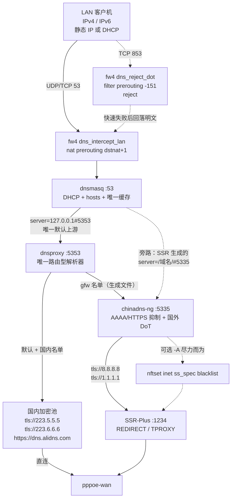
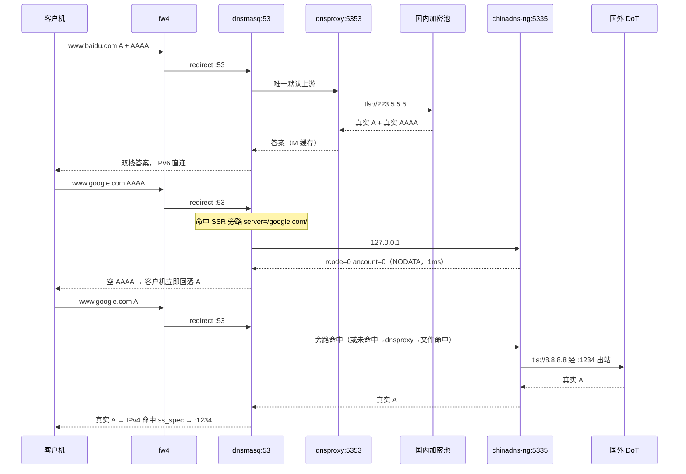
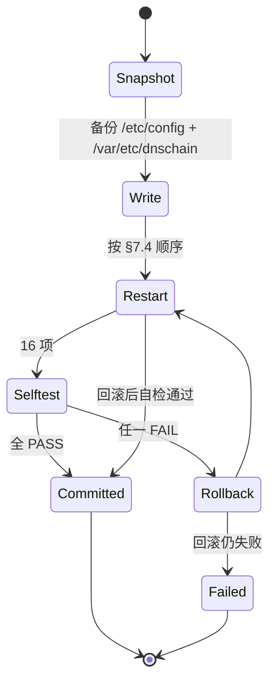

# ADR-0003：DNS 链路框架 —— dnsproxy 唯一路由入口 + 框架自持策略过滤器

- 状态：**提议（待批准，未落地到固件）**
- 日期：2026-10-20
- 取代：本文件取代已被撤回的 `0003-dns-chain-architecture.md` 与 `0004-dns-chain-framework.md`（撤回原因见 §15）
- 沿用：[ADR-0001](0001-filter-aaaa-semantics.md) 的拒绝集语义、[ADR-0002](0002-no-ipv6-proxy.md) 的「境外 IPv6 直连」取舍
- 相关：`files/etc/config/dnsproxy`、`files/etc/init.d/dnsproxy`、`files/etc/uci-defaults/99-gaming-optimize`、`files/etc/ssrplus/mosdns-config.yaml`、`GLOSSARY.md`、CHANGELOG v0.8.0 / v0.8.6

---

## 1. 问题与验收标准

用户提出五项要求，以及一条贯穿性诉求。

| # | 要求 | 可判定的验收条件 |
|---|---|---|
| R1 | 由 dnsproxy 拦截并代理**所有客户机**的 DNS，支持 DoH 与 DoT，覆盖 IPv4/IPv6 双栈 | 客户机（非 `127.0.0.1`）手工把 DNS 改成 `8.8.8.8` 仍被劫持；所有上游为 `https://` 或 `tls://`；`127.0.0.1` 与 `::1` 均在监听 |
| R2 | 国外节点通常只有 IPv4，国内外地址要**正确分流进 SSR-Plus** | 国内域名得到真实 A + 真实 AAAA，IPv4 直连；国外域名只有 A，IPv4 经 `:1234` 出站 |
| R3 | **独立页面**集中控制整个 DNS 解析配置 | 单页可改上游、协议、双栈策略、名单源、SSR 兼容模式、DHCP 下发 DNS、拦截总开关；改完自动自检，失败自动回滚 |
| R4 | **不要**「dnsproxy 只做国内 + SSR-Plus 查 MosDNS」 | 默认链路无 MosDNS 进程；dnsproxy 同时持有国内与国外上游 |
| R5 | 覆盖 SSR-Plus 四种 DNS 方式（DNS2TCP / ChinaDNS-NG / 内置 DNS / 本机 5335） | 四种模式各有明确的端口所有权与行为说明；切换不产生「指向无监听端口」的空窗 |

贯穿性诉求：**改 SSR-Plus 的 LuCI 页面不得把链路改坏。**

**范围**：本 ADR 只定义设计与落地清单，不含固件代码。代码落地另起一轮，按 §13 分阶段进行。

---

## 2. 现状基线（2026-10-20 实测）

本节所有条目都带证据。**凡无代码或命令支撑的，一律标注「设计态、未实现」，不得当作既成事实引用。**

### 2.1 当前链路

```
LAN 客户机（v4/v6）
  └─ fw4 dns_intercept_lan       nat prerouting, priority dstnat+1, udp/tcp 53 → :53
       └─ dnsmasq:53             noresolv=1, cache-size=8192, dns-forward-max=1024
            ├─ 默认 → dnsproxy:5353      国内 DoH 三上游（阿里 / 1.12.12.12 / 360）
            └─ server=/域名/#5335 × 23717 + gfw_base × 55 → mosdns:5335
                  └─ 国外 DoH（dns.google / cloudflare）经 :1234 代理出站
```

实测环境：`Linux LEDE 6.18.55 x86_64` / OpenWrt 24.10.5 / x86/64。

已安装组件：`dnsproxy 0.83.0-1`、`mosdns 5.3.4-14`、`chinadns-ng 2025.06.20-1`、`dns2tcp 1.1.2-3`、`dnsmasq-full 2.91-1`、`luci-app-ssr-plus 196-r19`。

> **`dns2tcp` 是已安装的**（作为 `luci-app-ssr-plus` 的传递依赖进固件），尽管 CI 的 CONFIG 清单里没有 `CONFIG_PACKAGE_dns2tcp`。`dns2socks` 未安装。这修正了「模式 1 不可用」的旧判断，见 §7.1。

### 2.2 关键实测事实（决定架构只能怎么设计）

| # | 事实 | 证据 |
|---|---|---|
| F1 | dnsproxy 支持 `[/domain/]upstream` 域名分流，**匹配子域名**，可从文件读入 | `--help`；实测 `[/example.com/]` 覆盖 `www.example.com` |
| F2 | dnsproxy **不能** per-domain 抑制 AAAA；`--ipv6-disabled` 是全局开关 | `--help` 原文 "all AAAA requests" |
| F3 | dnsproxy **不支持** socks5 上游，**不支持** ipset/nftset 写入 | `--help` 无相关参数；实测 `unsupported url scheme: socks5` |
| F4 | dnsproxy 的 `--cache-size` 单位是**字节**，默认 64KB | `--help`：`Cache size (in bytes). Default: 64k.` 当前配的 `8192` = **8KB**，比默认还小 8 倍 |
| F5 | dnsproxy 的 `--cache-min-ttl` 会**人为延长** TTL | `--help`：`Artificially extending TTLs should only be done with careful consideration`；当前配 `60` |
| F6 | **dnsproxy 用国内上游直接答 gfw 域名会返回污染答案** | 见 §2.3，这是本 ADR 的决定性证据 |
| F7 | 124 个 `xn--` 域名使 dnsproxy **整体拒绝启动**（不是跳过单条） | 实测日志见 §2.4 |
| F8 | chinadns-ng 支持 `-N tag:<name>`（按域名组抑制 AAAA）、`--filter-qtype`、`-A <set>`（写 nftset）、`tls://` 上游、`--cache` 系列 | `chinadns-ng -h` 全文实测，版本 `2025.06.20 be347b5 \| wolfssl-5.8.0` |
| F9 | chinadns-ng 的 `--cert-verify` **默认关闭**；`-c/--china-dns` 默认值**是明文 `114.114.114.114`** | `-h` 原文：`--cert-verify  enable SSL certificate validation, default: no` |
| F10 | `ss_spec_output`（路由器自身出向）**只匹配 TCP**，端口集固定 | 见 §5.3 |
| F11 | `ss_spec_wan_ac` 的域名意图通道（`@blacklist`）**当前不含任何域名派生 IP** | 见 §5.2 |
| F12 | 国内 IPv6 库是**死路径**（不是死文件） | `ipv6_support=0` → `ipv6_rules_apply` 首步 `return 0`；`nft list set inet ss_spec china6` 报 `No such file or directory` |
| F13 | 三层缓存里**只有两层在工作**，mosdns 那层对真实域名从不命中 | 见 §2.5 |
| F14 | `dnsmasq` 的 `SIGHUP` **只清缓存、不重读配置** | CHANGELOG v0.8.6；本 ADR 把它当**优点**用于清缓存（§10.5） |

### 2.3 决定性证据：dnsproxy 直连国内上游会拿到污染答案

```
直连 :5353（dnsproxy，上游 = alidns / 1.12.12.12 / doh.360.cn）
  www.google.com     → 2001::1  + 104.244.42.197      ← 注入的 AAAA + Facebook IP
  www.youtube.com    → 2001::1  + 174.132.167.252     ← 同上
  www.wikipedia.org  → 2001::1  + 103.102.166.224
  www.baidu.com      → 240e:ff:e020:...               ← 国内正常

经 :53（dnsmasq 把 gfw 域名转给 mosdns:5335，再经代理查国外 DoH）
  www.google.com     → 142.251.156.119 …              ← Google 真实 IP
  www.youtube.com    → 142.251.156.4 …
  www.wikipedia.org  → 103.102.166.224                ← 真实（只有 AAAA 被注入）
```

`2001::1` 是 GFW 注入 AAAA 的典型值。**当前链路能用，全靠 dnsmasq 把 23717 个域名转给 `:5335`**。

这一条把「dnsproxy 必须把 gfw 域名交给策略过滤器」从优化变成**必要**：只要让 dnsproxy 用国内上游直接答这些域名，就是污染。

### 2.4 124 个 IDNA 域名会让 dnsproxy 整体起不来

把 `gfw_list.conf` 里全部 124 个 `xn--` 域名转成 `[/域名/]127.0.0.1:5335` 后启动 dnsproxy，实测：

```
RESULT: dnsproxy DEAD
ERROR running dnsproxy err="configuring proxy: parsing upstreams configuration:
  parsing error at index 115: domain at index 0: bad domain name "xn--wcvs22d1m.hk":
  idna: invalid label "wcvs22d1m"
  parsing error at index 116: domain at index 0: bad domain name "xn--wcvs22d1m.xn--j6w193g":
  idna: invalid label "wcvs22d1m""
```

**整个文件被拒，进程起不来**——不是跳过坏条目。

但这条**不构成功能缺口**：这 124 个域名在运行时 `gfw_list.conf` 里全都有 `server=/…xn--…/127.0.0.1#5335`，而 dnsmasq 做 punycode 匹配、客户端查的也正是 punycode 形式。故在 §9 的「收敛」方案下它们**本来就有分流**。

### 2.5 三层缓存的真实行为

用 `/proc/uptime`（厘秒精度）测量。`date +%s%N` 在 BusyBox 上**不支持**（返回秒级），任何用它测得的毫秒数都无效。

**同一随机域名连查 4 次**

| 查询目标 | 冷 | 热 |
|---|---|---|
| dnsmasq `:53` | 90ms | 0 / 10 / 0ms |
| dnsproxy `:5353` | 100ms | 0 / 10 / 0ms |
| mosdns `:5335` | 80ms | **80 / 70 / 70ms** |

**真实域名、间隔 3 秒连查 5 次**

| 目标 | www.google.com |
|---|---|
| mosdns `:5335` | 60 / 70 / 70 / 70 / 70ms ← **每次都是冷查询** |
| dnsmasq `:53` | 80 / 0 / 0 / 10 / 0ms |

**mosdns 的 `lazy_cache`（`size: 8000`、`lazy_cache_ttl: 86400`）对这些域名完全没有命中。**

dnsmasq 的缓存在扛活（`ubus call dnsmasq metrics`）：

```
dns_cache_inserted:    61591
dns_queries_forwarded: 14660
dns_local_answered:    5452
dns_stale_answered:    0
```

### 2.6 「三层会矛盾」的实体

同一个域名，两条路径给出**完全不同的答案**：

| 域名 | 经 `:53` | 直连 `:5353` |
|---|---|---|
| www.google.com | `142.251.157.119` ✅ | `2001::1` ❌ |
| www.wikipedia.org | `103.102.166.224` ✅ | `2001:df2:e500:ed1a::1` ❌ |
| www.github.com | `20.205.243.166` | `20.205.243.166` 一致 |

两份缓存各存一份答案，谁先被问到谁说了算。当前没暴露，只因为 gfw 域名被 dnsmasq 抢先转走。

### 2.7 文档与代码不符之处（本次一并修正）

| # | 文档说法 | 实测 | 处置 |
|---|---|---|---|
| D1 | `AGENTS.md:517`「两处 `restart` 一律改 `reload`（`grep -c 'dnsmasq restart'` 应为 **0**）」 | 路由器上 `grep -c` 返回 **1**，唯一匹配是 `echolog "restart: skip dnsmasq restart in stop()"`（日志字符串）；真正的两处调用（3161、3309）都是 `dnsmasq reload` | 断言写法有缺陷，会永久误报。改为「排除日志字符串后的调用点计数应为 0」 |
| D2 | 旧 ADR「`/usr/bin/gfw2ipset.sh` 删掉 ipset 行」 | 脚本在 `/usr/share/shadowsocksr/gfw2ipset.sh`（4737B），由 `init.d/shadowsocksr:3022` 在 `start_rules` 段调用 | 路径修正；结论（`run_mode=router` 时剥掉 ipset 行）成立 |
| D3 | 旧 ADR「`gfw_list.conf` 约 2.37 万条」 | 文件 **47434 行** = 23717 域名 × 2 行；运行时副本 23717 行 | 必须区分「行数」与「域名数」 |
| D4 | 旧 ADR「124 条 IDNA 域名」 | **124 个域名**（248 行）——旧 ADR 是对的 | 保持 124 |
| D5 | `GLOSSARY.md:49-51`「dnsproxy 另有 24 条硬编码国外域名例外」 | 该清单 v0.8.0 已删，`AGENTS.md:335` 明令不要加回 | 重写该条目 |
| D6 | 旧 ADR「`gfw2ipset.sh` 把 `ipset=` sed 成 `nftset=`」 | 实测运行时副本 `^ipset=`=0、`^nftset=`=0——是**整行删除**，不是转换 | 结论修正 |
| D7 | `AGENTS.md`「`@whitelist` 必须含代理节点自身 IP，否则回环」 | `whitelist` 集合**无任何元素**；节点回环靠 `ss_spec_wan_ac` 第 2 条硬编码单 IP 规则 | 两套机制并存，文档记的是没在用的那套 |
| D8 | CHANGELOG v0.8.3「两处 restart 已改 reload、restart 计数降为 0」 | 路由器上确实已是 reload（符合意图），但**仓库 overlay 生成的代码仍是 restart**（`99-gaming-optimize:503`），两者已漂移 | 新 ADR 以路由器实测为准，并把漂移记入风险 |

### 2.8 启动时序的一次实测矛盾

```
dnsmasq PID 31226 启动于  15:03:11
gfw_list.conf mtime 为    15:14
mosdns/v2ray 启动于       15:14:16 / 15:14:13
```

SSR 在 15:14 重启并重写 `gfw_list.conf`，随后执行 `dnsmasq reload`（PID 未变）。按 F14，**这次 reload 不会重读 conf-dir**，运行中的 dnsmasq 用的是 15:03 那份副本。当前没出问题，只因为两次内容相同。

这正是「保留 dnsmasq 路径」的代价：**它可能用着旧名单**。而 dnsproxy 的域名文件由框架按 md5 重新生成，永远是最新的——两条路径并存时，dnsproxy 那条是兜底。

---

## 3. 核心决策

1. **单一路由入口**：`dnsproxy` 是全链路唯一「有路由逻辑」的解析器（R4）。国内域名走国内加密池，gfw 域名交给策略过滤器。
2. **策略过滤器独立**：per-domain AAAA/HTTPS 抑制由**框架自持的 chinadns-ng 实例**提供，端口 `:5335`。它不是 SSR-Plus 的 DNS 后端；SSR-Plus 在默认档案下不启动任何 DNS 后端。
3. **单一缓存层**：缓存只在 `dnsmasq`（客户机唯一入口）。dnsproxy 与过滤器**均不缓存**。理由见 §10.5。
4. **dnsmasq 不做策略**：DHCP、`/etc/hosts`、租约、一级缓存，唯一默认上游是 `127.0.0.1#5353`。它**保留** SSR-Plus 生成的 `server=/域名/#5335` 作为同策略旁路（§9），不构成第二套策略。
5. **国外解析用 IP 形式 DoT，经代理出站**：`tls://8.8.8.8`、`tls://1.1.1.1`；由 SSR-Plus 的 OUTPUT 链代理（`router_proxy=1` + `dports` 含 853）。
6. **端口所有权是唯一硬不变量**：`:5335` 归框架过滤器所有；SSR-Plus 必须处于不绑 `:5335` 的模式（0 或 7）。由收敛器强制执行（R5）。
7. **配置写入单点**：新增 `dnschain` 是唯一写入者；`luci-app-dnsproxy` 与 SSR-Plus 的页面降级为「下游」，改动由收敛器归一。
8. **拦截总开关**：一个滑块决定「拦不拦 LAN 的 DNS」，关闭时不改任何其他配置（§10.7）。

---

## 4. 目标链路与组件职责



### 4.1 组件职责

| 组件 | 端口 | 职责 | 明确不做 |
|---|---|---|---|
| `fw4` 片段 | — | 劫持 LAN 入向 53（v4+v6）；拒绝 LAN 出向 853 | 不解析、不缓存 |
| `dnsmasq` | `:53` | DHCP、`/etc/hosts`、租约、**唯一缓存层**、`deny.list` 的 `address=` | 不持独立策略；不直接连加密上游；不做 AAAA 抑制 |
| `dnsproxy` | `:5353`（`127.0.0.1` + `::1`） | 唯一路由：国内→国内加密池；gfw→过滤器；DoH/DoT 上游 | **不缓存**（F4/F5）；不抑制 AAAA（F2）；不写 nftset（F3） |
| `chinadns-ng` | `:5335` | gfw 域名：AAAA/HTTPS 抑制、国外 DoT、可选 nftset 写入 | **不缓存**；不解析国内域名（`-d gfw` 语义） |
| `SSR-Plus` | `:1234` | 透明代理、IP 段分流、`blacklist`/`whitelist` | **不提供** DNS（模式 0/7） |
| `dnschain`（新增） | — | 生成配置、拥有上述进程、事务化应用、自检、收敛 | 不实现解析逻辑 |

### 4.2 一次查询的完整数据流



两条路径（dnsmasq 旁路、dnsproxy 域名文件）**最终落在同一个过滤器**，故答案一致（§9）。

---

## 5. R2：国内外地址如何正确分流进 SSR-Plus

分三层，缺一层都会「看起来配好了但实际不对」。

### 5.1 DNS 层：决定客户机拿到哪种地址

| 域名类别 | A | AAAA / HTTPS(65) | 客户机行为 |
|---|---|---|---|
| 国内（默认路径） | 真实 | **真实** | 优先 IPv6 直连，无需代理 |
| 国外（gfw 名单） | 真实（经代理查询） | **NODATA**（`rcode=0, ancount=0`） | 立即回落 IPv4 |

关键：国外 AAAA 必须是**空答复**而不是超时。超时会卡住客户端 5 秒，空答复 1ms 回落。判定时必须把 `EMPTY`（预期）与 `TIMEOUT`（故障）分开（AGENTS.md §5.1）。

### 5.2 IP 层：决定 IPv4 走不走代理

`run_mode=router` 下 `ss_spec_wan_ac` 的实测判据（13 条，自上而下第一条命中即生效）：

```text
tcp dport 53 ip daddr 127.0.0.0/8        → return            # 本机 DNS 不回环
tcp dport != 53 ip daddr 172.64.146.35   → return            # 节点自身不回环（硬编码单 IP）
ip daddr @blacklist                      → jump ss_spec_wan_fw
ip daddr @whitelist                      → return
ip daddr @whitelist_domain               → return
ip saddr @fplan                          → jump ss_spec_wan_fw
ip saddr @bplan                          → return
meta l4proto tcp ip daddr @music         → return
ip daddr @ss_spec_wan_ac                 → return
ip daddr @china                          → return            # 国内 IPv4 直连
ip saddr @gmlan ip daddr != @china       → jump ss_spec_wan_fw
（兜底）                                  → jump ss_spec_wan_fw
```

集合实测规模：

| 集合 | 元素数 | 来源 |
|---|---|---|
| `china` | 3794（源 4318 条 CIDR，auto-merge 后） | `/etc/ssrplus/china_ssr.txt` |
| `whitelist_domain` | 95 | `white.list` 的 7 条 `nftset=` 解析结果 |
| `blacklist` | 7 | `wan_fw_ips`（`1.1.1.1`、`8.8.8.8` + 5 个 Telegram 段） |
| `ss_spec_wan_ac` | 15 | 保留网段 |
| `whitelist` / `music` / `fplan` / `bplan` / `gmlan` | **0** | 均未配置 |

四条要点：

- **主判据是 IP 段**（`@china`）。国外节点只有 IPv4 不构成问题：国外域名解析出的 IPv4 一定不在 `@china` 内，兜底即代理。
- **`@blacklist` 排在 `@china` 之前**，这是域名意图能覆盖 IP 库的关键。
- **`@blacklist` 当前不含任何域名派生 IP**（F11）：`gfw_list.conf` 用的是旧 ipset 语法 `ipset=/域名/gfwlist`，而 `gfwlist` 集合只在 `ssr-rules` 的 **iptables 分支**（`ipset_iptables()`）里创建；当前跑的是 nft 分支（`ipset_nft()`），`nft list sets inet ss_spec` 里没有 `gfwlist`。且 `gfw2ipset.sh` 在 `run_mode=router` 时把 `ipset=` 行**整行删除**（D6）。
- **`@whitelist` 是空的**（D7），节点回环靠第 2 条硬编码单 IP 规则。

### 5.3 出站层：让「解析国外域名的那条连接」也走代理

这是最容易漏的一层。dnsproxy 与过滤器都跑在路由器本机，它们的 DoT 连接走 **OUTPUT** 链，不是 PREROUTING。

`ss_spec_output` 实测：

```text
type nat hook output priority filter; policy accept;
meta nfproto ipv6 return
（8 条私有网段 return）
tcp dport { 22, 80, 143, 443, 465, 587, 853, 993, 995, 9418 } jump ss_spec_wan_ac
```

三个前提缺一不可：

| 前提 | 现状 | 不满足的后果 |
|---|---|---|
| `access_control.router_proxy=1` | 实测 `1` | 路由器自身 DoT 直连 → 被墙 → 国外域名全部超时 |
| `dports` 端口表覆盖 **853** | 实测含 853、**不含 53** | 853 不进代理，同上 |
| 上游 IP 命中 `@blacklist` 或不在 `@china` | `8.8.8.8`、`1.1.1.1` 均在 `@blacklist` | 被 `@china return` 放行成直连 |

**`ss_spec_output` 只匹配 TCP，没有 UDP。** 因此国外上游必须是 TCP 承载（DoT 853 或 DoH over TCP 443）。若用户在页面填了端口集之外的端口，路由器自身出向不会进代理、静默直连后被墙——页面必须校验（§10.8）。

### 5.4 为什么不用「节点只有 IPv4」当借口做全局 `--ipv6-disabled`

全局关 AAAA 会把国内也砍掉，破坏「国内双栈」。ADR-0001 的拒绝集语义（拒绝集 = 需走代理的域名集）必须保留，而它只能由 per-domain 过滤器实现（F2/F8）。

---

## 6. R1：双栈与加密

| 项 | 决策 |
|---|---|
| 客户机侧 | 明文 53 被 fw4 劫持进本机（v4+v6）。不做客户机侧 DoH/DoT 服务端（默认关闭，见 §10.4） |
| 国内上游 | `tls://223.5.5.5`、`tls://223.6.6.6`、`https://dns.alidns.com/dns-query`（页面可逐条改协议） |
| 国外上游 | `tls://8.8.8.8`、`tls://1.1.1.1`（**必须 IP 形式**，理由见 §10.1） |
| fallback | **默认不配**。页面提供显式开关，默认关（§10.2） |
| 证书校验 | 国外 DoT 开启 `--cert-verify`，落地前必测 IP SAN（§10.6） |
| 双栈 | 国内保留 AAAA、国外抑制 AAAA/HTTPS（§5.1） |
| 客户机怎么知道找本机 | IPv4 走 DHCP `option:dns-server`；IPv6 走 odhcpd RDNSS（`dhcp.lan.ra='server'`、`dhcpv6='disabled'`，实测已在位） |

---

## 7. R5：SSR-Plus 各 DNS 方式的映射与端口所有权

`pdnsd_enable` 的实际取值比「四种」多。**是否绑定 `:5335`** 是唯一影响本框架的差异。

`start_dns()` 在 `/etc/init.d/shadowsocksr:1288`（函数体 1288–1465），顶部固定：

```
dns_port="5335"
china_dns_port="5333"
tmp_dns_port="300"
tmp_shunt_dns_port="305"
```

### 7.1 模式映射

| 值 | UI 文案 | 是否绑 `:5335` | 二进制是否在固件 | 本框架下的定位 |
|---|---|---|---|---|
| `0` | 使用本机端口 5335 的 DNS 服务 | **否** | — | ✅ **默认**：`:5335` 由框架过滤器提供，SSR 不启任何 DNS |
| `7` | 优先使用模块内置 DNS | **否** | 需 `builtin_dns_enabled` 分支存在（实测存在，4 处） | ✅ 可选：DNS 由协议自身携带，`:5335` 仍归过滤器 |
| `1` | 使用 DNS2TCP 查询 | **是** | ✅ `dns2tcp 1.1.2-3` **已安装**（传递依赖） | ⚠️ 共存：过滤器迁 `:5337` |
| `2`/`3` | DNS2SOCKS / RUST | **是** | ❌ `dns2socks` **未安装** | ⛔ 本固件不支持，选了拒绝应用 |
| `4` | 使用 MOSDNS 查询 | **是** | ✅ `mosdns 5.3.4-14` | ⚠️ 仅兼容：MosDNS 只在此模式下存在 |
| `5` | 使用 DNSPROXY 查询并缓存 | **是** | ✅ 会再起一个 dnsproxy 绑 `:5335` | ⚠️ 仅兼容；同名不同实例，排障勿混淆 |
| `6` | 使用 ChinaDNS-NG 查询并缓存 | **是** | ✅ `chinadns-ng 2025.06.20-1` | ⚠️ 仅兼容；SSR 传 `-N --filter-qtype 64,65` 是**全局**过滤 AAAA |

> **模式 1 可用**是本 ADR 对旧判断的修正：`dns2tcp` 虽无显式 `CONFIG_PACKAGE_dns2tcp`，但作为 `luci-app-ssr-plus` 的传递依赖已进固件。`dns2socks` 确实没有。

### 7.2 模式 `0` 的语义就是本框架

「使用本机端口 5335 的 DNS 服务」在代码里的含义是：**SSR 自己不提供 DNS，但它的 gfw 分流仍指向 `127.0.0.1#5335`，等着别人在那个端口上提供服务**。`gfw2ipset.sh` 的 `$dns_port` 恒为 `5335`，与 `pdnsd_enable` 无关。

因此：

- 模式 0 是**唯一**「SSR 明确要求外部提供 `:5335`」的模式，正是本框架的接口。
- 反过来，模式 0 在历史上是**危险模式**：`:5335` 无人监听时 `gfw_list` 的 23717 条全部 `connection refused`/超时。这解释了为什么包模板默认 `pdnsd_enable='1'` 而不是 `0`，也解释了自检必须把「`:5335` 有监听」列为硬项。
- 模式 7 与模式 0 的差别只在「DNS 由谁答」：7 由代理协议自身（v2ray `dns` 字段）答，0 由本机 `:5335` 答。两者都不影响 `gfw_list` 的指向。

### 7.3 两种端口档案

| 档案 | 过滤器端口 | dnsproxy 域名文件指向 | 适用 |
|---|---|---|---|
| `primary`（默认） | `:5335` | `:5335` | SSR 处于 0 或 7 |
| `coexist`（自动降级） | `:5337` | `:5337` | SSR 处于 1/4/5/6 |

**`coexist` 下不改任何 SSR 生成的文件。** 因为框架自己的上游文件由它生成（指向 `:5337`），而 SSR 那条旁路仍指向 `:5335`——那是 SSR 自己的后端，与框架无关。两条路径不再收敛，但这是「用户硬要选 1/4/5/6」时接受的代价，页面须提示。

> 这一点与旧方案不同：旧方案在 `coexist` 下重写 `gfw_list.conf` 的目标端口。本 ADR **放弃重写**，因为重写需要在 SSR 每次 `start()` 之后重新执行，且会污染运行时副本、引入新的时序依赖。

### 7.4 切换模式时的顺序（避免空窗）

```text
应用新档案：
  1. 生成新配置到 /var/etc/dnschain/（不覆盖旧文件）
  2. 若新档案要占 :5335 → 先切 pdnsd_enable 并停 SSR 的 DNS 后端
  3. start 过滤器（新端口）
  4. reload dnsproxy（指向新端口）
  5. 自检 16 项，任一 FAIL → 回滚并重放旧档案
```

---

## 8. R3：独立页面 `网络 → DNS 链路`

### 8.1 定位

**只做配置读写、校验、下发、自检与回滚，不实现解析逻辑。** 页面与链路解耦是「改 UI 不坏链路」的前提。

### 8.2 配置模型（`/etc/config/dnschain`）

```uci
config dnschain 'main'
	option enabled '1'
	option intercept '1'              # 拦截总开关（§10.7）
	option profile 'primary'          # primary | coexist
	option entry_port '5353'
	option filter_port '5335'
	option lan_intercept '1'
	option intercept_dot '1'          # 拒绝 LAN 出向 853（§10.3）
	option intercept_doh '0'          # 尽力而为（§10.3）

config upstream 'cn'
	list server 'tls://223.5.5.5'
	list server 'tls://223.6.6.6'
	list server 'https://dns.alidns.com/dns-query'

config upstream 'foreign'
	list server 'tls://8.8.8.8'
	list server 'tls://1.1.1.1'
	option via_proxy '1'
	option cert_verify '1'

config aaaa 'policy'
	option domestic 'keep'            # 只读，唯一合法值
	option foreign 'suppress'         # 只读，唯一合法值
	option filter_https_rr '1'        # 同时抑制 qtype 65

config lists 'lists'
	option gfw_source '/etc/ssrplus/gfw_list.conf'
	option base_source '/etc/ssrplus/gfw_base.conf'
	option black_source '/etc/ssrplus/black.list'
	option auto_import '1'
	option import_interval '60'       # 轮询 md5 的秒数

config dhcp_dns 'dhcp_dns'
	option enabled '1'
	list server '223.5.5.5'
	list server '119.29.29.29'        # 仅在 intercept=0 时下发给 DHCP 客户机

config cache 'cache'
	option enabled '1'
	option size '8192'                # dnsmasq 条目数

config selftest 'selftest'
	option auto_rollback '1'
	option interval '300'

config ssr 'compat'
	option mode '0'
	option enforce '1'
```

`domestic`/`foreign` 两个字段刻意只保留唯一合法值：它们表达的是**不可配置的物理约束**（节点只有 IPv4），写成可选项只会制造「配成 keep 然后国外被 RST」的故障。页面把它们显示为只读并附原因。

### 8.3 页面结构

```text
网络 → DNS 链路 (admin/network/dns_chain)
├─ 概览
│   ├─ 一句话结论行（例如「国内正常 / gfw 域名 SERVFAIL（过滤器未监听）」）
│   ├─ 实时链路图（节点状态由实测驱动，不硬编码拓扑）
│   └─ 状态表：组件 / 端口 / 进程 / 最近探测结果 / 影响范围
├─ 拦截总开关
│   ├─ 滑块：开启 = 强制拦截静态 + DHCP 客户机 DNS
│   ├─ 关闭时：停用拦截规则，客户机自行解析
│   └─ 切换提示：「约 3 秒内新客户机拿不到地址、现有客户机 DNS 短暂中断」
├─ 解析策略
│   ├─ 国内上游（DoT/DoH 多行，默认三条，可逐条改协议）
│   ├─ 国外上游（IP 形式 DoT 多行，默认两条）+「经代理出站」说明
│   ├─ 上游端口校验：读取运行时 ss_spec_output 端口集，拒绝集合外端口
│   └─ fallback 开关（默认关）+ 开启时的污染警告
├─ 双栈策略（只读）
│   ├─ 国内 AAAA：保留
│   └─ 国外 AAAA/HTTPS：抑制（附「1ms 空答复 ≠ 超时」说明）
├─ DHCP 下发 DNS
│   ├─ 多个明文 DNS 地址（最多 4 个）
│   └─ 说明：仅在拦截关闭时下发；拦截开启时下发路由器自身地址
├─ 缓存
│   ├─ 开关与条目数（dnsmasq cache-size）
│   ├─ 「清空全部缓存」（SIGHUP，零中断）
│   └─ 只读统计：条目数 / 插入数 / 本地应答数 / 转发数
├─ SSR-Plus 兼容
│   ├─ 当前 pdnsd_enable 与端口所有权（实时探测 :5335 属谁）
│   ├─ 目标模式选择（0 推荐 / 7 可选 / 1/4/5/6 标「仅兼容」/ 2/3 标「不支持」）
│   └─ 一键归一（写回 pdnsd_enable + enable_switch=0 + filter_aaaa=1）
├─ 列表与文件
│   ├─ gfw 名单规模、最近生成时间、IDNA 过滤条数、名单最近更新时间
│   ├─ 「立即更新名单」（复用 SSR 的 update.lua gfw_data）
│   ├─ 「手动导入」按钮 + 自动导入开关与轮询间隔
│   └─ SSR-Plus 自有名单（black.list / white.list）的编辑入口
│       └─ 归属说明：这是 SSR 的文件，页面只代编辑，SSR 下次 start 生效
└─ 应用 / 回滚
    ├─ 应用（事务）：快照 → 写入 → 重启受影响进程 → 自检 → 失败自动回滚
    └─ 回滚：列出 /root/dnschain-backup-<ts>/ 并一键恢复
```

### 8.4 事务化应用



---

## 9. 抗「改 LuCI 就坏」：六道闸

| 闸 | 机制 | 拦住的真实故障 |
|---|---|---|
| G1 职责分离 | SSR 不提供 DNS；dnsproxy 不依赖 SSR 端口 | v0.8.0 的「SSR 停止 → dnsproxy 指向死端口 → 污染答案」 |
| G2 单一写入者 | 只有 `dnschain` 写 dnsproxy/过滤器/dnsmasq DNS 键 | 两个页面各写一半导致互相覆盖 |
| G3 收敛器 | 开机、SSR 配置变更、定时三处重放不变量 | 用户改完 SSR 页面忘记归一；`ssr-switch` 写 `global_server=nil` |
| G4 端口所有权断言 | `:5335` 归属必须与档案一致，冲突即拒绝应用并说明 | 切到模式 4 后两个进程抢 `:5335`，一个静默失败 |
| G5 事务 + 自动回滚 | 快照 → 应用 → 16 项自检 → FAIL 回滚 | 「点保存后全断，只能重刷」 |
| G6 路径收敛 | 两条路径同一过滤器；dnsproxy 域名文件按 md5 重生成 | v0.8.6 的「reload 不重读 conf-dir → 分流用旧内容」 |

### 9.1 为什么是「收敛」而不是「删除」

**决策（Q21=A）**：框架**不删、不重写** SSR 生成的任何文件，保留 `server=/域名/#5335` 作为旁路。

三条理由：

1. **两条路径同策略**：SSR 的 `server=` 指向 `:5335`，而 `:5335` 就是框架过滤器。dnsproxy 的域名文件也指向它。答同一份结果。
2. **不需要 `dnsmasq restart`**：删除方案要求每次 SSR 启动后删掉 conf-dir 里的 `server=` 行，而删除后 `reload` 不生效（F14）、`restart` 是 3 秒全断。收敛方案完全不需要这一步。
3. **IDNA 域名天然覆盖**：124 个 `xn--` 域名进不了 dnsproxy 文件（F7），但 SSR 的旁路已经覆盖它们。

代价（如实记录）：

- **SSR 重写 `gfw_list.conf` 后，运行中的 dnsmasq 可能用旧名单**（§2.8 实测）。此时 dnsproxy 那条路径是兜底——它按 md5 重新生成，永远最新。
- dnsmasq 每次启动要解析约 2.38 万条 `server=` 行。实测已在承受，无新增负担。

### 9.2 收敛器（`/usr/bin/dnschain-reconcile`）的不变量集

只断言框架拥有的键，其余一律不动：

```text
shadowsocksr.@global[0].pdnsd_enable        = <profile 对应值>
shadowsocksr.@global[0].enable_switch       = 0
shadowsocksr.@global[0].filter_aaaa         = 1     # 仅防御性保留，见 §9.4
shadowsocksr.@global[0].global_server       != nil  （为 nil 时只告警，不擅自改节点）
access_control.router_proxy                 = 1
dhcp.@dnsmasq[0].noresolv                   = 1
dhcp.@dnsmasq[0].server                     = 127.0.0.1#5353（恰好一条）
dhcp.@dnsmasq[0].dnsforwardmax              = 1024
dnsproxy.global.lan_dns_intercept           = 1
:5335 的持有者                              = 框架过滤器（profile=primary）
dports 端口表                               = 含 853 且不含 53（只校验，不改表）
```

触发点：`/etc/init.d/dnschain start`、`procd_add_reload_trigger shadowsocksr dnsproxy dhcp`、`dnschain-selftest` 定时任务（默认 300s）。

**收敛器不得做的事**：不改 `global_server` 的节点选择、不改 `run_mode`/`dports`/`lan_ac_mode`、不改 `filter_aaaa` 的语义解释、不重启 SSR、不删 SSR 的文件。

### 9.3 名单导入（单向、可自动）

```
源：/etc/ssrplus/gfw_list.conf（23717 个 server= 行）+ gfw_base.conf（55 条）
  ↓ 单向读取，绝不回写
目标：/etc/dnschain/gfw-domains.txt（纯域名，去重）
     /var/etc/dnschain/upstreams-domains.txt
        → [/域名/]127.0.0.1:5335   × 23593（已滤掉 124 个 xn--）
```

- **自动导入**：收敛器按 `import_interval`（默认 60s）轮询源文件 md5，变化即重导。页面有开关可关。
- **手动导入**：页面按钮，立即重导。
- **重导不重启 dnsproxy**，除非行数变化超过阈值（默认 1%，可调）。
- 选择轮询而非 `inotify`：OpenWrt 的 procd 对任意文件没有触发器，`inotify` 需额外工具；60 秒延迟对名单更新这种低频事件完全够用。
- 不修改 SSR 的 `update.lua` / `ssrplusupdate.sh`（避免碰上游脚本）。

### 9.4 `filter_aaaa` 的处置

在 `primary` 档案下 MosDNS 不在链路上，`filter_aaaa` 对实际行为**无影响**；保留 `=1` 只是为了让用户临时切回模式 4 时不至于立刻出现「有 IPv6 但打不开站点」。页面必须显示这一解释，避免维护者按旧语义误改（AGENTS.md §5 的教训）。

### 9.5 启动时序

SSR-Plus `start()` 先装 dnsmasq 分流、约 2 秒后才拉起后端的 4 秒空窗（AGENTS.md §4.1），在本设计下**不再造成解析中断**：

1. dnsmasq 的唯一上游是 `:5353`，与 SSR 生命周期无关；过滤器由 `dnschain` 独立托管，不随 SSR 停启。
2. SSR 无论重写还是删除 `gfw_list.conf`，命中的域名最终都落在**同一个过滤器**上（§9.1）。
3. SSR 停启过程中对 dnsmasq 的那次 `reload` 只清缓存、不中断服务，代价是缓存变冷、首查变慢。

仍然成立的代价：SSR 停启期间代理本身不可用，国外 A 记录会超时或失败。这不是 DNS 故障，是「代理不在」的正确表现。

---

## 10. 配置要点

### 10.1 dnsproxy（由 `dnschain` 生成，写入 `/var/etc/dnschain/dnsproxy.args`）

```text
--listen 127.0.0.1 --listen ::1
--port 5353
--upstream https://dns.alidns.com/dns-query
--upstream tls://223.5.5.5
--upstream tls://223.6.6.6
--upstream /var/etc/dnschain/upstreams-domains.txt
--bootstrap 223.5.5.5 --bootstrap 223.6.6.6
--timeout 5s --upstream-mode parallel
--hosts-file-enabled=true --hosts-files /etc/hosts
```

**刻意不配的三项**：

| 不配 | 理由 |
|---|---|
| `--cache` 及所有 `--cache-*` | 缓存只在 dnsmasq（§10.5）。且 `--cache-size` 单位是字节（F4），`--cache-min-ttl` 会人为延长 TTL（F5） |
| `--fallback` | 见 §10.2 |
| `--ipv6-disabled` | 全局开关会连国内一起砍（F2） |

**国外上游为什么必须 IP 形式**：dnsproxy 不支持 socks5（F3），国外 DoT 只能靠 IP 层送进 `:1234`。而 REDIRECT 后 v2ray 收到的是**目标 IP**，若上游用域名形式（`tls://dns.google`），TLS 握手的 SNI 与目标 IP 不一致会导致失败。IP 形式则无此问题——实测 `8.8.8.8:853`/`1.1.1.1:853` 的证书都带 IP SAN（落地前须复核，§10.6）。

`upstreams-domains.txt` 由 gfw 名单生成：

```text
[/<gfw 域名>/]127.0.0.1:5335
```

两条硬约束：

1. **参数名是 `--upstream`，不是 `--upstream-file`**（后者不存在）。
2. **必须过滤 `xn--`**，否则整个文件被拒、进程起不来（F7）。

### 10.2 为什么不配 fallback

`fallback` 是**全局**的，不区分域名。过滤器一旦不可用（SSR 模式切换、进程被杀、`:5335` 未被占用），gfw 域名就落到 fallback。

CHANGELOG v0.8.0 记录的就是这条路径：`[/google.com/…]127.0.0.1:5335` 连不上 → 日志 `ERROR exchange failed … connection refused` → 回落 `https://1.12.12.12/dns-query` → `youtube.com → 31.13.92.37`、`wikipedia.org → 31.13.94.36`（均为 Facebook 的 IP）。

去掉 fallback 后，过滤器不可用时 gfw 域名得到 `SERVFAIL`，客户端立刻失败、不缓存污染答案，自检能明确指出「过滤器没在监听」。这是诚实信号，优于「看起来能解析但地址是错的」。

页面提供显式开关，默认关；开启时必须显示污染警告。

### 10.3 chinadns-ng（框架自有实例）

```text
-b 127.0.0.1 -l 5335
-d gfw
-t tls://8.8.8.8,tls://1.1.1.1
-N tag:gfw --filter-qtype 64,65
-A inet@ss_spec@blacklist
--cert-verify --ca-certs /etc/ssl/certs/ca-certificates.crt
-o 5
```

- **不加 `-g`**：`-d gfw` 已把未匹配的域名归为 `tag:gfw`，而本实例只接收 gfw 域名，因此 `-g` 与 `-d gfw` 等价，多一份名单只会制造第二个真相源。
- **不配 `-c/--china-dns`**：默认值是明文 `114.114.114.114`（F9）。本实例 `-d gfw`、无 `tag:chn`、无 `tag:none`，china 组不可达，故它不会被查询；但生成配置时应显式写空值（若版本接受），并在 CI 断言「参数里没有 `114.114.114.114`」。
- **`-N tag:gfw`**：只对 gfw 组抑制 AAAA（F8）。不要写成裸 `-N`——当前语义等价，但将来引入 `-g`/自定义组时，裸 `-N` 会连带抑制那些组。
- **`--filter-qtype 64,65`**：HTTPS/SVCB 记录携带 `ipv6hint`，不抑制会把 IPv6 偏好带回来。
- **不启用 `--cache`**：缓存只在 dnsmasq（§10.5）。
- **不启用 `--verdict-cache`**：该缓存只服务 `tag:none` 域名的 IP 判定，本实例没有 `tag:none` 域名。
- **`-A …blacklist` 是「尽力而为」**：`ssr-rules` 每次重建会 flush `blacklist` 再灌 `wan_fw_ips`，写入的 IP 会被清掉。主判据仍是 IP 段（§5.2）。不承诺即时恢复，也不让框架去争写权。
- **`-A` 需要 `CAP_NET_ADMIN`**：procd 启动时显式授予，不要沿用 dnsproxy 的 `dnsproxy` 用户（其能力集只有 `CAP_NET_BIND_SERVICE`）。

### 10.4 LAN 出向 853 / 443

| 层 | 规则 | 说明 |
|---|---|---|
| T1（默认开） | `iifname br-lan udp/tcp dport 53 redirect to :53` | 已有实现（`inet fw4 dns_intercept_lan`） |
| T2（默认开） | `iifname br-lan tcp dport 853 reject` | 让自带 DoT 的客户端**快速失败**并回落明文，从而被 T1 接住 |
| T3（默认关） | 按 IP 集合阻断已知公共 DoH | 443 上的 DoH 无法在不做 SNI 检查的前提下区分；只能尽力而为，页面须如实标注 |

**T2 必须排在 tproxy 之前。** `ss_spec_mangle prerouting` 的优先级是 `mangle`（-150），而 `inet fw4` 的 dstnat+1 是 -99——tproxy 先执行。故拒绝规则要写在**独立 table** 里、用 `type filter hook prerouting priority -151`。

**写法约束（AGENTS.md 红线 7）**：`/etc/nftables.d/*.nft` 里**禁止出现 `table` 声明**，只能写裸 chain。fw4 的 ruleset 模板在 `table inet fw4 { }` 内部 include 该目录，写完整 table 会形成嵌套、nft 报 `syntax error`，整个 ruleset 不加载 → 断网。

> 注意：`priority -151` 的规则若要挂在 `inet fw4` 之外，需放在 `/etc/nftables.d/` 且**不能**自带 `table`——这与「独立优先级」存在张力。落地时须实测：若裸 chain 无法指定 `-151`，则改为在 `fw4` 的 `dstnat`（-100）之前用一个 `priority -101` 的 chain，或在 `ss_spec_mangle` 的 tproxy 规则**之前**插入 `tcp dport 853 return`。**这是落地前的必测项。**

**T2 与「对客户机提供 DoH/DoT」互斥**：开启服务端（`--tls-port`/`--https-port`）时必须自动关闭 T2，并提示「证书需被客户端信任」。默认**不开启**服务端：`files/etc/config/dnsproxy:118` 的 `tls.enabled='0'` 就是现状。

### 10.5 缓存：只留 dnsmasq 一层

**决策（Q17=A′）**：缓存只在 `dnsmasq`。dnsproxy 与过滤器均不缓存。

理由三条，都有实测支撑：

1. **dnsmasq 是所有客户机查询的唯一入口。** 缓存放这里，一个域名只可能有一份答案，物理上不存在分歧。放 dnsproxy 就要保证「所有查询都经过它」——而 dnsmasq 会把 23717 个域名直接转给 `:5335`，绕过了 dnsproxy，于是必然两份缓存（§2.6 实测到了具体形态）。
2. **它已经在工作**：61591 条插入、5452 次本地应答（§2.5），不是新增负担。
3. **dnsproxy 那层当前只有 8KB**（F4），且 `--cache-min-ttl 60` 会人为把 TTL 拉到至少 60 秒（F5）。留着它等于留一个「改了上游、60 秒内还给旧答案」的装置。

**代价（如实记录）**：dnsmasq 不做加密，它的缓存存的是**明文形态的答案**。但这不降低安全性——客户机到 dnsmasq 本来就是明文 53，加密只发生在 dnsmasq 之后到上游那一段。缓存放在解密后的位置，不改变任何加密属性。

**为什么 mosdns 那层不算**：实测对真实域名从不命中（§2.5），等于没有缓存。

**清缓存是零中断的**：dnsmasq 的 `SIGHUP` 只清缓存、不重读配置（F14）。这条在「重读配置」用途上是缺陷，在「清缓存」用途上恰好是优点——清空缓存而进程不重启、客户机无感知。对比 `restart` 约 3 秒全断。

**页面按钮集合（Q29=A）**：

| 按钮 | 实现 | 说明 |
|---|---|---|
| 清空全部缓存 | `kill -HUP <dnsmasq pid>` | 零中断；提示「接下来若干次查询会变慢」 |
| 只读统计 | `ubus call dnsmasq metrics` | 条目数 / 插入数 / 本地应答数 / 转发数 |

**「清空指定域名」不做**：dnsmasq 与 dnsproxy 都没有按域名淘汰单条缓存的接口。任何「看起来能只清一条」的实现都是假的。

### 10.6 证书校验

`chinadns-ng` 的 `--cert-verify` 默认 **no**（F9），即 `tls://8.8.8.8` 只加密、不验证证书，中间人可以换证书。本框架显式开启：

```text
--cert-verify --ca-certs /etc/ssl/certs/ca-certificates.crt
```

并像 dnsproxy 那样在 procd 里把该文件 jail-mount 进去（`files/etc/init.d/dnsproxy:293` 已有样例）。

**落地前必测项**：先在路由器上对 `8.8.8.8:853`、`1.1.1.1:853` 做一次握手并打印证书 SAN，确认含 IP SAN。若某个上游不带 IP SAN，则该上游降级为「加密但不校验」并在页面标注，**而不是**整条链路退回不校验。

### 10.7 拦截总开关（滑块）

**语义（Q15 + Q26 + Q27）**：

| 状态 | 行为 |
|---|---|
| **开启** | 强制拦截 **静态 IP 客户机 + DHCP 客户机**的 53；DHCP 下发的 DNS 是**路由器自身地址** |
| **关闭** | 停用 `dns_intercept_lan` 规则；客户机自行解析；DHCP 客户机按页面配置的**明文 DNS 列表**下发（最多 4 个） |

- 关闭时**不改** dnsmasq 的 `noresolv`/`server`，也不改框架其他配置——滑块的作用域只有「拦不拦」。
- 切换需要改 `dhcp-option=6`，而 `reload` 不重读配置（F14），因此**接受一次约 3 秒的 restart**（Q27=A）。页面必须提示：「约 3 秒内新客户机拿不到地址、现有客户机 DNS 短暂中断」。
- 不采用「两套 `dhcp-range` tag 预置」：dnsmasq 的 tag 机制同样要 restart 才重读，省不掉那次中断，只增加配置复杂度。

### 10.8 上游端口校验

`ss_spec_output` 只匹配 TCP 且端口集固定（F10）。用户在页面填了集合外的端口（如 `tls://8.8.8.8:8853`）时，路由器自身出向**不会进代理**，静默直连后被墙 → 国外域名 SERVFAIL，而页面显示「配置正确」。

**页面校验**：读取**运行时**的 `ss_spec_output` 端口集，拒绝集合外的端口并给出原因（Q23=A）。

**收敛器只校验不改表**：`53` 必须在 tproxy 表外、`853` 必须在表内。不改 `dports` 本身——那张表在 v0.8.4 里刚因为含 53 出过事故。

### 10.9 已知的明文旁路：`applechina.conf`

`start_dns()` 在 `apple_optimization=1`（模板默认）时把 `/etc/ssrplus/applechina.conf` 拷进 dnsmasq 的 conf-dir，该文件是 **173 条 `server=/<Apple 域名>/114.114.114.114`** —— 明文 UDP DNS，**完全绕过 dnsproxy**。

这与 R1 的「所有解析都走加密上游」直接冲突。两种处置，页面里做成二选一：

| 选项 | 做法 | 代价 |
|---|---|---|
| A（推荐） | overlay `applechina.conf`，把 173 条的目标改成 `127.0.0.1#5353`；**不设** `apple_dns` | Apple 域名失去国内 CDN 定向 |
| B | 设 `shadowsocksr.@global[0].apple_optimization='0'` | 规则不再生成，彻底干净，但放弃该优化 |

**不要**用 `apple_dns` 去改：`old_appledns` 用 `grep -oE` 只抽 IP、丢端口，二次启动会叠成 `127.0.0.1#5353#5353`，dnsmasq 解析该行出错（审计报告 §T1、AGENTS.md §9 均已记录）。

### 10.10 客户机怎么知道该找本机

| 协议 | 下发者 | 机制 | 现状 |
|---|---|---|---|
| IPv4 | `dnsmasq` DHCP | `option:dns-server` | 拦截开启时下发路由器地址；关闭时下发页面配置的明文 DNS 列表 |
| IPv6 | `odhcpd` RA | RDNSS（`dhcp.lan.ra='server'`，`dhcpv6='disabled'`） | 实测已设 |

若日后有人把 `dhcp.lan.ra_dns` 关掉或给 DHCP 手填 `option:dns-server`，IPv6 客户端会拿不到 DNS。页面应在「概览」里只读展示 `dhcp.lan.ra_dns` 与 `dhcp.@dnsmasq[0].dhcp_option` 的当前值。

---

## 11. 自检清单（页面、CI、`dnschain-selftest` 共用）

| # | 检查项 | 判据 |
|---|---|---|
| 1 | fw4 劫持在位 | `nft list chain inet fw4 dns_intercept_lan` 含 `udp dport 53` 与 `tcp dport 53` |
| 2 | dnsmasq 分流目标唯一 | 生成的配置里 `server=/域名/127.0.0.1#<端口>` 的端口集合 ⊆ {`5353`, `<filter_port>`} |
| 3 | dnsmasq 唯一默认上游 | 生成的配置中 `server=127.0.0.1#5353` 恰好 1 条 |
| 4 | dnsproxy 在监听 | `:5353` 于 `127.0.0.1` 与 `::1` 均可解析 |
| 5 | dnsproxy 参数与配置一致 | `tr '\0' ' ' </proc/<pid>/cmdline` 含配置中的全部上游，且**不含** `--cache` |
| 6 | 过滤器在监听 | `:5335`（或 `:5337`）有监听，且属框架 PID |
| 7 | 端口所有权无冲突 | `:5335` 的持有者与 `profile` 一致；SSR 模式与档案匹配 |
| 8 | 国内 A 正确 | `192.168.3.254:53` 查 `www.baidu.com` 得真实 A |
| 9 | 国内 AAAA 保留 | `www.moe.gov.cn` / `www.taobao.com` 有真实 AAAA |
| 10 | 国外 A 正确 | `www.google.com` 得 Google 真实 IP（非 `31.13.x` / `157.240.x` / `104.244.x`） |
| 11 | 国外 AAAA 抑制 | 返回 `EMPTY`（`rcode=0 ancount=0`），**不是** `TIMEOUT` |
| 12 | 国外 DoT 出站 | `netstat -antp` 有 chinadns-ng 到 `8.8.8.8:853` 或 `1.1.1.1:853` 的 ESTABLISHED |
| 13 | 代理与分流在位 | `nft list tables \| grep -c ss_spec` == 2；`:1234` 在监听；`global_server` != `nil` |
| 14 | fw4 规则可加载 | `fw4 check` 通过 |
| 15 | 无明文旁路 | `grep -rnE 'server=/[^/]+/([0-9]{1,3}\.){3}[0-9]{1,3}' /tmp/dnsmasq.d/ \| grep -v '#5353'` 为 0（`applechina.conf` 的 173 条必须已改为 `#5353`） |
| 16 | 缓存层唯一 | dnsproxy 与 chinadns-ng 的 cmdline 均**不含** `--cache`；dnsmasq `cache-size` > 0 |

**测试纪律**：

- 必须用客户机真实地址 `192.168.3.254:53` 测，不能只测 `127.0.0.1:53`。
- 必须区分 `OK` / `EMPTY` / `NX` / `TIMEOUT` / `FAIL` 五种结果（AGENTS.md §5.1、§6.2 第 2 项）。
- 测量延迟**不能用 `date +%s%N`**——BusyBox 不支持，会静默返回秒级值、全部显示 0ms。用 `/proc/uptime`（厘秒）。

---

## 12. 降级矩阵（五处故障，全部不回落明文）

| 故障点 | 客户机看到什么 | 影响范围 | 对应自检项 |
|---|---|---|---|
| dnsmasq 挂 | 全部域名失败（无旁路） | 全部 | 1、3 |
| dnsproxy 挂 | 全部域名失败（dnsmasq 唯一上游是它） | 全部（旁路域名除外） | 4、5 |
| 过滤器挂 | gfw 域名 SERVFAIL，国内不受影响 | 仅 gfw 域名 | 6、10、11 |
| 代理挂 | gfw 域名 SERVFAIL（国外 DoT 必须经代理） | 仅 gfw 域名 | 12、13 |
| 国内上游全挂 | 国内域名 SERVFAIL | 仅国内域名 | 8、9 |

**任何一处都不允许回落明文。** 理由：CHANGELOG v0.8.0 的实测已证明「回落国内上游」会把 `youtube.com` 解析成 `31.13.92.37`（Facebook 的 IP）并缓存住，比直接失败难排查得多。

**页面必须把「挂在哪、退到哪」显示出来**（Q16）：一句话结论行 + 实测驱动的链路图 + 状态表。图要能画出断头路径（例如过滤器挂时画出「gfw 域名 → SERVFAIL」），而不是只把节点标红。

---

## 13. 落地清单与阶段

### 13.1 文件清单

| 类型 | 路径 | 说明 |
|---|---|---|
| 新增 | `files/etc/config/dnschain` | §8.2 的默认值 |
| 新增 | `files/etc/init.d/dnschain` | procd；生成 `/var/etc/dnschain/*`；启停 dnsproxy 与过滤器；写 fw4 片段 |
| 新增 | `files/usr/bin/dnschain-reconcile` | §9.2 不变量集 + §9.3 名单导入 |
| 新增 | `files/usr/bin/dnschain-selftest` | §11 的 16 项，输出机器可读结果 |
| 新增 | `files/etc/uci-defaults/99-zz-dnschain` | 首刷默认；命名须排在 `99-gaming-optimize` **之后** |
| 新增 | `package/luci-app-dnschain/` | LuCI 应用（视图、menu.d、acl.d、rpcd、`po/zh-cn`） |
| 修改 | `files/etc/config/dnsproxy` | 只保留「默认上游 + bootstrap」；去掉 `fallback` 与 `cache`；域名分流迁到生成文件 |
| 修改 | `files/etc/init.d/dnsproxy` | 支持从 `/var/etc/dnschain/dnsproxy.args` 读取参数（或改为由 `dnschain` 直接 procd 托管） |
| 新增 | `files/etc/ssrplus/applechina.conf`（overlay） | 173 条明文目标改为 `127.0.0.1#5353`，且**不设** `apple_dns`（§10.9 选项 A） |
| 修改 | `files/etc/uci-defaults/99-gaming-optimize` | `pdnsd_enable=4` → `0`；`tunnel_forward_mosdns` 不再写入；修正 §2.7 D1 的断言描述 |
| 修改 | `.github/workflows/build-openwrt.yml` | `chmod +x` 清单；新增契约校验（端口所有权、单一缓存层、`-N tag:gfw` 非裸 `-N`、gfw 名单行数、无 `114.114.114.114`） |
| 修改 | `.gitattributes` | 见 §13.2 |
| 修改 | `AGENTS.md` §4/§5 | 同步新链路；修正 D1/D7 |
| 修改 | `GLOSSARY.md` | 见 §13.3 |
| 保留 | `files/etc/ssrplus/mosdns-config.yaml` | 仅 SSR 模式 4 使用；CI 的行号契约继续有效 |
| 文档 | 本 ADR + CHANGELOG | 功能落地时按仓库规范追加版本段 |

### 13.2 `.gitattributes` 补充

现有规则**不覆盖**三个待新增路径（实测 `git check-attr` 为 `text: auto / eol: lf`，只被 `* text=auto` 兜底，未强制）。须补：

```
**/etc/config/dnschain                 text eol=lf
**/etc/init.d/dnschain                 text eol=lf
**/usr/bin/dnschain-reconcile          text eol=lf
**/usr/bin/dnschain-selftest           text eol=lf
```

沿用 `**/` 前缀（根锚定 `/etc/...` 永不匹配 `files/` 前缀，见 AGENTS 红线 1）。`package/luci-app-dnschain/` 已被 `package/**` 覆盖。

**CI 执行位清单**（`build-openwrt.yml:475-478`）须加 `files/etc/init.d/dnschain`、`files/usr/bin/dnschain-*`、`files/etc/uci-defaults/99-zz-dnschain`。

### 13.3 `GLOSSARY.md` 变更

| 条目 | 变更 |
|---|---|
| `dnsproxy` | **重写**：删除「24 条硬编码国外域名例外」（v0.8.0 已删）；改为「唯一路由型解析器，国内→国内加密池，gfw→过滤器，不缓存」 |
| `dnsmasq` | **重写**：改为「`:53` 唯一入口 + 唯一缓存层 + DHCP」，删除「按域名分派」的旧描述 |
| `mosdns` | **重写**：改为「仅 SSR 模式 4 时存在，不在默认链路中」 |
| `跳数` | **更新**：最长 4 跳（dnsmasq → dnsproxy → 过滤器 → 上游） |
| 新增 `策略过滤器` | `:5335` 的 chinadns-ng 实例，只做 gfw 域名的 AAAA/HTTPS 抑制与国外 DoT |
| 新增 `端口所有权` | 某端口在同一时刻只能由一个组件监听；`:5335` 归过滤器 |
| 新增 `档案` | `primary`（过滤器 `:5335`，SSR 模式 0/7）/ `coexist`（`:5337`，SSR 模式 1/4/5/6） |
| 新增 `收敛器` | 重放不变量集、把 SSR 页面改动归一的后台组件 |

### 13.4 阶段（每阶段独立快照，可单独回滚）

| 阶段 | 内容 | 风险 | 回滚 |
|---|---|---|---|
| P1 | 只建**独立页面**：只读展示 + 自检，不写配置 | 极低 | 删页面 |
| P2 | 引入 dnsproxy 域名文件与过滤器（dnsmasq 旁路仍在，两条路径同策略） | 中 | 恢复 P2 前快照 |
| P3 | 收敛缓存层（关 dnsproxy/过滤器缓存，dnsmasq 唯一缓存） | 中 | 恢复 P3 前快照 |
| P4 | 处理 `coexist` 档案、853 拒绝、`applechina.conf` 归一 | 中 | 恢复 P4 前快照 |

**每阶段各自快照**（`/root/dnschain-backup-<ts>/`）。共用一份会让「只想退 P3」变成「连 P2 一起退」。

---

## 14. 风险与边界

| # | 风险 | 影响 | 处置 |
|---|---|---|---|
| R-1 | dnsproxy 重启需重新加载约 2.36 万条域名文件 | 约 1 秒内解析中断 | 自检在重启后执行；页面提示；不在定时任务里重启 |
| R-2 | 124 个 IDNA 域名无法进 dnsproxy 分流文件 | 走默认（国内）上游 → 可能污染 | 由 dnsmasq 的 gfw_list 旁路覆盖（§9.1） |
| R-3 | **名单外的被墙域名**走国内上游 → 拿到 `2001::1` 或 Facebook IP | 新墙域名在名单更新前不可用 | 已知边界；页面显示名单更新时间 + 「立即更新」（复用 `update.lua gfw_data`）；用户可加入 `black.list` |
| R-4 | 境外原始 IPv6（字面地址、非域名访问）仍直连 | 被 RST | ADR-0002 的既有取舍，不在本框架范围内改变 |
| R-5 | 443 上的第三方 DoH 无法完全拦截 | 客户机可绕过加密 DNS 策略 | T3 尽力而为；页面标注「不保证」 |
| R-6 | `-A …blacklist` 写入的 IP 在 `ssr-rules` 重建时被 flush | 域名意图短暂丢失 | 主判据是 IP 段；不承诺即时恢复 |
| R-7 | 过滤器是国外域名的**单点** | 过滤器挂 → 国外域名全挂（国内不受影响） | procd `respawn`；自检第 6 项；页面状态灯 |
| R-8 | 代理不可用时国外域名失败 | 用户看到「国外站点打不开」 | 正确信号：不回落国内上游；页面显示「代理未运行」 |
| R-9 | **仓库 overlay 与固件实况已漂移**（§2.7 D8） | 下一次刷机可能把 reload 改回 restart | 落地时以路由器实测为准，并修正 overlay |
| R-10 | SSR 重写 `gfw_list.conf` 后 dnsmasq 可能用旧名单（§2.8） | 部分 gfw 域名走国内上游 | dnsproxy 域名文件兜底（按 md5 重生成） |
| R-11 | T2（拒绝 853）的优先级写法未实测 | 若无法指定 `-151`，规则可能被 tproxy 抢先 | **落地前必测**（§10.4）；备选方案已列 |
| R-12 | `--cert-verify` 依赖上游证书含 IP SAN | 开启后握手失败 | 落地前必测（§10.6）；失败则单个上游降级并标注 |
| R-13 | 拦截开关切换需 restart dnsmasq | 约 3 秒中断 | 页面明确提示（§10.7） |

---

## 15. 附录：为什么撤回 0003 与 0004

| 旧文件 | 问题 |
|---|---|
| `0003-dns-chain-architecture.md` | ① 把 `gfw2ipset.sh` 的路径写成 `/usr/bin/`（实际在 `/usr/share/shadowsocksr/`）；② 把「行数」当「域名数」（47434 vs 23717）；③ 多处写「已实测」但仓库里没有对应代码（`--upstream <path>` 的生成器从未存在）；④ §10 留了四个未决问题，与 0004 互相覆盖 |
| `0004-dns-chain-framework.md` | ① 自称「取代 0003 的未决分支」，但两者同时存在、都标「提议」，读者无法判断哪个权威；② 建立在「`dnsmasq restart` 已改 reload」之上，而仓库 overlay 实际生成的仍是 restart（§2.7 D8）；③ 提出 `coexist` 档案下重写 `gfw_list.conf`，这会在 SSR 每次 `start()` 后引入新的时序依赖；④ 设计了三层缓存并存，与「只留一层」的结论相反 |

两份文件的共同问题：**它们都是孤岛**——除彼此之外全仓库零引用（ADR-0004 除自身标题行外没有任何文件引用它），CHANGELOG 无 v0.8.x 条目提及，`AGENTS.md` §4/§5 也未指向它们。因此它们能一路写着与代码不符的内容而没人发现。

本 ADR 的应对：

1. **只有一份权威文档**，编号复用 `0003`（不制造编号空洞）。
2. **现状基线逐条带证据**，无代码支撑的一律标「设计态、未实现」。
3. **接入现有文档网络**：`AGENTS.md` §4/§5 指向本文件，`GLOSSARY.md` 同步术语，CHANGELOG 记录变更。

---

## 16. 已确认的决策（原「待批准」，2026-10-20 全部确认）

以下四项在设计质询过程中已逐条确认，不再是开放问题：

| # | 决策 | 确认时的取舍 |
|---|---|---|
| 1 | 接受「过滤器（chinadns-ng）常驻 `:5335`、SSR-Plus 固定模式 0」作为默认档案 | `coexist` 降级为「用户硬要选 1/4/5/6」时的自动档 |
| 2 | 接受 T2（拒绝 LAN 出向 853）默认开启 | 页面须说明「自带 DoT 的客户端会先失败再回落」；与服务端 DoH/DoT 互斥 |
| 3 | 接受独立页面作为**新包** `luci-app-dnschain` | 与 trafficctl 的 vendored 模式一致，不并入 `luci-app-dnsproxy` 的 patch 体系 |
| 4 | 接受把「三层缓存并存」定性为**设计缺陷** | 与 `files/etc/config/dnsproxy` 现有注释口径不同，须一并修正 |

**仍未定的实现级问题**（不属于本 ADR 的决策范围，落地时再定）：

- T2 的优先级写法（`-151` 裸 chain 是否可行）——§10.4 列为必测项，附备选方案。
- `8.8.8.8` / `1.1.1.1` 的证书是否含 IP SAN——§10.6 列为必测项，失败则单上游降级。
- `dnschain` 是**直接 procd 托管** dnsproxy，还是让 `init.d/dnsproxy` 读 `dnsproxy.args`——§13.1 两种写法都可，落地时按最小改动选。

---

## 17. 设计质询记录（供复核）

本 ADR 的设计经 30 轮逐项质询，全部决策点均有明确答复。几处**曾被我判断错、后经实测纠正**的地方记录于此，避免后来者重犯：

| 我最初的判断 | 实测结果 | 教训 |
|---|---|---|
| 「缓存放 dnsproxy 可以避免改了上游、dnsmasq 还给旧答案」 | 任何缓存都有这个性质，不是两者的区别 | 论证必须指向两者的**真实差异** |
| 「`--cache-size 8192` 是 8192 个条目」（照抄 dnsmasq 语义） | dnsproxy 的单位是**字节**，8192 = 8KB，比默认 64KB 还小 | 同名参数在不同组件里语义可能完全不同 |
| 「`xn--` 是 248 条，旧 ADR 的 124 作废」 | 124 个域名 × 2 行 = 248 行，**旧 ADR 是对的** | 我自己犯了正在批评别人的「行数当域名数」 |
| 「`/usr/bin/gfw2ipset.sh` 不存在」 | 在 `/usr/share/shadowsocksr/`，**旧 ADR 的结论成立** | 一次 `ls` 未命中不等于文件不存在 |
| 「mosdns 那层也在缓存，三层并存」 | 它对真实域名**从不命中**（5 次连查全 60–80ms） | 「配置里写了 cache」≠「缓存真的在工作」 |
| 用 `date +%s%N` 测延迟 | BusyBox **不支持**，静默返回秒级值 → 全部 0ms | 测量前先自检工具精度 |

**共同教训**：本轮所有结论都改为「先在路由器上实测，再写进文档」。旧 0003/0004 的失败根源正是跳过这一步——它们把「设计意图」当成了「已实现事实」。
