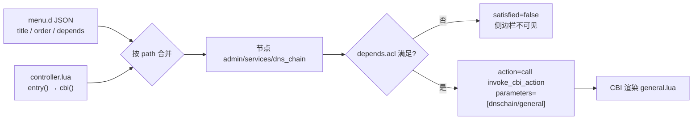
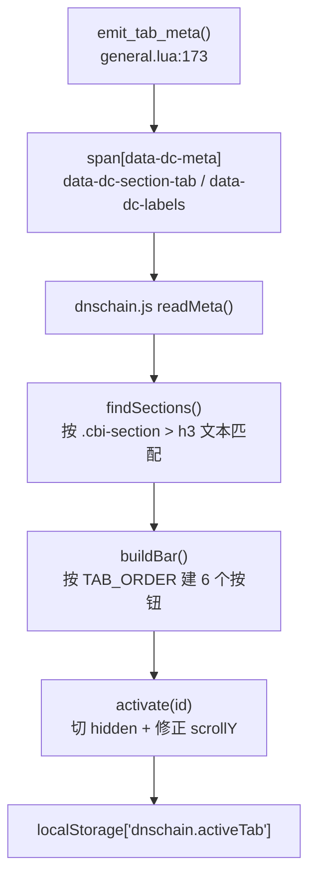
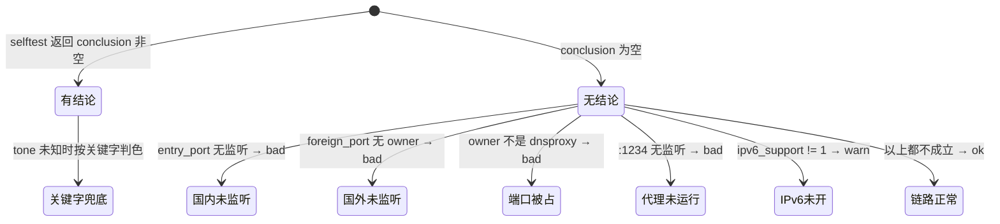

# luci-app-dnschain —— DNS 链路控制页面

`luci-app-dnschain` 是「服务 → DNS 链路」这一张 CBI 页面：把 dnsmasq / dnsproxy / SSR-Plus 三层的可控参数集中在一页，并把链路的实时状态、域名归属判定、自动改道结果渲染成可读的表格与 SVG 图。它**不实现任何解析逻辑**，只做配置读写、校验、下发、自检与可视化（证据：`package/luci-app-dnschain/luasrc/model/cbi/dnschain/general.lua:8-9`）。

页面在固件里的角色是「DNS 链路的唯一控制台」，但**链路本体不在这个包里**：`init.d/dnschain`、`dnschain.sh`、`dnschain-health`、`dnschain-reconcile`、`dnschain-selftest`、`/etc/config/dnschain` 全部由 `files/` overlay 提供，不是 opkg 包（证据：`package/luci-app-dnschain/Makefile:17-20` 明确写了「不依赖 dnschain 包 —— 本框架的 init/config/脚本全部由 files/ overlay 提供」，`LUCI_DEPENDS:=+luci-base` 在 `Makefile:21`）。

理解本页面的前提是记住一条分工：**页面是壳，脚本是里**。页面上每个按钮都只是 `luci.sys.exec` 一条 `/usr/bin/dnschain-*` 命令；页面上每个数字都是从运行时文件或脚本 stdout 里读出来的。页面从不自己算分流、不自己找进程、不自己发信号。

---

## 1. 一句话定位与包构成

| 项 | 值 | 证据 |
|---|---|---|
| 包名 | `luci-app-dnschain` | `package/luci-app-dnschain/Makefile:9` |
| 版本 | `PKG_VERSION:=1.2.1`，`PKG_RELEASE:=1` | `Makefile:10-11` |
| 依赖 | 仅 `+luci-base` | `Makefile:21` |
| 架构 | `LUCI_PKGARCH:=all`（纯 Lua + 静态资源） | `Makefile:22` |
| 许可证 | Apache-2.0 | `Makefile:13` |
| 路由条数 | 1 条（同路径双通道声明） | 见 §2 |
| 后端 ubus 对象 | **无**（不注册 rpcd 插件） | 见 §3.1 |
| CBI 模型 | `general.lua`（1980 行）+ `dnschain.lua`（1054 行，数据层）+ `diagrams.lua`（905 行，SVG 生成） | 文件行数实测 |
| 前端资源 | `dnschain.js`（349 行，tab 控制器）+ `dnschain.css`（716 行，语义色令牌与版式） | 同上 |
| 中文翻译 | `po/zh-cn/luci-app-dnschain.po`（1431 行，475 组 msgid/msgstr） | 同上 |

目录结构（全部由 `Makefile` 的 `luci.mk` 安装到固件）：

```
package/luci-app-dnschain/
├── Makefile
├── luasrc/
│   ├── controller/dnschain.lua            ← 路由 + 前置守卫
│   └── model/cbi/dnschain/
│       ├── general.lua                    ← 页面本体（20 个可见 section + 1 个元数据 section）
│       ├── dnschain.lua                   ← 数据层：读运行时状态、调脚本
│       └── diagrams.lua                   ← 两张 SVG 导图
├── htdocs/luci-static/resources/dnschain/
│   ├── dnschain.js                        ← 把 section 收拢成 6 个 tab
│   └── dnschain.css                       ← shadcn 视觉语言的语义色令牌
├── root/usr/share/luci/menu.d/luci-app-dnschain.json     ← 路由（JSON 通道）
├── root/usr/share/rpcd/acl.d/luci-app-dnschain.json      ← ACL
└── po/zh-cn/luci-app-dnschain.po
```

包内**没有** `root/usr/libexec/rpcd/*`，即不存在任何 rpcd 插件（证据：`package/luci-app-dnschain/` 下只有 `root/usr/share/luci/menu.d/` 与 `root/usr/share/rpcd/acl.d/` 两个 root 子路径）。

---

## 2. 路由表

本包是全仓库**唯一**同时用两条通道声明同一路由的包（`menu.d` JSON 与 Lua controller 各写一次）。

| 路由路径 | 菜单标题 | order | action 类型 | 目标 | ACL | 声明位置 |
|---|---|---|---|---|---|---|
| `admin/services/dns_chain` | DNS 链路 | 20 | `cbi` | `dnschain/general` | `luci-app-dnschain` | `package/luci-app-dnschain/root/usr/share/luci/menu.d/luci-app-dnschain.json:2-11`；同路径另在 `package/luci-app-dnschain/luasrc/controller/dnschain.lua:37-40` 用 `entry()` 声明 |

逐字段对照：

| 字段 | JSON 通道的值 | Lua 通道的值 | 证据 |
|---|---|---|---|
| path | `admin/services/dns_chain` | `{"admin","services","dns_chain"}` | `menu.d:2` / `controller:37` |
| title | `DNS 链路` | `_("DNS 链路")` | `menu.d:3` / `controller:39` |
| order | `20` | `20` | `menu.d:4` / `controller:39` |
| action.type | `cbi` | 由 `cbi()` 展开为 `call` | `menu.d:6` / `controller:38` |
| action.path / 参数 | `dnschain/general` | `cbi("dnschain/general")` | `menu.d:7` / `controller:38` |
| depends.acl | `["luci-app-dnschain"]` | 无（Lua 通道不声明 ACL） | `menu.d:9-11` / `controller:37-40` |
| 附加字段 | 无 | `page.dependent = false` | `controller:40` |

### 2.1 两处声明在运行时合并为同一个节点

路由器实测的菜单树缓存（OpenWrt 24.10.5 / LuCI 26.293）里，`admin.services.dns_chain` 节点是：

```json
"dns_chain": {
  "satisfied": true,
  "action": {
    "module": "luci.dispatcher",
    "type": "call",
    "post": { "cbi.submit": true },
    "function": "invoke_cbi_action",
    "parameters": [ "dnschain/general", {} ]
  },
  "depends": { "acl": [ "luci-app-dnschain" ] },
  "order": 20,
  "title": "DNS 链路"
}
```

（实测快照，2026-10-23 读取；同一条记录也写在 `docs/routes.md:93-105`。）

这一条同时证明三件事：

1. **`title` / `order` / `depends` 来自 JSON，`action` 来自 controller**。JSON 写的是 `type: cbi`，最终节点里却是 `type: call` + `function: invoke_cbi_action` —— 说明 `menu.d` 的 `cbi` 与 Lua 的 `cbi()` 被展开成同一个 call 动作，且同名字段是**字段级覆盖**而不是整节点替换。
2. **`page.dependent = false`（`controller:40`）没有出现在树里**。该字段在 ucode dispatcher 里没有任何消费者，属于**无效声明**；`docs/routes.md:111` 已把这条实测结论记录在案。
3. 节点 `satisfied: true` 来自 `depends.acl` 的判定 —— 当前会话拥有 `luci-app-dnschain` 这个 ACL 组。

### 2.2 order 的取值约束

`order = 20` 不是随手取的。侧边栏顺序依据写在 controller 的注释里（`controller:14-26`）：

| 相邻菜单 | order | 来源 |
|---|---|---|
| ShadowSocksR Plus+ | 10 | `/usr/lib/lua/luci/controller/shadowsocksr.lua`（注释 `controller:17`） |
| **DNS 链路（本页）** | **20** | `controller:39` |
| 动态 DNS | 59 | 注释 `controller:19` |
| DNS Proxy | 60 | 注释 `controller:20` |
| 带宽监控 | 80 | 注释 `controller:21` |
| 网络唤醒 | 90 | 注释 `controller:22` |

约束是 `10 < order < 59`，取 20 留余量（`controller:25-26`）。

### 2.3 绝对不能加 `page.leaf = true`

`controller:28-36` 记录了一次实测：v0.12.0 曾加 `page.leaf = true`（本意是「每次进入都重新渲染」），结果**侧边栏里这一项直接消失**。原因是 leaf 节点在生成的菜单树 JSON 里带 `"wildcard": true`，前端把 wildcard 节点当占位/通配，不渲染成菜单链接。注释里附了当时观察到的节点片段（`controller:33-34`）。



---

## 3. 请求走向

### 3.1 打开页面（GET）

按顺序：

1. 浏览器请求 `/cgi-bin/luci/admin/services/dns_chain`。
2. dispatcher 同时加载 `menu.d` 与 controller，按路径建树并合并同名字段（证据：`docs/routes.md:22-30` 记录的 `/usr/share/ucode/luci/dispatcher.uc:362` 与 `:389-424`）。
3. 判定 `depends.acl`（`menu.d:9-11`）：不满足则节点 `satisfied=false`，侧边栏不显示、直连 URL 也被拒。
4. 执行 controller 的 `index()`。**第一件事是前置守卫**：`/etc/config/dnschain` 不存在就直接 `return`，不注册任何路由（证据：`package/luci-app-dnschain/luasrc/controller/dnschain.lua:10-12`）。
5. 注册路由 `entry({"admin","services","dns_chain"}, cbi("dnschain/general"), _("DNS 链路"), 20)`（`controller:37-39`）。
6. dispatcher 按 `parameters=[dnschain/general]` 载入 CBI 模型 `package/luci-app-dnschain/luasrc/model/cbi/dnschain/general.lua`。
7. 模型顶部建 `Map("dnschain", translate("DNS 链路"), ...)`（`general.lua:41`），并 `require` 数据层与图示层（`general.lua:36-37`）。
8. 覆写 `m.state_handler`，把按钮 `write()` 里登记的消息在 parse 结束后写到 `self.message`（`general.lua:65-79`）。这一步是按钮结果能显示到页面上的唯一原因 —— 注释 `general.lua:48-62` 记录了原来的三层失效原因（Button 需要非空 formvalue、`res:parse()` 返回值被丢弃、Map 模板读的是 `map.message` 而不是 `m.message`）。
9. 依次渲染 20 个可见 section（行号见 §4.1）与 1 个空标题元数据 section。
10. 元数据 section 由 `emit_tab_meta(m)` 在**最后**创建（`general.lua:173-190`，调用点 `general.lua:2023`）。它的 `cfgvalue()` 输出一段 `rawhtml`：`<link>` 引 CSS、`<script defer>` 引 JS、`<span data-dc-meta="1">` 带两个 JSON 属性 `data-dc-section-tab` 与 `data-dc-labels`（`general.lua:182-188`）。属性值必须用**单引号**包裹，否则 JSON 里的双引号会截断属性（注释 `general.lua:172-179`）。
11. 浏览器加载 `dnschain.js`（`general.lua:184`），它在 `DOMContentLoaded` 或立即执行 `init()`（`dnschain.js:348-352`）。
12. `init()` 依次：读元数据（`dnschain.js:50-61`）→ 移除空的 CBI tabmenu（`:302`，函数 `:203-216`）→ 给整块内容行加竖排类（`:303`，函数 `:239-258`）→ 绑定「单域名解释」输入行（`:304`，函数 `:272-296`）→ 收起元数据容器（`:310-315`）→ 按 `<h3>` 文本找到所有 section（`:317`，函数 `:70-85`）→ 统计每个 tab 的红徽标数（`:323-327`，`countBadges` 在 `:87-89`）→ 建 tab 栏（`:331`，`buildBar` 在 `:105-135`）→ 按 `localStorage['dnschain.activeTab']` 恢复上次 tab，否则取第一个（`:342-345`）。
13. `activate(id)` 切显示并修正滚动位置（`dnschain.js:159-190`）。滚动修正是必需的：各 tab 高度差数倍，只切 `hidden` 会让 `scrollY` 停在旧值、屏幕只剩页脚（注释 `dnschain.js:141-158`）。

**本包不注册任何 ubus 对象。** 全仓库对 ubus 的调用只有一处：`ubus call dnsmasq metrics`（`package/luci-app-dnschain/luasrc/model/cbi/dnschain/dnschain.lua:330`）。其余所有动作都走 `luci.sys.exec` / `luci.sys.call` / `io.popen` 直接执行 shell 命令（调用点全集见 §5）。

### 3.1.1 冷启动为什么慢：实测拆解（v0.15.0）

**先说结论：慢的根因是「CBI 服务端渲染全部 section」，不是网络、不是浏览器。**

LuCI 的 CBI Map 页面在**一次 HTTP 请求内**渲染全部 section 与 option 的
`cfgvalue()`。本页用前端 tab 分组（单张表单 + CSS 隐藏），所以**即使你只想看
「概览」，域名 tab 的 `_status_map`、`_status_table`、`_explain` 也全部会执行**。
这是本页所有性能问题的前提。

实测（OpenWrt 24.10.5 / 内核 6.18.55 / N2930，2026-10-23）：

| 后端调用 | 单次耗时 | 每次开页调用次数 | 说明 |
|---|---|---|---|
| `/usr/bin/dnschain-selftest -f` | **2860–3960ms** | 1（缓存命中后 320ms） | 最大头。20 项检查、18 次 `nslookup`、30 次 `netstat`、550ms 的 `fw4 check` |
| `/usr/bin/dnschain-health status` | **210ms** | 1 | 逐观测域名算归属 + 读状态文件（v0.15.3 优化前 1070ms） |
| `nft list set inet ss_spec china` | 100ms | 1 | 2025 个 CIDR，单次 100–120ms |
| `nft list set inet ss_spec blacklist` | 30ms | 1 | |
| `netstat -lntup` | 30ms | 1（`listen_table` 已缓存） | 原实现每次 `port_owner` 都跑一次，共 30 次 |
| `ubus call dnsmasq metrics` | <10ms | 1 | |
| `/usr/bin/dnschain-health explain <域名>` | 2370ms | 0（仅用户输入域名后） | 不在首屏路径 |

`dnschain-selftest` 的逐项耗时（清缓存后，`emit` 打时间戳测得）：

```
item  1    0ms（首轮含脚本启动与库加载约 300ms）
item  2  210ms
item  3   30ms
item  4  100ms
item  5   30ms
item  6   30ms
item  7   20ms
item  8   10ms
item  9   60ms
item 10 1070ms   ← 热点：google 经代理 DoH 真实往返
item 12   40ms
item 13   50ms
item 14   10ms   （fw4 check 命中缓存；未命中时 550ms）
item 15  340ms   ← 热点：扫 /tmp/dnsmasq.d 全部文件
item 16    0ms
item 17   40ms
item 18 1350ms   ← 最大热点：每个观测域名各扫一遍 1.5MB 分流片段
item 19  140ms
item 20   80ms
```

外部命令次数（`sh -x` 统计）：`sed` 366、`awk` 288、`grep` 165、`cat` 54、
`tr` 36、`netstat` 30、`nslookup` 18、`fw4` 18、`wc` 12、`nft` 6。
BusyBox 每次 fork 约 5–8ms，**命令次数本身就是主要成本**。

已生效的缓存机制（`dnschain.lua:49-69`）：

- `cached(key, fn)` 是**模块级** `_cache`，进程内共享 → 同一请求内
  `selftest` / `chain_snapshot` / `list_stats` / `listen_table` / `cache_stats`
  各只跑一次。页面里 `ds.selftest()` 被调用 3 次（结论、实时诊断图、自检表），
  实际只执行 1 次。
- `dnschain-selftest` 另有 60 秒磁盘缓存（`/var/run/dnschain/selftest.cache`），
  命中时 2860ms → 320ms。
- `invalidate(key)` 在每次写操作后清缓存（`general.lua` 的 8 个按钮全部调用）。

### 3.1.2 性能优化策略

按「收益 / 风险」排序，**前四条已实施**，其余是需要权衡的可选项。

#### 已实施

| # | 策略 | 位置 | 效果 |
|---|---|---|---|
| 1 | **合并概览与诊断 tab**，消除 `dg.route_map` 的重复渲染 | `general.lua:113-139` | 少渲染一整张 SVG（约 40 个节点/连线元素） |
| 2 | **移除全部箭头 marker** | `diagrams.lua` + `general.lua` | 少 5×3 个 `<marker>` 定义与每条线的 `marker-end` 解析 |
| 3 | **实时诊断图复用 `ds.selftest()`** | `general.lua:498-590` | 新增一张图但**零新增后端调用**（缓存命中） |
| 4 | **`dnschain-health status` 批量归属判定** | `dnschain.sh`（`dc_domain_class_batch`）+ `dnschain-health`（`cmd_status`） | **1070ms → 210ms**。原实现每个域名调 3 次 `dc_domain_class`（cls / pref / custom 各一次），8 域名 = 24 次全表扫描 `db-domains.txt`；改为一次收集 + 三次 `grep -Fxf` 拿全部命中，判定全在纯 shell 完成 |

#### 可选（需权衡）

| # | 策略 | 预期收益 | 风险 / 代价 |
|---|---|---|---|
| 4 | **item 18 改单次扫描**：现在是「每个观测域名各跑 `echo`+`sed`+`grep -qE`，每次全扫 1.5MB」，8 个域名 ≈ 8×170ms | −1350ms | 需保证精确前缀匹配语义不变 |
| 5 | **item 10/11 与 8/9 并行**：4 次独立 DNS 探测目前串行 | −900ms | POSIX sh 的 `&`+`wait` + 临时文件；不能破坏 `dc_run_timeout` 的完成标记机制 |

| 7 | **tab 内容懒加载**：首屏只渲染概览，其余 tab 点击时用 XHR 拉 | −2000ms 以上 | 与「单张 CBI 表单一次保存」的架构冲突，改动量大，且会引入 tab 间状态不同步 |
| 8 | **`nft list set china` 结果缓存到 tmpfs**，带 30 秒 TTL | −100ms | 数字可能滞后；国内 IP 段变化不频繁，可接受 |

**不建议做的**：把 `selftest` 改成异步轮询。它会让「首屏看到结论」变成
「首屏看到加载中」，而结论徽标正是用户打开这个页面的首要目的。

⚠️ 若日后确实要加懒加载（第 7 条），必须同时解决「保存时其他 tab 的
未提交值」问题 —— CBI 的 `write()` 只遍历**本次请求里解析到的** option。

### 3.2 保存（POST，只写 UCI）

1. 浏览器提交 `cbi.submit`。CBI 对每个 option 调用其 `write()`，未自定义 `write()` 的 option 直接把值写进它绑定的 UCI section。
2. 特殊写盘只有一处：`_filter_aaaa` 这个 `ListValue` 不写 `dnschain`，而是写**另一个包**的键 —— `luci.sys.call("uci -q set shadowsocksr.@global[0].filter_aaaa='…' && uci -q commit shadowsocksr")`（`general.lua:1426-1427`）。注释 `general.lua:1632-1425` 说明为什么不能用 `luci.sys.call("...%s...", v)`：它不支持 `%s` 插值，会把字面 `%s` 写进 UCI。
3. 紧接着调 `ds.sync_dnsmasq_filter_aaaa()`（`general.lua:1429`）。该函数按 SSR-Plus 的规则算出目标值（`ipv6_support=1` → 目标 0；否则跟随用户偏好，`dnschain.lua:638-642`），若与当前 `dhcp.@dnsmasq[0].filter_aaaa` 不同则写 UCI 并**重启 dnsmasq**（`dnschain.lua:658-676`）。重启而非 reload 的理由：`filter_aaaa` 是写进 `/var/etc/dnsmasq.conf.*` 的，SIGHUP 不重读（`dnschain.lua:666-668`）。
4. 校验失败时 `setmsg()` 登记消息（`general.lua:1652-1660`），由第 8 步的 `state_handler` 覆写输出。

保存路径**不重建分流片段**。片段要不要重建由「保存并应用」决定（见 §3.3）；只点「保存」时页面上「已录入清单」会显示「待应用」（`general.lua:801`）。

### 3.3 保存并应用（POST）

1. CBI 先完成默认的 parse 与写盘。
2. 然后执行本 Map 自定义的 `m.apply_on_parse`（`general.lua:1913-1924`）：先调基类实现，再 `pcall(ds.apply_domains)`，把结果翻成一句话写进 `m.message`。
3. `ds.apply_domains()` = `luci.sys.exec("/usr/bin/dnschain-health apply 2>&1")` + 清请求级缓存（`dnschain.lua:864-868`）。
4. `dnschain-health apply`（`files/usr/bin/dnschain-health:205-264`）依次：重建自定义列表 → 重建 db-domains → 记录静态片段与 watch.servers 的 md5 → 重建 `dnschain-split.conf` → 重建 `watch.servers` → 比较 md5 决定出口。
5. 出口共 5 条正常 + 2 条失败（注释 `general.lua:2172-2196`）：

| 出口 | 触发条件 | 页面文案 |
|---|---|---|
| `DNSMASQ=restarted（静态片段已变）` | 静态片段 md5 变了，且 `/etc/init.d/dnsmasq` 可执行（`dnschain-health:242-245`） | 「已应用（dnsmasq 已重启，静态片段生效）」（`general.lua:1941`） |
| `DNSMASQ=skipped（无 init.d/dnsmasq）` | 片段变了但没有 init 脚本（`dnschain-health:247`） | 「已保存，但未应用」（`general.lua:2013`） |
| `DNSMASQ=skipped（框架未启用）` | `main.enabled != 1`（`dnschain-health:231-234`） | 同上，并带括号里的原因（`general.lua:1971-1976`） |
| `DNSMASQ=sighup（仅观测域名变化）` | 片段没变、watch.servers 变了（`dnschain-health:254-258`） | 「已应用（仅观测域名变化，SIGHUP 已生效，无中断）」（`general.lua:1942`） |
| `DNSMASQ=unchanged（无变化，未动 dnsmasq）` | 两者都没变（`dnschain-health:261`） | 「配置已保存（分流片段无变化，未重启 dnsmasq）」（`general.lua:2012`） |
| `ERROR=生成自定义列表失败` | `dc_gen_custom_lists` 失败（`dnschain-health:208`） | 「✗ 应用失败：…」（`general.lua:1948-1949`、`:1954-1957`） |
| `ERROR=生成分流片段失败` | `dc_gen_dnsmasq_split` 失败（`dnschain-health:221`） | 同上 |

解析状态词时**只能取 ASCII**：`out:match("DNSMASQ=([%a%-]+)")`（`general.lua:2204`）。注释 `general.lua:2200-2203` 记录了踩过的坑 —— 写成 `(%S+)` 会把全角括号里的中文整段吃进去，导致 `skipped` 分支永远匹配不上。

### 3.4 八个按钮各自的请求走向

| 按钮（CBI option 名） | 显示名 | write() 位置 | 后端命令 | 命令实现 |
|---|---|---|---|---|
| `_apply_domains` | 重建分流规则并生效 | `general.lua:1246-1251` | `dnschain-health apply` | `dnschain.lua:864-868` → `dnschain-health:205-264` |
| `_cycle_now` | 立即探测一轮 | `general.lua:1373-1380` | `dnschain-health cycle` | `dnschain.lua:857-861` → `dnschain-health:351` → `dnschain.sh:1587-1770` |
| `_reset_health` | 清空改道状态 | `general.lua:1266-1270` | `dnschain-health reset` | `dnschain.lua:871-875` → `dnschain-health:272-278` |
| `_selftest_now` | 立即重新自检 | `general.lua:1968-1978` | `dnschain-selftest` | `dnschain.lua:506-537` → `dnschain-selftest:580-672` |
| `_reconcile` | 一键归一 | `general.lua:1855-1859` | `dnschain-reconcile` | `dnschain.lua:466-469` → `dnschain-reconcile:367-414` |
| `_import` | 手动导入名单 | `general.lua:2102-2106` | `dnschain-reconcile`（与上一条**完全相同**） | `dnschain.lua:451-454` → 同上 |
| `_update_gfw` | 更新 GFW 名单 | `general.lua:1873-1877` | `/usr/bin/lua /usr/share/shadowsocksr/update.lua gfw_data` | `dnschain.lua:457-463` |
| `_flush_cache` | 清空全部缓存 | `general.lua:2008-2014` | `dnschain-health flush` | `dnschain.lua:427-434` → `dnschain-health:309-316` → `dnschain.sh:497-503` |

每个按钮 `write()` 结尾都调 `ds.invalidate()`（或 `ds.invalidate("selftest")`）。这不是可选项：`dnschain.lua` 有请求级缓存（`dnschain.lua:49-71`），不清缓存的话页面显示的还是按钮执行前的旧结果（注释 `general.lua:1832-1834`）。

`_update_gfw` 是唯一一个**先判文件存在再执行**的按钮：`fs.access("/usr/share/shadowsocksr/update.lua")` 失败时直接返回错误，不执行（`dnschain.lua:458-460`）。它也是唯一一个不看命令输出的按钮 —— `sys.exec` 的返回值被丢弃，函数无条件 `return true`（`dnschain.lua:461-462`）。

---

## 4. 页面元素 → 后端调用对照

### 4.1 6 个 tab 与 20 个 section

tab 定义在 `general.lua:98-107`（`TAB_LABELS`），前端顺序常量在 `dnschain.js:46`（`TAB_ORDER = ['overview','domains','resolve','split','proxy','dhcp']`）。section → tab 的映射表是 `general.lua:134-162`（`SECTION_TAB`），键是 **translate 之后的标题文本**，所以改标题必须同步改这张表（注释 `general.lua:109-112`）。

> **v0.15.0：概览与诊断已合并**（用户要求「概览 tab 和诊断合并在一页显示，严格查重重复功能移除」）。
>
> 合并前 7 个 tab，`diag`（诊断）独立。合并后 6 个，「自检」「操作」两个 section 归入 `overview`。
>
> 合并时消除的**重复**：概览原有的「分流决策」图是「域名」tab 判定链路图的第二次渲染（同一函数 `dg.route_map`），已删除；概览改用本页独有的「实时诊断链路」图。
>
> 保留的两项**不是**重复：「结论」徽标与「自检 20 项」表格都来自 `ds.selftest()`，但是同一次采集的两种视图（一句话结论 vs 逐项证据），请求级缓存保证只跑一次。

| tab id | 显示名 | section 标题（= `m:section` 的标题参数） | section 行号 | 归组依据 |
|---|---|---|---|---|
| `overview` | 概览与诊断 | 当前状态 | 222 | `general.lua:136` |
| `overview` | 概览与诊断 | 自检 | 1994 | `general.lua:137` |
| `overview` | 概览与诊断 | 操作 | 2064 | `general.lua:138` |
| `domains` | 域名 | 自定义域名 · 国内（补全归属） | 864 | `general.lua:141` |
| `domains` | 域名 | 自定义域名 · 国外（补全归属） | 880 | `general.lua:142` |
| `domains` | 域名 | 判定链路 | 978 | `general.lua:143` |
| `domains` | 域名 | 改道状态 | 1134 | `general.lua:144` |
| `domains` | 域名 | 改道明细 | 1232 | `general.lua:145` |
| `domains` | 域名 | 分诊结果 | 1317 | `general.lua:146` |
| `domains` | 域名 | 观测与阈值 | 1389 | `general.lua:147` |
| `domains` | 域名 | 域名操作 | 1456 | `general.lua:148` |
| `resolve` | 解析 | 国内上游 | 1545 | `general.lua:150` |
| `resolve` | 解析 | 国外上游 | 1557 | `general.lua:151` |
| `resolve` | 解析 | 双栈策略 | 1591 | `general.lua:152` |
| `resolve` | 解析 | 端口与实例 | 1685 | `general.lua:153` |
| `resolve` | 解析 | 缓存 | 1719 | `general.lua:154` |
| `split` | 分流 | 名单规模 | 1755 | `general.lua:156` |
| `proxy` | 代理 | SSR-Plus 兼容 | 1859 | `general.lua:158` |
| `proxy` | 代理 | 拦截与框架开关 | 1922 | `general.lua:159` |
| `dhcp` | DHCP | DHCP 下发 DNS（明文） | 1954 | `general.lua:161` |

合计 **20 个有标题的可见 section**，加 1 个空标题元数据 section（`general.lua:173`，标题参数是空串，`anonymous = true`），共 21 个 `.cbi-section`。

> **v0.16.0：新增「分诊结果」section**（`general.lua:1317`，归 `domains` tab）。
>
> 背景：分诊是 v0.16.0 新增的核心能力，但在此之前**页面上完全看不到它的结果** ——
> 只能通过命令行 `dnschain-triage list` 查。用户明确要求「所有功能都要能对得上
> 视觉上看到的 web ui」，故补此面板。
>
> 它与「改道明细」**不是重复功能**：
>
> | | 改道明细 | 分诊结果 |
> |---|---|---|
> | 输入集合 | 观测列表里 8 个种子域名 | 客户机访问过、但不在任何库里的未知目标 |
> | 判定方法 | DNS 探测（两条链各一次） | HTTP 实测（试直连 / 试代理） |
> | 落库目标 | `watch.servers`（DNS 走哪个实例） | `china`/`blacklist` 集合 + `dom_domestic`/`dom_foreign` |
> | 回答的问题 | 「这个域名的首选链通不通、要不要改道」 | 「这个未知目标该直连还是走代理」 |

合计 **19 个有标题的可见 section**，加 1 个空标题元数据 section（`general.lua:173`，标题参数是空串，`anonymous = true`），共 20 次 `m:section()` 调用。

未归组的 section 始终显示（`dnschain.js:162-164`）—— 这是「新增 section 后不会莫名消失」的保护。当前 20 个全部已归组，所以这条兜底没有实际生效对象。



### 4.1.1 四张图的职责边界（v0.15.0）

页面上共 **4 张 SVG 思维导图**，各自回答不同问题。它们**不是**重复：

| 图 | 渲染位置 | 函数 | 回答什么问题 | 数据来源 |
|---|---|---|---|---|
| 解析链路 | `general.lua:281`（`_chain_graph`） | 内联（`general.lua:283-500`） | 组件在不在、端口是否监听 | `ds.chain_snapshot()` |
| **实时诊断链路** | `general.lua:498`（`_live_diag_map`） | 内联（`general.lua:499-590`） | **哪一段真的通、断在哪、证据是什么** | `ds.selftest()` 的 20 项 |
| 判定链路 | `general.lua:969`（`_route_map`） | `dg.route_map()` | 某个域名按规则会怎么走 | 端口 + 配置（纯计算） |
| 改道状态 | `general.lua:1125` 段内（`_status_map`） | `dg.status_map()` | 哪些观测域名当前被改道 | `ds.health_rows()` |

「实时诊断链路」是 v0.15.0 新增，把自检 20 项**按链路阶段重新分组**（客户机入口 / dnsmasq / 国内链路 / 国外链路 / 代理与分流 / 分流规则 / fw4 / 双栈与端口），每段给最差状态、PASS/FAIL/SKIP 计数、以及该段的证据串。这样一眼看出断点在哪一段，不用在 20 行表格里逐行找红色。

⚠️ 它**不新增后端调用** —— `ds.selftest()` 已被「结论」徽标调用过，请求级缓存命中。

### 4.1.2 连线不画箭头（v0.15.0）

用户要求「所有的思维导图连线移除箭头显示」。四处实现全部改为无箭头：

| 位置 | 改动 |
|---|---|
| `diagrams.lua` `hline()` / `curve()` / `vline()` | 删掉 `marker-end` 参数 |
| `diagrams.lua` `defs()` / `arrow()` | **整个函数删除**，不再生成 `<marker>` |
| `general.lua` 内联链路图 `marker()` / `arrow()` | 同样删除，不再输出 `<defs>` |

副作用与配套调整：

- 同页多图不再有 SVG id 冲突风险（根因是 marker id 是文档级全局的）。
- 但「同页多图」这个前提仍在，故保留 `id_prefix` 参数，改落在无副作用的 `data-dc-figure="<prefix>"` 上（`diagrams.lua:91-94`），供前端与测试区分。
- 断言全部改为**反向条件**：不得出现 `<marker` 与 `marker-end`。见 `tools/render-dnschain-diagrams.py:176`（`check_no_arrows`）、`tools/verify-dnschain-domains.sh:645-660`、`build-openwrt.yml:414-447`。

⚠️ CI 与 shell 断言必须先剥掉 Lua 注释行（`grep -v '^[[:space:]]*--'`）再判断 —— 注释里写了「v0.15.0 移除了 marker-end」这类说明文字，不剥注释会让断言永久误报。

### 4.2 可写项 → UCI 键

`TypedSection, "dnschain"` 下的 option 写到类型为 `dnschain` 的 section，即配置文件里唯一那一段 `config dnschain 'main'`（`files/etc/config/dnschain:42`）。

| 页面项（option 名） | 所在 section（行号） | 写入的 UCI 键 | 备注 |
|---|---|---|---|
| `domain` | `dom_domestic`（739） | `dnschain.dom_domestic.domain`（list） | `DynamicList`，挂 `validate_domain`（`general.lua:745`） |
| `domain` | `dom_foreign`（753） | `dnschain.dom_foreign.domain`（list） | 同上（`general.lua:758`） |
| `enabled` | `health`（1174） | `dnschain.health.enabled` | 默认 `1`（`:1177`） |
| `watch` | `health`（1179） | `dnschain.health.watch`（list） | `:depends("enabled","1")`（`:1183`） |
| `timeout` | `health`（1185） | `dnschain.health.timeout` | `range(1,10)`，默认 2（`:1188-1189`） |
| `retries` | `health`（1192） | `dnschain.health.retries` | `range(0,5)`，默认 2（`:1195-1196`） |
| `fail_threshold` | `health`（1199） | `dnschain.health.fail_threshold` | `range(1,10)`，默认 2（`:1201-1202`） |
| `recover_threshold` | `health`（1205） | `dnschain.health.recover_threshold` | `range(1,20)`，默认 3（`:1207-1208`） |
| `min_dwell` | `health`（1211） | `dnschain.health.min_dwell` | `range(0,3600)`，默认 120（`:1213-1214`） |
| `interval` | `health`（1217） | `dnschain.health.interval` | `range(0,3600)`，默认 60（`:1220-1221`） |
| `server` | `cn`（1330） | `dnschain.cn.server`（list） | `or(hostname, ipaddr)` + `validate_upstream`（`:1331-1333`） |
| `server` | `foreign`（1343） | `dnschain.foreign.server`（list） | 同上（`:1344-1346`） |
| `cert_verify` | `foreign`（1349） | `dnschain.foreign.cert_verify` | 页面明示「仅作记录」（`:1352-1353`） |
| `via_proxy` | `foreign`（1357） | `dnschain.foreign.via_proxy` | 页面明示「仅作记录」（`:1361-1362`） |
| `_filter_aaaa` | `aaaa`（1412） | **`shadowsocksr.@global[0].filter_aaaa`** | `ListValue` + 自定义 `write()`（`:1422-1442`），不写 dnschain |
| `filter_https_rr` | `aaaa`（1456） | `dnschain.aaaa.filter_https_rr` | 页面明示「没有运行时消费者」（`:1460`） |
| `entry_port` | `dnschain`（1469） | `dnschain.main.entry_port` | `port`，默认 5353（`:1471-1474`） |
| `foreign_port` | `dnschain`（1476） | `dnschain.main.foreign_port` | `port`，默认 5336（`:1479-1482`） |
| `enabled` | `cache`（1505） | `dnschain.cache.enabled` | 页面明示「框架不读这个开关」（`:1506-1507`） |
| `size` | `cache`（1511） | `dnschain.cache.size` | `range(128,65536)`，默认 8192（`:1514-1516`） |
| `auto_import` | `lists`（1600） | `dnschain.lists.auto_import` | 默认 1（`:1603`） |
| `import_interval` | `lists`（1605） | `dnschain.lists.import_interval` | 页面明示「没有运行时消费者」（`:1606-1607`） |
| `restart_threshold` | `lists`（1612） | `dnschain.lists.restart_threshold` | `range(0,100)`，默认 1（`:1614-1615`） |
| `gfw_source` | `lists`（1617） | `dnschain.lists.gfw_source` | `datatype=file`（`:1619`） |
| `base_source` | `lists`（1623） | `dnschain.lists.base_source` | 同上（`:1625`） |
| `black_source` | `lists`（1629） | `dnschain.lists.black_source` | 同上（`:1631`） |
| `mode` | `ssr`（1645） | `dnschain.compat.mode` | `ListValue`：`0` / `7`（`:1648-1649`）；section **名**是 `compat` |
| `enforce` | `ssr`（1653） | `dnschain.compat.enforce` | 默认 1（`:1656`） |
| `require_ipv6` | `ssr`（1658） | `dnschain.compat.require_ipv6` | 默认 1（`:1664`） |
| `enabled` | `dnschain`（1706） | `dnschain.main.enabled` | 默认 1（`:1709`） |
| `intercept` | `dnschain`（1711） | `dnschain.main.intercept` | 默认 1（`:1715`） |
| `intercept_dot` | `dnschain`（1717） | `dnschain.main.intercept_dot` | 默认 1（`:1722`） |
| `intercept_doh` | `dnschain`（1724） | `dnschain.main.intercept_doh` | 默认 0（`:1728`），页面明示「只做标注」（`:1725`） |
| `enabled` | `dhcp_dns`（1740） | `dnschain.dhcp_dns.enabled` | 默认 1（`:1742`） |
| `server` | `dhcp_dns`（1744） | `dnschain.dhcp_dns.server`（list） | `datatype=ip4addr`（`:1745`） |
| `auto_rollback` | `selftest`（1816） | `dnschain.selftest.auto_rollback` | 页面明示「回滚逻辑尚未实现」（`:1818-1819`） |
| `interval` | `selftest`（1823） | `dnschain.selftest.interval` | 页面明示「仓库里没有定时调度」（`:1825-1826`） |

`ssr` 段的行号 1645-1664 对应的 section 在 `general.lua:1639` 用 `TypedSection, "ssr"` 建，所以 option 写到类型为 `ssr` 的唯一 section，即 `config ssr 'compat'`（`files/etc/config/dnschain:197`）。

### 4.3 只读展示项 → 数据来源

22 个业务 `DummyValue`（另有 1 个 `_dc_meta` 承载 tab 元数据，见 `general.lua:177`），全部 `rawhtml` 输出、`cfgvalue()` 现算：

| 展示项 | 行号 | 数据来源 | 落到哪个后端 |
|---|---|---|---|
| 结论 | 225 | `ds.selftest().conclusion`，为空时按端口/进程状态自算（`general.lua:238-261`） | `dnschain-selftest` |
| 解析链路（链路图） | 281 | `ds.chain_snapshot()`（`dnschain.lua:359-404`） | `netstat` + `ubus call dnsmasq metrics` + `nft list set` + `uci` |
| **实时诊断链路（v0.15.0）** | 498 | `ds.selftest()` 的 20 项，按链路阶段分组 | 同上（缓存命中，不额外调用） |
| 链路指标 | 619 | `ds.chain_snapshot()` + `ds.cache_stats()` | 同上 |
| 组件状态 | 672 | `port_listening` / `port_owner` / `is_dnsproxy` / `ssr_ipv6` / `cache_stats` | `netstat -lntup`、`/proc/<pid>/cmdline`、`ubus call dnsmasq metrics` |
| 已录入清单 | 886 | `ds.uci_list` + `ds.custom_domestic/foreign` | `uci -q get` + 读 `/var/etc/dnschain/custom-*.txt` |
| 走法 | 969 | `dg.route_map{id_prefix="dcrt-dm"}` | 纯计算 |
| 单域名解释 | 1001 | GET 参数 `dc_explain`（`general.lua:990-999`）+ `ds.explain()` | `dnschain-health explain <域名>` |
| 状态导图 | 1125 | `ds.health_rows()` + `ds.health_summary()` | `dnschain-health status` |
| 改道通道 | 1138 | `ds.serversfile_ready()`（`dnschain.lua:900-976`） | `uci -q get dhcp.@dnsmasq[0].serversfile`、读 `/var/etc/dnsmasq.conf.*`、`/proc/<pid>/status`、`/proc/<ppid>/cmdline` |
| 自动改道进程 | 1051 | `ds.health_daemon()`（`dnschain.lua:984-1049`） | 遍历 `/proc/*/cmdline` 找 `dnschain-health daemon`、读 `/var/run/dnschain/health.state` |
| 明细 | 1103 | `ds.health_rows()` | `dnschain-health status` |
| 国内 AAAA | 1378 | 固定文案 | 无 |
| 国外 AAAA | 1383 | `ds.ssr_filter_aaaa()` / `ds.dnsmasq_filter_aaaa()` / `ds.ssr_ipv6()` | `uci -q get`（三个键） |
| 实际生效值 | 1444 | 同上三个值 | 同上 |
| 当前监听 | 1484 | `ds.port_listening` | `netstat -lntup` |
| 当前统计 | 1519 | `ds.cache_stats()` | `ubus call dnsmasq metrics` |
| 规模 | 1542 | `ds.list_stats()`（`dnschain.lua:271-325`） | 读 `gfw_list.conf` / `gfw_base.conf` / `foreign-split.conf` / `dnschain-split.conf` + `date -r` |
| IP 集归属核对 | 1563 | `ds.chain_snapshot()` + `ds.ipset_audit()`（`dnschain.lua:558-585`） | `nft list set` + 读 `china_ssr.txt` / `china6_ssr.txt` |
| SSR-Plus 当前状态 | 1666 | `ds.ssr_mode/ssr_ipv6` + 三条 `luci.sys.exec`（`general.lua:1671-1673`） | `uci -q get` |
| 实际下发 | 1748 | 两条 `luci.sys.exec`（`general.lua:1751-1752`） | `uci -q get dnschain.main.intercept`、`network.lan.ipaddr` |
| 自检结果 | 1771 | `ds.selftest()` | `dnschain-selftest` |

`ds.selftest()` 与 `ds.health_rows()` 都被多处调用，但底层命令每个请求只跑一次 —— 靠 `cached()`（`dnschain.lua:52-62`）。这是 v0.11.1 的性能修复：实测页面原本 7.4 秒，逐项计时后定位到「同一份数据被反复采集」（注释 `dnschain.lua:27-47`）。

---

## 5. 后端接口清单

### 5.1 `/usr/bin/dnschain-health`（8 个子命令）

入口分发在 `files/usr/bin/dnschain-health:343-364`，`case` 在 `:350-358`，用法串在 `:360`。

| 子命令 | 实现 | 输出格式 | 页面调用点 |
|---|---|---|---|
| `cycle` | `dc_health_cycle`（`dnschain.sh:1587-1770`） | 末行 `CYCLE ok=<n> switch=<n> bad=<n> wait=<n>`（`dnschain.sh:1764-1765`）；前置跳过时输出 `SKIP …`（`:1594`、`:1595`、`:1627`、`:1638`、`:1643`） | `dnschain.lua:857-861`（`_cycle_now`） |
| `daemon` | `cmd_daemon`（`dnschain-health:318-338`） | 常驻，无结构化输出 | **页面不调**；由 procd 托管（`init.d/dnschain:375-380`） |
| `status` | `cmd_status`（`dnschain-health:76-124`） | 每域名一行 `ROW domain\|class\|pref\|active\|fail\|ok\|last\|result\|state`（`:114-115`），末行 `SUM total=… normal=… degraded=… rerouted=… both_bad=… custom=…`（`:121-122`） | `dnschain.lua:776-780`（`health_status_raw`，`health_rows`/`health_summary` 共用） |
| `explain <域名>` | `cmd_explain`（`dnschain-health:37-43`）→ `dc_explain_domain`（`dnschain.sh:1835-1936`） | `KEY=VALUE` 逐行：`DOMAIN`/`CLASS`/`PREFERRED`/`ACTIVE`/`WATCH`/`CUSTOM`/`PROBE_DOMESTIC`/`PROBE_FOREIGN`/`ANSWER_DOMESTIC`/`ANSWER_FOREIGN`/`DECISION`/`REASON`（`dnschain.sh:1842-1935`） | `dnschain.lua:842-854` |
| `check` | `cmd_check`（`dnschain-health:135-181`） | 每个非法项一行 `BAD <域名> <原因>`（`:143`、`:151`、`:170`），末行 `OK`（`:179`）或 `FAIL bad=<n>`（`:175`） | **页面无调用点**；仅 `dnschain-selftest:428` 调用 |
| `apply` | `cmd_apply`（`dnschain-health:205-264`） | `SPLIT=<server 条数> <nftset 条数>`（`:222`）+ `DNSMASQ=…`（`:232`/`:245`/`:247`/`:256`/`:261`）+ `OK`（`:233`/`:249`/`:257`/`:262`）或 `ERROR=…`（`:208`/`:221`） | `dnschain.lua:864-868` |
| `reset` | `cmd_reset`（`dnschain-health:272-278`） | `OK 已清空健康状态`（`:276`） | `dnschain.lua:871-875` |
| `flush` | `cmd_flush`（`dnschain-health:309-316`） | `OK=已清空 dnsmasq 缓存（零中断）`（`:314`）或 `ERROR=…`（`:311`） | `dnschain.lua:427-434` |

`flush` 存在的理由是「清缓存必须找对 PID」：`pidof dnsmasq` 返回 3 个 PID，第一个是 ujail 辅助子进程，对它 SIGHUP 是空操作（`dnschain-health:298-308` 记录实测；`dnschain.sh:427-452` 记录三层结构）。Lua 侧原先自己实现了一份 `pidof dnsmasq | awk '{print $1}'`，因此静默失效（`dnschain.lua:413-426` 记录修正过程）。现在两边只有一处实现：`dc_dnsmasq_pid` 按 `:53` socket inode 反查 `/proc/<pid>/fd`（`dnschain.sh:454-491`）。

### 5.2 `/usr/bin/dnschain-reconcile`（无参数）

入口 `files/usr/bin/dnschain-reconcile:367-414`，**不接受子命令**（`main` 只 `mkdir` 后依次调三个阶段）。输出全部经 `dnschain_log()`（`dnschain.sh:31-34`），形态是 `dnschain: <文本>` 同时写 stdout 与 syslog。

| 阶段 | 函数 | 做什么 | 证据 |
|---|---|---|---|
| 1 | `reconcile_invariants` | 重放不变量集：SSR-Plus 5 个键、dnsmasq 4 个键、`dnsproxy.global.lan_dns_intercept`、`cache.size`→`dhcp.cachesize`、nftset 归零自愈、`--cache` 反查、`ss_spec_output` 端口集校验、`/etc/dnsmasq.conf` 的 `log-facility=syslog` 自愈 | `dnschain-reconcile:51-237` |
| 2 | `reconcile_lists` | 名单指纹变化时重建三个派生物，并按行数变化百分比决定是否 reload dnschain | `dnschain-reconcile:245-310` |
| 3 | `reconcile_intercept` | 按 `main.intercept` 决定下发/清除 `dhcp_option=6,…`，变更后重启 dnsmasq | `dnschain-reconcile:316-362` |

退出码有传播：任一阶段失败 → `main` 返回 1（`dnschain-reconcile:372-380`、`:408-413`）。但页面侧只用输出文本判定成功与否 —— `exec_ok()` 看到 `ERROR` 或 `失败` 就返回 false（`dnschain.lua:445-449`）。

### 5.3 `/usr/bin/dnschain-selftest`（可带 `-f`）

| 项 | 内容 | 证据 |
|---|---|---|
| 项数 | 20 项，`emit 1..20` | `dnschain-selftest:107`、`:124`、`:162`、`:189`、`:203`、`:220`、`:233`、`:255`、`:263`、`:272`、`:282`、`:295`、`:309`、`:320`、`:371`、`:404`、`:422`、`:441`、`:465`、`:543` |
| 每行格式 | `<序号> <PASS\|FAIL\|SKIP> <项目名> — <证据/原因>` | `dnschain-selftest:35` |
| 汇总行 | `SUMMARY PASS=<n> FAIL=<n> SKIP=<n>` | `dnschain-selftest:641` |
| 结论行 | 有 FAIL 时按国内解析/dnsproxy 监听拼一句（`:657-663`），全通过时 `CONCLUSION: 链路正常`（`:668`） | 同左 |
| 退出码 | 任一 FAIL → 1（`:654-665`）；否则 0（`:671`） | 同左 |
| 结果缓存 | `/var/run/dnschain/selftest.cache`，TTL 60 秒，带失效指纹 | `dnschain-selftest:595-616`、`:698-740` |
| 强制刷新 | `-f` / `--force` 跳过缓存 | `dnschain-selftest:598-600` |

页面解析这段输出时有两个必须遵守的细节：

- **分隔符必须按字节精确匹配**。`SELFTEST_SEP = " \226\128\148 "`（`dnschain.lua:496`），因为 Lua 的字符类按字节工作，写 `[^—]` 会把 `—`(E2 80 94) 的三个字节都排除，凡名称里含 `一`/`上`/`下` 这类第三字节为 0x80 的汉字就匹配失败。注释 `dnschain.lua:482-495` 记录了实测：20 项里 7 项整行进 name、10 项 name 尾随空格。
- **SKIP 要单独统计**。`pass` 从 `SUMMARY` 取第一个分组，`skip` 再匹配一次（`dnschain.lua:522-531`），`total` 用 `#items`（`:532`）。

### 5.4 其它命令

| 命令 | 调用点 | 说明 |
|---|---|---|
| `ubus call dnsmasq metrics` | `dnschain.lua:330` | 全包唯一的 ubus 调用；解析成 `key=number` 表（`:331-335`） |
| `netstat -lntup` | `dnschain.lua:108` | 一次拿 TCP+UDP 全表，解析成 `{["udp:53"]="<pid>"}`（`:122-138`） |
| `nft list chain inet ss_spec ss_spec_output` | `dnschain.lua:178` | 抽 `tcp dport { … }` 里的端口集，用于上游端口校验（`:236-264`） |
| `nft list set inet ss_spec <name>` | `dnschain.lua:348-351` | 数集合元素个数（`blacklist` / `china`） |
| `date -r /etc/ssrplus/gfw_list.conf` | `dnschain.lua:321` | 取名单 mtime；BusyBox 没有 `stat`（`:319-320`） |
| `uci -q get <key>` | `dnschain.lua:595` | 统一走 `uci_get()` 缓存（`:593-597`） |
| `uci -q get dnschain.<section>.<option>` | `dnschain.lua:747` | `io.popen` 读 list，按空白切 token（`:751-753`） |
| `uci -q set dhcp.@dnsmasq[0].filter_aaaa=…` + `uci commit dhcp` | `dnschain.lua:658-659` | 随后 `/etc/init.d/dnsmasq restart`（`:668`） |
| `uci -q set shadowsocksr.@global[0].filter_aaaa=…` + `uci commit shadowsocksr` | `general.lua:1426-1427` | 页面唯一直接写 UCI 的 option |
| `ls /var/etc/dnsmasq.conf.*` | `dnschain.lua:913` | 找生效的 dnsmasq 配置，验证 `servers-file=` 是否在里面（`:916-928`） |
| `ls -d /proc/[0-9]*` | `dnschain.lua:993` | 找 `dnschain-health daemon` 进程（`:996-1018`） |
| `/usr/bin/lua /usr/share/shadowsocksr/update.lua gfw_data` | `dnschain.lua:461` | 更新 GFW 名单 |

### 5.5 运行时文件

| 文件 | 读/写方 | 内容 | 证据 |
|---|---|---|---|
| `/var/etc/dnschain/custom-domestic.txt` | 读 | 规范化后的自定义国内域名，一行一个 | `dnschain.lua:729`、`dnschain.sh:609` |
| `/var/etc/dnschain/custom-foreign.txt` | 读 | 同上（国外） | `dnschain.lua:735`、`dnschain.sh:610` |
| `/var/etc/dnschain/foreign-split.conf` | 读 | 纯域名清单（数据库国外 − 自定义国内 − 观测域名） | `dnschain.lua:314`、`dnschain.sh:257-326` |
| `/var/run/dnschain/health.state` | 读 | 7 字段 `domain\|pref\|active\|fail\|ok\|last\|res` | `dnschain.lua:1025-1035`、`dnschain.sh:1449-1450` |
| `/tmp/dnsmasq.d/dnschain-split.conf` | 读 | 真正的 `server=/域名/` 片段 | `dnschain.lua:317-318`、`dnschain.sh:1050` |
| `/etc/ssrplus/gfw_list.conf` / `gfw_base.conf` | 读 | 名单源 | `dnschain.lua:304-305` |
| `/etc/ssrplus/china_ssr.txt` / `china6_ssr.txt` | 读 | 国内 IP 段源，仅用于行数核对 | `dnschain.lua:581-582` |
| `/var/etc/dnsmasq.conf.*` | 读 | 验证 `servers-file=` 与 `cache-size=` | `dnschain.lua:913-928` |
| `/proc/<pid>/cmdline`、`/proc/<pid>/status` | 读 | 判进程身份、找父进程（ujail 包装） | `dnschain.lua:163`、`:945`、`:955`、`:998` |

---

## 6. ACL 与权限面

ACL 组名 `luci-app-dnschain`，文件 `package/luci-app-dnschain/root/usr/share/rpcd/acl.d/luci-app-dnschain.json`，被 `menu.d:9-11` 的 `depends.acl` 引用。

### 6.1 声明的权限面

| 类别 | 内容 | 证据 |
|---|---|---|
| read.ubus | `service: [list]`、`dnsmasq: [metrics]` | `acl.d:5-8` |
| read.uci | `dnschain, dnsproxy, dhcp, shadowsocksr, network, firewall` | `acl.d:9` |
| read.file | `/var/etc/dnschain/*`、`/var/run/dnschain/*`、`/etc/ssrplus/gfw_list.conf`、`gfw_base.conf`、`black.list`、`white.list`、`/etc/config/dnschain`、`/proc/*/cmdline` | `acl.d:10-19` |
| read.command | `/usr/bin/dnschain-selftest`、`dnschain-reconcile`、`dnschain-health` | `acl.d:20-24` |
| write.uci | `dnschain, dnsproxy, dhcp`（**不含 `shadowsocksr`**） | `acl.d:27` |
| write.file | `/var/etc/dnschain/*`、`/var/run/dnschain/*` | `acl.d:28-31` |
| write.command | 三个脚本 + `/etc/init.d/dnschain` + `/etc/init.d/dnsmasq` | `acl.d:32-38` |

### 6.2 声明面与实际调用面不重合的地方

先明确一个前提事实：**本页面的所有后端动作都在 Lua 层直接执行 shell 命令**（`luci.sys.exec` / `luci.sys.call` / `io.popen`），不经过 rpcd 的 uci/ubus 通道；前端 `dnschain.js` 只操作 DOM、`localStorage` 与 `location.href`，没有任何网络请求（全文 349 行，无 `ubus`/`rpc`/`fs.read`）。因此 ACL 的 uci / file / command 清单在运行时**不是这些动作的闸门**，它表达的是「这个页面被允许触达哪些资源」的声明。下面列的每一条都是**声明与代码不一致**，不是「点了会失败」。

| # | 不一致 | 声明侧 | 实际侧 |
|---|---|---|---|
| 1 | `write.uci` 不含 `shadowsocksr`，但页面写它 | `acl.d:27` | `general.lua:1426-1427` 写 `shadowsocksr.@global[0].filter_aaaa` |
| 2 | `command` 白名单不含 `/usr/share/shadowsocksr/update.lua`，但页面调它 | `acl.d:20-24`、`:32-38` | `dnschain.lua:461` 执行 `/usr/bin/lua /usr/share/shadowsocksr/update.lua gfw_data` |
| 3 | read 授予 `ubus service.list`，页面零调用点 | `acl.d:6` | 全包唯一 ubus 调用是 `dnschain.lua:330` 的 `dnsmasq metrics` |
| 4 | read 授予 uci `dnsproxy`，页面零调用点 | `acl.d:9` | 全包 grep `dnsproxy` 在 Lua 侧无命中 |
| 5 | read 授予 uci `firewall`，页面零调用点 | `acl.d:9` | 同上 |
| 6 | read 授予 `/etc/ssrplus/white.list`，页面零调用点 | `acl.d:16` | 全包无 `white.list` 的读取 |
| 7 | write 授予 `command /etc/init.d/dnschain`，页面零调用点 | `acl.d:36` | `/etc/init.d/dnschain` 只在一条**提示文案**里出现（`general.lua:1072`），不是调用 |
| 8 | write 授予 file 写权限，页面零直接写文件 | `acl.d:28-31` | 页面把写盘全部委托给脚本（`dnschain.lua:427-875` 全部是 exec） |
| 9 | read 授予 `/proc/*/cmdline`，页面还读了 `/proc/<pid>/status` | `acl.d:18` | `dnschain.lua:945` 读 `/proc/<pid>/status`；`dnschain.lua:993` 还 `ls -d /proc/[0-9]*` 遍历 |
| 10 | 页面读了两个不在 file 清单里的名单文件 | `acl.d:10-19` 未列 | `dnschain.lua:581-582` 读 `/etc/ssrplus/china_ssr.txt`、`china6_ssr.txt` |
| 11 | `read.command` 与 `write.command` 重复列了同样三个脚本 | `acl.d:20-24` vs `:32-38` | 脚本同时需要读与写权限这一前提在仓库内无说明；重复项本身不构成缺陷，但两处必须同步维护 |

`docs/routes.md:155-159` 已登记了本表第 1、2、3 条，其余 8 条是本文件新增的记录。

---

## 7. 依赖、构建与打包

### 7.1 Makefile

| 变量 | 值 | 证据 |
|---|---|---|
| `PKG_NAME` | `luci-app-dnschain` | `Makefile:9` |
| `PKG_VERSION` / `PKG_RELEASE` | `1.2.1` / `1` | `Makefile:10-11` |
| `PKG_LICENSE` | `Apache-2.0` | `Makefile:13` |
| `PKG_MAINTAINER` | `openwrt-build` | `Makefile:14` |
| `LUCI_TITLE` | `LuCI support for DNS Chain framework` | `Makefile:16` |
| `LUCI_DEPENDS` | `+luci-base`（**刻意不写 `+dnschain`**） | `Makefile:21`，理由在 `:17-20` |
| `LUCI_PKGARCH` | `all` | `Makefile:22` |
| 构建入口 | `include $(TOPDIR)/feeds/luci/luci.mk` | `Makefile:40` |

不写 `+dnschain` 的理由值得单独记：运行时组件全部由 `files/` overlay 提供，**没有叫 `dnschain` 的包**。若写成 `+dnschain`，kconfig 会因符号不存在把整包判为不可选 —— 注释直接指向了 trafficctl 的 `+hostapd-utils` 事故（`Makefile:17-20`，对应 `AGENTS.md` §3）。

### 7.2 CI 如何取包

| 步骤 | 做什么 | 证据 |
|---|---|---|
| `Add luci-app-dnschain (本地包…)` | 先断言 `../openwrt-build/package/luci-app-dnschain` 存在，再 `cp -r` 进 `lede/package/` | `.github/workflows/build-openwrt.yml:166-179` |
| 关键文件断言 | 逐个检查 10 个文件在不在（`Makefile`、controller、三个 model、CSS、JS、menu.d、acl.d、PO） | `build-openwrt.yml:182-198` |
| 运行时组件断言 | 检查 `files/usr/bin/dnschain-health`、`files/usr/share/dnschain/dnschain.sh` 存在 | `build-openwrt.yml:207-215` |
| 执行位断言 | 检查 `files/usr/bin/dnschain-health` 有 `-x`，缺了明确失败 | `build-openwrt.yml:219-226` |
| CSS 契约 | 必须有 `html[data-darkmode="true"]` 块；`--dc-ok/--dc-warn/--dc-bad/--dc-info` 各定义 ≥2 次 | `build-openwrt.yml:238-253` |
| 空文件断言 | CSS/JS 必须 > 500 字节 | `build-openwrt.yml:255-263` |
| tabmenu 收拢 | CSS 必须有 `.cbi-tabmenu:not(:has(`，JS 必须有 `dropEmptyTabmenu` | `build-openwrt.yml:274-286` |
| 版式断言 | 不得写死 `.dc-chain svg` 的 `max-width`；必须有 `dc-table-wrap` 与 `min-width`；五类块内容必须进 `:has()` 竖排规则；`dc-block-row` 在 CSS 与 JS 都有 | `build-openwrt.yml:306-361` |
| 表格容器计数 | `dc-table-wrap"><table class="dc-table` 与 `</tbody></table></div>` 数量必须相等且 ≥3 | `build-openwrt.yml:369-377` |
| 链路图几何 | 从 `general.lua` 抽 `W/H`、`X4`、`NW`、`GAP`，断言 `W > X4 + NW + GAP + NW` | `build-openwrt.yml:379-397` |
| 链路图形制 | 必须有贝塞尔 `C` 指令、`local cap = math.floor((x2 - x1) / 2)`、节点 `fill="var(--dc-surface)"`；**不得有 `<marker>` 或 `marker-end`**（v0.15.0 移除箭头）、必须有 `data-dc-figure` | `build-openwrt.yml:399-447` |
| 域名契约 | 调 `sh ../openwrt-build/tools/verify-dnschain-domains.sh`，失败即 `exit 1` | `build-openwrt.yml:437-454` |
| 配置符号 | `CONFIG_PACKAGE_luci-app-dnschain=y` 与 `CONFIG_PACKAGE_luci-i18n-dnschain-zh-cn=y` 必须进 `.config` | `build-openwrt.yml:678-682`、`:857-884` |

注意 `.config` 里仍有一条 `CONFIG_PACKAGE_chinadns-ng=y`（`build-openwrt.yml:687`），而同文件 `:864-867` 又写明「v0.10.0：不再要求 `CONFIG_PACKAGE_chinadns-ng`，故不作为硬断言」。这两处描述互相矛盾，见 §8 第 8 条。

### 7.3 执行位与行尾

`files/` overlay 的执行位由 CI 的 `chmod +x` 清单保证（`build-openwrt.yml:984-992` 共 5 条 `if [ -f … ]; then chmod +x`），**不使用 `|| true`** —— 文件缺失必须让 CI 明确失败（注释 `:985`）。

无扩展名脚本的行尾由 `.gitattributes` 强制 LF：

| 模式 | 证据 |
|---|---|
| `**/etc/config/dnschain` | `.gitattributes:57` |
| `**/etc/init.d/dnschain` | `.gitattributes:58` |
| `**/etc/uci-defaults/99-zz-dnschain` | `.gitattributes:59` |
| `**/usr/bin/dnschain-reconcile` | `.gitattributes:60` |
| `**/usr/bin/dnschain-selftest` | `.gitattributes:61` |
| `**/usr/bin/dnschain-health` | `.gitattributes:62` |
| `**/usr/share/dnschain/dnschain.sh` | `.gitattributes:63` |
| `**/etc/capabilities/dnschain-filter.json` | `.gitattributes:64` |

### 7.4 中文语言包

`luci.mk` 由 `LUCI_BASENAME=dnschain` 推导出语言包符号 `luci-i18n-dnschain-zh-cn`（CI 注释 `build-openwrt.yml:679-680`、`:861-862`）。PO 共 475 组 msgid/msgstr，其中 4 组 msgstr 为空（文件头与多行续行）。v0.15.0 新增 8 条（「概览与诊断」「实时诊断链路」+ 6 个链路阶段名），由 `python tools/extract-dnschain-i18n.py --write` 追加。图示模块的文案也在提取范围内（`tools/extract-dnschain-i18n.py:19-27`），漏掉它会让「域名」tab 的 SVG 内文字中英混排。

---

## 8. 已知不一致 / 陷阱

以下每一条都能用行号证明。前 3 条与 ACL 相关，已在 §6.2 展开。

| # | 现象 | 证据 |
|---|---|---|
| 1 | `page.dependent = false` 是**无效声明**：ucode dispatcher 里没有消费者，该字段不进菜单树 | `controller:40`；实测记录见 `docs/routes.md:111` |
| 2 | 「一键归一」与「手动导入名单」两个按钮执行**完全相同**的命令 | `general.lua:1985`（`ds.reconcile_now`）与 `:1994`（`ds.import_lists`）分别调 `dnschain.lua:466-469` 与 `:451-454`，两者都是 `sys.exec("/usr/bin/dnschain-reconcile 2>&1")` |
| 3 | 「立即重新自检」按钮**没有真正绕过脚本侧缓存**。按钮说明写「点此可强制刷新」（`general.lua:1969-1970`），但它只清 Lua 请求级缓存；`dnschain.lua:508` 调的是不带 `-f` 的 `/usr/bin/dnschain-selftest`，而脚本有 60 秒磁盘缓存（`dnschain-selftest:595-616`，`-f` 分支在 `:598-600`）。60 秒内点按钮仍会拿到旧结果 | `general.lua:1972-1978` vs `dnschain.lua:508` vs `dnschain-selftest:595-616` |
| 4 | 注释声称模型层保留 `check_domains()`，但该函数**不存在** | `general.lua:1284` 写「注意：ds.check_domains() 仍保留在模型层」，而 `dnschain.lua` 里没有 `M.check_domains`（全部 `function M.*` 定义中无此项） |
| 5 | `dnschain-health check` 在页面**无调用点**，只在自检脚本里被调 | `dnschain-health:355`；唯一调用者 `dnschain-selftest:428`；页面移除「校验自定义列表」按钮的理由见 `general.lua:1401-1413` |
| 6 | `M.read_args`（`dnschain.lua:78-95`）与 `M.watch_list`（`:759-761`）**定义了但无人调用** | 全包 grep 只有定义处；`general.lua` 读观测域名走的是 `uci_list("health","watch")`（`dnschain.lua:759-761` 内部就是它，但外层无人引用） |
| 7 | `dnschain.lua` 顶部 `require "luci.http"`（`:17`）与 `require "luci.dispatcher"`（`:18`）、`M.sys = sys`（`:22`）**未使用** | 该文件内 `http.` 与 `disco.` 零引用；`general.lua:989` 用的是自己局部的 `require "luci.http"` |
| 8 | CI 既强制 `CONFIG_PACKAGE_chinadns-ng=y`（`:687`），又声明「不再要求该符号」（`:864-867`） | 同一文件两处矛盾 |
| 9 | `files/etc/capabilities/dnschain-filter.json` 授予 `CAP_NET_ADMIN`/`CAP_NET_BIND_SERVICE`/`CAP_NET_RAW`，但**仓库内无消费者**：没有任何 procd 实例用 `procd_set_param capabilities` 指向它，chinadns-ng 已移除 | 文件全文 27 行；`files/` 下 `capabilities` 的唯一引用是 `init.d/dnsproxy:319` 指向 `dnsproxy.json`；CI 只断言该文件存在且权限 0644（`tools/verify-firmware-artifact.sh:141`） |
| 10 | 10 个 UCI 键在仓库内**无运行时消费者**，页面已逐个标注「仅作记录」：`main.intercept_doh`、`aaaa.domestic`、`aaaa.foreign`、`aaaa.filter_https_rr`、`foreign.cert_verify`、`foreign.via_proxy`、`lists.import_interval`、`cache.enabled`、`selftest.auto_rollback`、`selftest.interval` | 页面标注：`general.lua:1844`、`:1576`、`:1469`、`:1477`、`:1725`、`:1639`、`:1945`、`:1952`；`aaaa.domestic`/`foreign` 本身是只读 `DummyValue`（`:1378`、`:1383`）。消费者核查：`dc_get`/`dc_get_list` 在 `files/` 里对这些键零命中 |
| 11 | `selftest.interval` 被描述为「定时自检间隔」，但仓库内既无 cron 也无 procd 定时实例 | `general.lua:1950-1953` 自己写明了这一点；`files/` 下无 crontab、`init.d/dnschain` 只有 `dnsproxy` / `dnsproxy-foreign` / `health` 三个实例（`:280`、`:308`、`:375`） |
| 12 | 「分流规则」这个数字有两个来源，容易看错。页面「链路指标」的「分流规则」读 `chain_snapshot().split_count`（`general.lua:660`），它来自 `dnschain-split.conf` 的 `server=` 行数（`dnschain.lua:317-318`、`:376`）；而「名单规模」的「已生成分流」读 `list_stats().domains`（`general.lua:1677`），那是 `foreign-split.conf` 的**纯域名**行数（`dnschain.lua:314`），不含自定义列表。两者不相等是正常的 | `dnschain.lua:309-318` 的注释明确区分了这两者 |
| 13 | `foreign_port` 与 `entry_port` 相同会让两个 dnsproxy 实例抢同一端口，`preflight` 会拒绝启动 | `init.d/dnschain:186-191`；页面对两个值都只做 `datatype=port`，**不做「不相等」的页面校验**（`general.lua:1591`、`:1599`） |
| 14 | 自定义域名同时出现在国内与国外两个列表时，归属无法确定，脚本会判 `FAIL`，但页面**保存时不拦** | 脚本侧：`dnschain-health:156-172`（`grep -Fxf` 求交集）；页面侧 `validate_domain`（`general.lua:760-833`）只校验单个域名格式，不查跨列表冲突 |
| 15 | 域名格式有两道闸，但**页面拒绝集合与脚本拒绝集合并不完全等价**（页面注释自认「不追求完全等价」） | 页面：`general.lua:756-759`；脚本：`dnschain.sh:649-693`。页面已补齐四条以缩小差距（`general.lua:796-825`） |
| 16 | **`shadowsocksr.filter_aaaa` 有四个写入点，页面那个会被静默推翻。** 页面「抑制国外 AAAA」开关写 0/1（`general.lua:1542-1562`），但收敛器每轮强制写回 `0`（`files/usr/bin/dnschain-reconcile:97-98`），`uci-defaults` 也写 `0`（`files/etc/uci-defaults/99-zz-dnschain:76-80`）。只有 `files/etc/uci-defaults/99-gaming-optimize:796` 写 `1`，且它在排序上先执行（`99-gaming` < `99-zz-dnschain`，CI 断言见 `build-openwrt.yml:1207-1218`），因此是**死写入**。用户在页面选「开启 —— 抑制国外 AAAA」后，下一次收敛即被改回 0，页面读 `ds.ssr_filter_aaaa()` 又会显示「关闭」 | `general.lua:1542-1562` vs `dnschain-reconcile:97-98` vs `99-zz-dnschain:76-80` vs `99-gaming-optimize:796` |
| 17 | 页面「双栈策略」的实际生效值提示只解释「`ipv6_support=1` 时被 SSR-Plus 覆盖」，**没有提到收敛器也会覆盖**，且覆盖方向相反（收敛器把用户偏好改成 0） | `general.lua:1518-1522`（提示文案）vs `dnschain-reconcile:97-98` |

### 8.1 页面对「链路不健康」的判定链

值得单独看一遍，因为它是「页面说 A、实际干 B」最容易出问题的地方。结论徽标不读译文判色，而是走**语义分支**（`general.lua:238-261`）：



关键字兜底（`general.lua:244-254`）只在拿不到语义分支时才走到 —— 原实现靠 `concl:find("未监听")` 这类中文子串判色，非中文界面下永远绿色（注释 `general.lua:232-215`）。

### 8.2 改道判定的状态档位

`dnschain-health status` 的 `state` 是给页面画图用的粗粒度结论，五档 + `custom` 标注：

| state | 含义 | 判定依据 | 证据 |
|---|---|---|---|
| `ok` | 当前链可达 | `result` 不以 `both-bad`/`switch:`/`fallback:`/`recover-wait:`/`probe:` 开头 | `dnschain-health:110` |
| `degraded` | 首选链开始失败但未到阈值 | `result` 以 `probe:` 开头 | `dnschain-health:109` |
| `rerouted` | 已改道 | `result` 以 `switch:`/`fallback:`/`recover-wait:` 开头 | `dnschain-health:107-108` |
| `both-bad` | 两条链都不通 | `result` 以 `both-bad` 开头 | `dnschain-health:106` |
| `unknown` | 还没有探测数据 | `result` 为空 | `dnschain-health:102-103` |
| （`custom`） | **不是状态**，是归属来源标注 | 只计数，不参与分类 | `dnschain-health:100`、`:119-122` |

图示层的 `STATUS_ORDER` 是 `{"ok","degraded","rerouted","both-bad","unknown"}`（`diagrams.lua:561`），未知或空 state 统一归入 `unknown` 以保证「画出的行数 == 输入行数」（`diagrams.lua:597-614`）。`both-bad` 即使为 0 也恒占一档（`diagrams.lua:637-645`）。

---

## 9. 验证方法

以下命令都在仓库根执行，且是 CI 与本地**同一份**逻辑。

| 命令 | 校验什么 | 断言条数 | 证据 |
|---|---|---|---|
| `sh tools/verify-dnschain-domains.sh` | 域名归属与自动改道的契约：section 名唯一性、两个 `DynamicList` 都挂 `validate`、归属优先级、改道判定、servers-file 位置、PID 选取、nftset 自愈位置、`grep -c \|\| echo 0` 反向断言、图示无箭头 + `data-dc-figure` 图身份、`<form>` 反向断言、日志 `syslog` 自愈、section 名与 config 名一致 | 129 条（脚本自身输出为准） | 脚本 `tools/verify-dnschain-domains.sh`；CI 调用点 `build-openwrt.yml:449` |
| `python tools/check-dnschain-lua.py` | 用 lupa（真实 Lua 解释器）跑语法 + 模型单测 + **真实渲染每个 `cfgvalue()`** | 121 条 | 脚本 `tools/check-dnschain-lua.py:23-27` 列出被检文件；`AGENTS.md` §4.0 记录了为什么必须真渲染而不是 `luac -p` |
| `python tools/render-dnschain-diagrams.py` | 两张导图的纯几何：越界、重叠、viewBox 容不下；并输出可打开的 HTML 预览 | 44 条 | 脚本 `tools/render-dnschain-diagrams.py:16-20`；`--check` 只检查不输出 |
| `python tools/extract-dnschain-i18n.py` | 提取 `translate()` 文案并与 PO 比对，报缺失项 | 4 个 Lua 文件在扫描范围 | 脚本 `tools/extract-dnschain-i18n.py:19-28`；`--write` 追加缺失条目 |
| `sh tools/verify-dnschain-ci-sim.sh` | 在临时目录复现 CI 的「`lede/` 与 `openwrt-build/` 同级」目录场景，避免本地在仓库根跑得到假结论 | — | 脚本 `tools/verify-dnschain-ci-sim.sh:1-40` |

注意：只有 `verify-dnschain-domains.sh` 被 CI 直接调用（`build-openwrt.yml:449`）。`check-dnschain-lua.py`、`render-dnschain-diagrams.py`、`extract-dnschain-i18n.py`、`verify-dnschain-ci-sim.sh` 在 `build-openwrt.yml` 里**没有任何调用点**（全文件 grep 这 4 个名字均无命中），它们是纯本地校验工具。因此「CI 会跑」这句话只对第一个脚本成立。

路由器上的只读取证（不属于 CI，但排查时按这个顺序）：

```sh
# 1. 服务与三个 procd 实例
/etc/init.d/dnschain status
ps w | grep -c '[d]nschain-health daemon'      # 应为 1（health.enabled=1 且 interval>0 时）

# 2. 端口所有权
netstat -lnup | grep -E ':(5353|5336)'
netstat -lntp | grep ':1234'

# 3. 分流片段规模（两个数字含义不同，见 §8 第 12 条）
grep -c '^server=' /tmp/dnsmasq.d/dnschain-split.conf
wc -l < /var/etc/dnschain/foreign-split.conf

# 4. 改道通道
uci -q get dhcp.@dnsmasq[0].serversfile
grep -c '^servers-file=' /var/etc/dnsmasq.conf.*

# 5. 20 项自检（-f 强制绕过 60 秒缓存）
/usr/bin/dnschain-selftest -f

# 6. 单域名解释
/usr/bin/dnschain-health explain github.com
```

判读时注意：`dnschain-selftest` 的 `EMPTY`（rcode=0 且 ancount=0）在**国内 AAAA** 是失败（第 9 项期望 `OK`，`dnschain-selftest:263-270`），在**国外 AAAA** 也是失败（第 11 项 v0.10.0 起期望 `OK`，`:282-293`）。把 `EMPTY` 一律当故障、或一律当正常，都会得出错误结论。

---

## 10. 相关文档

| 文档 | 内容 |
|---|---|
| `docs/routes.md` | 全仓库路由总表；本页在 §1.1 与 §2、§5 |
| `docs/runtime/dns-chain.md` | 运行时链路：两个 dnsproxy 实例、分流片段、改道通道 |
| `docs/runtime/overlay-inventory.md` | `files/` 里每个文件的角色与执行位来源 |
| `docs/adr/0003-dns-chain-framework.md` | 框架的整体设计 |
| `docs/adr/0005-remove-chinadns-ng.md` | 为什么移除 chinadns-ng、改成双 dnsproxy |
| `docs/adr/0006-domain-routing-and-reroute.md` | 归属 / 首选 / 当前三个概念与改道规则 |
| `GLOSSARY.md` | 术语表 |
