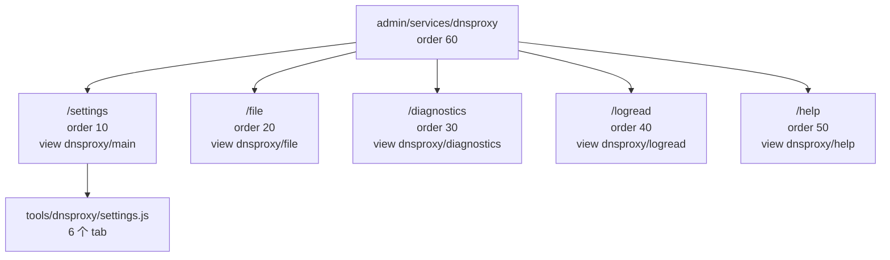
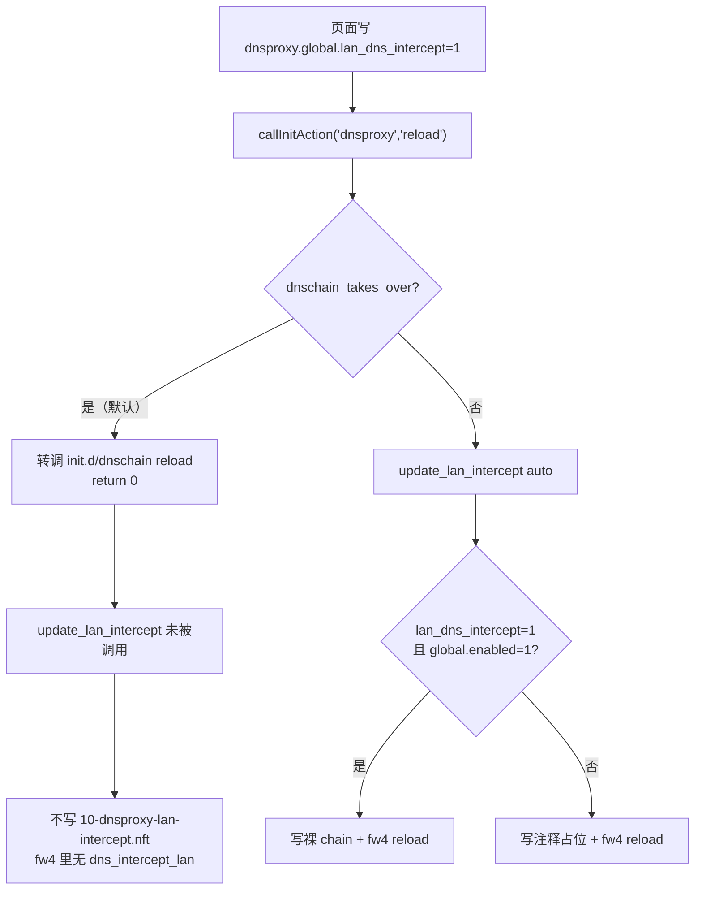

# luci-app-dnsproxy —— DNS Proxy 页面（上游包 + 3 个本地 patch）

`luci-app-dnsproxy` 是「服务 → DNS Proxy」这一组页面：配置 dnsproxy 实例的监听地址/端口、上游、缓存、TLS 服务端、隐私选项与性能参数，并提供状态、诊断、配置原文、日志、帮助五个辅助页。它的**源码不在本仓库**：CI 每次构建都从上游 `adm1n5ky/luci-app-dnsproxy` 全新克隆，本仓库只以三个 patch 的形式记录改动（证据：`.github/workflows/build-openwrt.yml:562-566`、`patches/luci-app-dnsproxy/README.md:5-16`）。

这个包在本固件里的角色比较特殊：**它是 dnsproxy 二进制的「可回退」配置入口，而不是框架启用时的实际配置来源**。框架（dnschain）启用时，dnsproxy 的启动参数由 `/var/etc/dnschain/dnsproxy.args` 与 `dnsproxy-foreign.args` 决定，`init.d/dnsproxy` 直接让位、一个实例都不启动（证据：`files/etc/init.d/dnsproxy:273-287`）。本页面写的 `/etc/config/dnsproxy` 只在框架关闭时才决定行为（证据：`files/etc/config/dnsproxy:6-15`）。

因此读本文件时请始终分清两条链路：

| 框架状态 | dnsproxy 由谁启动 | 本页面的配置是否生效 | 证据 |
|---|---|---|---|
| `dnschain.main.enabled=1`（默认） | `init.d/dnschain` 的两个 procd 实例（`dnsproxy` / `dnsproxy-foreign`） | **不生效**，参数来自 `/var/etc/dnschain/*.args` | `init.d/dnsproxy:280-287`、`init.d/dnschain:407-408` |
| `dnschain.main.enabled=0` | `init.d/dnsproxy` 自己 | 生效 | `init.d/dnsproxy:289-331` |

---

## 1. 一句话定位与包构成

| 项 | 值 | 证据 |
|---|---|---|
| 包名 | `luci-app-dnsproxy` | `build-openwrt.yml:568-569`（clone 到 `package/luci-app-dnsproxy`） |
| 来源 | 上游 `https://github.com/adm1n5ky/luci-app-dnsproxy`，`--depth 1` | `build-openwrt.yml:568-569` |
| 本地改动 | 3 个 patch | `patches/luci-app-dnsproxy/` 下 `0001`/`0002`/`0003` 三个文件 + `README.md` |
| 路由条数 | 6 条（全部由上游 `menu.d` 提供，**仓库内无该文件**） | 见 §2 |
| 二进制来源 | helloworld feed 的 `dnsproxy` 0.83.0（packages feed 的 0.56.2 被删） | `build-openwrt.yml:617-631` |
| init / config | 由 `files/` overlay 提供，**不用上游的** | `files/etc/init.d/dnsproxy`、`files/etc/config/dnsproxy`；`README.md:52-53` |
| 视图文件 | `view/dnsproxy/{main,file,diagnostics,logread,help}.js` + `tools/dnsproxy/settings.js` | `docs/routes.md:82`（路由器实测）；patch 0003 改了这 6 个文件 |
| 页面内 tab | 6 个：`general` / `servers` / `cache` / `tls` / `privacy` / `perf` | `patches/luci-app-dnsproxy/0003-add-zh-cn-localization.patch:9-21` |

三个 patch 的职责（`patches/luci-app-dnsproxy/README.md:20-24`）：

| Patch | 行数 | 职责 | 改的文件 |
|---|---|---|---|
| `0001-add-lan-dns-intercept.patch` | 46 | 新增「拦截所有客户端 DNS」开关；保存后触发 dnsproxy reload | `tools/dnsproxy/settings.js`、`view/dnsproxy/main.js` |
| `0002-fix-version-detect-for-opkg.patch` | 59 | 版本探测兼容 opkg；ACL 加 `/usr/lib/opkg/status` 只读 | `usr/share/rpcd/acl.d/luci-app-dnsproxy.json`、`view/dnsproxy/main.js` |
| `0003-add-zh-cn-localization.patch` | 1179 | 6 个 JS 页面的 `_()` 串直接换成中文 | `settings.js`、`diagnostics.js`、`file.js`、`help.js`、`logread.js`、`main.js` |

---

## 2. 路由表

**仓库内不存在 `luci-app-dnsproxy` 的 `menu.d` 文件**（`package/` 下只有 `luci-app-dnschain` 与 `luci-app-trafficctl` 两个本地包；`patches/luci-app-dnsproxy/` 下只有 3 个 patch 与 1 个 README）。路由由上游包在构建时克隆进来的 `menu.d` 提供，本仓库不改路由表，只通过 patch 往已有页面加控件（`docs/routes.md:69`）。

下表取自 `docs/routes.md:71-78` 的登记（该登记附带路由器实测核对，见 `docs/routes.md:82`）：

| 路由路径 | 菜单标题 | order | action 类型 | 目标 | 声明位置 |
|---|---|---|---|---|---|
| `admin/services/dnsproxy` | DNS Proxy | 60 | `view` | `dnsproxy/main` | 上游 `menu.d`（**仓库内无该文件**） |
| `admin/services/dnsproxy/settings` | Settings | 10 | `view` | `dnsproxy/main` | 同上 |
| `admin/services/dnsproxy/file` | Configuration File | 20 | `view` | `dnsproxy/file` | 同上 |
| `admin/services/dnsproxy/diagnostics` | Diagnostics | 30 | `view` | `dnsproxy/diagnostics` | 同上 |
| `admin/services/dnsproxy/logread` | System Log | 40 | `view` | `dnsproxy/logread` | 同上 |
| `admin/services/dnsproxy/help` | Help | 50 | `view` | `dnsproxy/help` | 同上 |

路由器实测（只读，2026-10-23 快照，记录在 `docs/routes.md:82`）：

- `/usr/share/luci/menu.d/luci-app-dnsproxy.json` 与上表逐字一致；
- `/www/luci-static/resources/view/dnsproxy/` 下有 `main.js`、`file.js`、`diagnostics.js`、`logread.js`、`help.js` 五个视图；
- `/www/luci-static/resources/tools/dnsproxy/settings.js` 一个表单模块。

`order = 60` 与 dnschain 页面的 `order = 20` 同处「服务」菜单，dnschain 的注释记录了完整顺序（证据：`package/luci-app-dnschain/luasrc/controller/dnschain.lua:16-22`：SSR-Plus 10 / DNS 链路 20 / 动态 DNS 59 / **DNS Proxy 60** / 带宽监控 80 / 网络唤醒 90）。



---

## 3. 请求走向

### 3.1 打开设置页（GET）

1. 浏览器请求 `/cgi-bin/luci/admin/services/dnsproxy/settings`。路由来自上游 `menu.d`，本仓库不参与（§2）。
2. 渲染 `view/dnsproxy/main.js`。它 `uci.load('dnsproxy')`、`callServiceStatus('dnsproxy')`、并读包数据库三件事并发（证据：`patches/luci-app-dnsproxy/0002-fix-version-detect-for-opkg.patch:45-57` 的 hunk 上下文，`Promise.all` 里三项）。
3. 包版本探测走 `parseVersion()`：先读 `/lib/apk/db/installed`（OpenWrt 25.x 的 apk 格式），为空则回退 `/usr/lib/opkg/status`（lede / 24.10 的 opkg 格式）（`0002` patch:49-56）。解析失败返回 `null`，页面按「未安装」处理（`0002` patch:24-27、`:43`）。
4. 表单由 `tools/dnsproxy/settings.js` 的 `addSection(m)` 建：一个 `NamedSection 'settings'`，6 个 tab（`0003` patch:9-21），48 个字段（§4）。
5. 每个字段的 `cfgvalue` / `write` 都直接读写 UCI，不经 ubus（`0003` patch:28-406 的 48 组 `uci.get`/`uci.set`）。

### 3.2 保存（POST）

1. 点「保存」→ `handleSave` → 每个字段的 `write()` 调 `uci.set(...)`。
2. 点「保存并应用」→ 本仓库改过的 `handleSaveApply`（`0001` patch:29-43）：

```js
return this.handleSave(ev)
    .then(function () {
        ui.changes.apply(mode == '0')
    })
    .then(function () {
        // ALL_DOH patch: 保存后触发 dnsproxy 服务 reload
        return callInitAction('dnsproxy', 'reload').catch(function (e) {
            ui.addNotification(null, E('p', 'DNS 拦截规则更新失败: ' + e.message))
        })
    })
```

改动前是 `return this.handleSave(ev).then(function () { ui.changes.apply(mode == '0') })`（`0001` patch:30-32 的删除行），保存后**不触发任何服务动作**。

3. `callInitAction('dnsproxy','reload')` 落到 `/etc/init.d/dnsproxy` 的 `service_reload`（`files/etc/init.d/dnsproxy:346-356`）。
4. `service_reload` 第一件事是 `config_load`，第二件事是判 `dnschain_takes_over`（`:347-350`）：

| 框架状态 | `service_reload` 做什么 | 证据 |
|---|---|---|
| 启用 | 转调 `/etc/init.d/dnschain reload`，然后 `return 0` —— **不调用 `update_lan_intercept`** | `init.d/dnsproxy:350-353` |
| 关闭 | `update_lan_intercept auto` | `init.d/dnsproxy:355` |

这条分支是本页面最容易被误解的地方，单独在 §6.1 展开。

### 3.3 五个辅助页

| 页面 | 视图 | 做什么 | 证据 |
|---|---|---|---|
| Configuration File | `dnsproxy/file.js` | 直接把 `/etc/config/dnsproxy` 全文放进 `<textarea>`，保存走 `fs.write(filePath, value)`，**绕过 UCI** | `0003` patch:597-619 |
| Diagnostics | `dnsproxy/diagnostics.js` | 端口 53 占用者判定、dnsproxy 监听套接字表、DNS 查询、路由追踪 | `0003` patch:411-591 |
| System Log | `dnsproxy/logread.js` | 带级别过滤、暂停/继续、跟随的日志查看器 | `0003` patch:977-1029 |
| Help | `dnsproxy/help.js` | 协议说明与官方文档外链 | `0003` patch:626-…（`admin/services/dnsproxy/help` 链接见 `:446`） |
| 状态（在 settings 页顶部） | `main.js` 的 `renderStatus` | 运行状态、版本、启动/重启/停止/启用/禁用五个按钮 | `0003` patch:1057-1158 |

`file.js` 的保存路径**不走 UCI**，这一点写在它自己的说明文案里（`0003` patch:604-605：「直接编辑 /etc/config/dnsproxy。这是唯一的配置来源——直接保存到磁盘，绕过 UCI。」）。这意味着用这个页面改的配置不会被 `uci commit` 标记，也不会触发 `procd_add_reload_trigger "$CONF"` 之外的任何动作（trigger 定义在 `init.d/dnsproxy:358-360`）。

---

## 4. 页面元素 → 后端调用对照

### 4.1 6 个 tab 与 48 个字段

tab 名与显示名（`0003` patch:9-21）：

| tab id | 原英文名 | 中文名 |
|---|---|---|
| `general` | General | 常规 |
| `servers` | Servers | 服务器 |
| `cache` | Cache | 缓存 |
| `tls` | TLS / HTTPS / QUIC | TLS / HTTPS / QUIC（**未翻译**，patch:17 保留原文） |
| `privacy` | Privacy & Security | 隐私与安全 |
| `perf` | Performance | 性能 |

字段清单（字段名 → UCI 键）。「init 消费」一列表示 `files/etc/init.d/dnsproxy` 是否把该键转成命令行参数：

| tab | 字段名 | UCI 键 | init 消费 | 证据（patch 0003 行 / init 行） |
|---|---|---|---|---|
| general | `listen_addr` | `dnsproxy.global.listen_addr` | ✅ `--listen` | `:28` / `:68-73` |
| general | `listen_port` | `dnsproxy.global.listen_port` | ✅ `--port` | `:35` / `:75-79` |
| general | `upstream_mode` | `dnsproxy.global.upstream_mode` | ✅ `--upstream-mode` | `:47` / `:99` |
| general | `ipv6_disabled` | `dnsproxy.global.ipv6_disabled` | ✅ `--ipv6-disabled` | `:55` / `:63` |
| general | `http3` | `dnsproxy.global.http3` | ✅ `--http3` | `:63` / `:61` |
| general | `insecure` | `dnsproxy.global.insecure` | ✅ `--insecure` | `:70` / `:62` |
| general | `verbose` | `dnsproxy.global.verbose` | ✅ `--verbose` | `:76` / `:65` |
| general | `log_file` | `dnsproxy.global.log_file` | ✅ `--output` | `:85` / `:94` |
| **general** | **`lan_dns_intercept`** | **`dnsproxy.global.lan_dns_intercept`** | ✅ 只被 `update_lan_intercept` 读（不是命令行参数） | `:97` / `:202` |
| servers | `upstream` | `dnsproxy.servers.upstream` | ✅ `--upstream` | `:106` / `:88-90` |
| servers | `bootstrap` | `dnsproxy.servers.bootstrap` | ✅ `--bootstrap` | `:114` / `:88-90` |
| servers | `fallback` | `dnsproxy.servers.fallback` | ✅ `--fallback` | `:122` / `:88-90` |
| cache | `cache_enabled` | `dnsproxy.cache.enabled` | ✅ `--cache` | `:129` / `:101-102` |
| cache | `cache_optimistic` | `dnsproxy.cache.cache_optimistic` | ✅ `--cache-optimistic` | `:137` / `:103` |
| cache | `cache_size` | `dnsproxy.cache.size` | ✅ `--cache-size` | `:143` / `:104` |
| cache | `cache_min_ttl` | `dnsproxy.cache.min_ttl` | ✅ `--cache-min-ttl` | `:151` / `:105` |
| cache | `cache_max_ttl` | `dnsproxy.cache.max_ttl` | ✅ `--cache-max-ttl` | `:157` / `:106` |
| cache | `optimistic_answer_ttl` | `dnsproxy.cache.optimistic_answer_ttl` | ❌ | `:166` / 无 |
| cache | `optimistic_max_age` | `dnsproxy.cache.optimistic_max_age` | ❌ | `:174` / 无 |
| tls | `tls_enabled` | `dnsproxy.tls.enabled` | ✅ 决定是否加 TLS 参数 | `:183` / `:119` |
| tls | `tls_crt` | `dnsproxy.tls.tls_crt` | ✅ `--tls-crt` | `:191` / `:120` |
| tls | `tls_key` | `dnsproxy.tls.tls_key` | ✅ `--tls-key` | `:199` / `:121` |
| tls | `tls_port` | `dnsproxy.tls.tls_port` | ✅ `--tls-port` | `:205` / `:123` |
| tls | `https_port` | `dnsproxy.tls.https_port` | ✅ `--https-port` | `:211` / `:122` |
| tls | `quic_port` | `dnsproxy.tls.quic_port` | ✅ `--quic-port` | `:217` / `:124` |
| tls | `https_server_name` | `dnsproxy.tls.https_server_name` | ❌ | `:225` / 无 |
| tls | `https_userinfo` | `dnsproxy.tls.https_userinfo` | ❌ | `:233` / 无 |
| tls | `tls_min_version` | `dnsproxy.tls.tls_min_version` | ❌ | `:242` / 无 |
| tls | `tls_max_version` | `dnsproxy.tls.tls_max_version` | ❌ | `:251` / 无 |
| privacy | `edns_enabled` | `dnsproxy.edns.enabled` | ✅ `--edns` | `:260` / `:114-115` |
| privacy | `edns_addr` | `dnsproxy.edns.edns_addr` | ✅ `--edns-addr` | `:268` / `:116` |
| privacy | `bogus_nxdomain` | `dnsproxy.bogus_nxdomain.ip_addr` | ✅ `--bogus-nxdomain` | `:277` / `:81` |
| privacy | `private_rdns_enabled` | `dnsproxy.private_rdns.enabled` | ✅ `--use-private-rdns` | `:286` / `:83-86` |
| privacy | `private_rdns_upstream` | `dnsproxy.private_rdns.upstream` | ✅ `--private-rdns-upstream` | `:293` / `:85` |
| privacy | `private_subnets` | `dnsproxy.private_rdns.private_subnets` | ❌ | `:301` / 无 |
| privacy | `dns64_enabled` | `dnsproxy.dns64.enabled` | ✅ `--dns64` | `:309` / `:109-110` |
| privacy | `dns64_prefix` | `dnsproxy.dns64.dns64_prefix` | ✅ `--dns64-prefix` | `:317` / `:111` |
| privacy | `hosts_enabled` | `dnsproxy.hosts.enabled` | ✅ `--hosts-file-enabled` | `:325` / `:308-311` |
| privacy | `hosts_files` | `dnsproxy.hosts.hosts_files` | ✅ `--hosts-files` | `:331` / `:310` |
| perf | `timeout` | `dnsproxy.global.timeout` | ✅ `--timeout` | `:340` / `:97` |
| perf | `rate_limit` | `dnsproxy.global.rate_limit` | ✅ `--ratelimit` | `:348` / `:96` |
| perf | `ratelimit_subnet_len_ipv4` | `dnsproxy.global.ratelimit_subnet_len_ipv4` | ❌ | `:357` / 无 |
| perf | `ratelimit_subnet_len_ipv6` | `dnsproxy.global.ratelimit_subnet_len_ipv6` | ❌ | `:364` / 无 |
| perf | `udp_buf_size` | `dnsproxy.global.udp_buf_size` | ✅ `--udp-buf-size` | `:372` / `:98` |
| perf | `max_go_routines` | `dnsproxy.global.max_go_routines` | ✅ `--max-go-routines` | `:380` / `:95` |
| perf | `refuse_any` | `dnsproxy.global.refuse_any` | ✅ `--refuse-any` | `:388` / `:64` |
| perf | `pending_requests_enabled` | `dnsproxy.global.pending_requests_enabled` | ❌ | `:397` / 无 |
| perf | `pprof` | `dnsproxy.global.pprof` | ❌ | `:405` / 无 |

合计 48 个字段，其中 **37 个被 init 消费、11 个不被消费**（`optimistic_answer_ttl`、`optimistic_max_age`、`https_server_name`、`https_userinfo`、`tls_min_version`、`tls_max_version`、`private_subnets`、`ratelimit_subnet_len_ipv4`、`ratelimit_subnet_len_ipv6`、`pending_requests_enabled`、`pprof`）。这 11 个键在页面能改、能存进 UCI，但 `init.d/dnsproxy` 的 `load_config_arg` / `load_config_list` / `load_config_param`（`:60-126`）没有任何一处读取它们，因此**不会进 dnsproxy 的命令行**。注意这只在框架关闭时有意义 —— 框架启用时整个 `init.d/dnsproxy` 都不跑（§3.2）。

### 4.2 状态区的五个服务控制按钮

`main.js` 的 `renderStatus` 生成五个按钮，点击都走 `makeActionHandler(action)` → `callInitAction('dnsproxy', action)`（`0003` patch:1055 显示 `restart` 分支、`:1106-1148` 是五个按钮的文本）：

| 按钮（中文） | action | 禁用条件 | 证据 |
|---|---|---|---|
| 启动 | `start` | `!enabled \|\| running \|\| notInstalled` | `0003` patch:1106-1112 |
| 重启 | `restart` | `!running \|\| notInstalled` | `:1115-1121` |
| 停止 | `stop` | `!running \|\| notInstalled` | `:1124-1130` |
| 启用 | `enable` | `enabled \|\| notInstalled` | `:1133-1139` |
| 禁用 | `disable` | `!enabled \|\| notInstalled` | `:1142-1148` |

`notInstalled` 来自 §3.1 的版本探测。这就是 patch 0002 存在的原因：`parseVersion` 只认 apk 格式时，opkg 固件上版本恒为 `null` → `notInstalled = true` → **五个按钮全灰**（`patches/luci-app-dnsproxy/README.md:23` 与 `AGENTS.md` §8「固件内 `/etc/init.d/dnsproxy` 无法执行、LuCI 服务控制全灰」）。

---

## 5. 后端接口清单

### 5.1 `/etc/init.d/dnsproxy`（procd）

`files/etc/init.d/dnsproxy`，360 行，`USE_PROCD=1`、`START=90`（`:17-18`）。

| 函数 | 行号 | 职责 |
|---|---|---|
| `is_enabled` / `is_empty` / `append_param*` / `load_config_arg` / `load_config_list` / `load_config_param` | `:26-126` | 把 UCI 拼成 dnsproxy 命令行 |
| `get_lan_device` | `:130-135` | 解析 LAN 设备名：`network.lan.device` → 回退 `network.lan.ifname` → 回退 `br-lan` |
| `fw_backend` | `:140-146` | `command -v nft` 有则 `nft`，否则 `ipt` |
| `update_lan_intercept_ipt` | `:157-189` | fw3 后端：写 `/etc/firewall.user` 的标记段 + 立即 `iptables/ip6tables -A` |
| `update_lan_intercept` | `:199-256` | 按 UCI 状态同步拦截规则并触发防火墙重载 |
| `dnschain_takes_over` | `:273-275` | `[ "$(uci -q get dnschain.main.enabled)" = "1" ]` |
| `start_service` | `:277-331` | 先判让位，再起实例，最后 `update_lan_intercept auto` |
| `stop_service` | `:333-341` | 让位则直接 `return 0`；否则 `update_lan_intercept off` |
| `service_reload` | `:346-356` | 让位则转调 dnschain reload；否则 `update_lan_intercept auto` |
| `service_triggers` | `:358-360` | `procd_add_reload_trigger "$CONF"` |

procd 实例参数（`:300-327`）：`user dnsproxy`、`procd_add_jail dnsproxy ronly log`、`capabilities "/etc/capabilities/dnsproxy.json"`、挂载 `/etc/hosts`、CA 证书、`log_file`（rw）、`tls_crt`、`tls_key`、`hosts_files`。

### 5.2 让位逻辑（关键）

```sh
dnschain_takes_over() {
	[ "$(uci -q get dnschain.main.enabled 2>/dev/null)" = "1" ]
}
```

（`init.d/dnsproxy:273-275`）

判据是**配置意图**而不是进程状态 —— 注释 `:270-272` 写明理由：开机时序下 procd 尚未拉起进程时用 `pgrep` 会误判（对应 `AGENTS.md` §8「开机时 LAN DNS 拦截规则不生成」）。

三个入口的让位行为：

| 入口 | 让位时 | 证据 |
|---|---|---|
| `start_service` | 打印一行说明，`return 0` —— **不建 procd 实例、不调 `update_lan_intercept`** | `:280-287` |
| `stop_service` | `config_load` 后直接 `return 0` —— **不调 `update_lan_intercept off`** | `:335-338` |
| `service_reload` | 转调 `/etc/init.d/dnschain reload`，`return 0` | `:347-353` |

### 5.3 LAN DNS 拦截的两条实现路径

`update_lan_intercept` 的决策表（`:199-209`）：

| 输入 | 取值 | 结果 |
|---|---|---|
| `mode`（调用方传参） | `auto` / `off` | `off` 时无条件关 |
| `lan_dns_intercept` | `config_get_bool global lan_dns_intercept 1`（默认 1） | 必须为 1 |
| `global.enabled` | `is_enabled global enabled` | 必须为 1 |
| `enable_intercept` | 三者同时满足才为 1 | 决定写规则还是写占位 |

**fw4 / nftables 路径**（`:211-247`）：

1. `mkdir -p /etc/nftables.d`（`:214`）。
2. 开启时写 `/etc/nftables.d/10-dnsproxy-lan-intercept.nft`（路径常量在 `:24`），内容是**裸 chain**（`:222-231`）：

```
chain dns_intercept_lan {
	type nat hook prerouting priority dstnat + 1; policy accept;
	iifname "$dev" udp dport 53 redirect to :53 comment "!alldoh: intercept LAN UDP DNS (v4/v6)"
	iifname "$dev" tcp dport 53 redirect to :53 comment "!alldoh: intercept LAN TCP DNS (v4/v6)"
}
```

3. 关闭时**不删文件**，写成一行注释占位（`:232-240`）。理由写在 `:233-236`：fw4 对 `/etc/nftables.d/*.nft` 用 glob include，目录为空会导致 include 无匹配、`fw4 reload` 失败。
4. 最后触发 `fw4 reload`：`/etc/init.d/firewall reload`，不存在则 `fw4 reload`（`:242-247`）。

**fw3 / iptables 路径**（`:157-189`、`:248-255`）：

1. 先 `sed -i` 删掉 `/etc/firewall.user` 里 `# === ALL_DOH LAN DNS 拦截 BEGIN/END ===` 之间的旧段，再 `iptables -t nat -F prerouting_rule`（`:165-166`）。
2. 开启时把四条规则写进 `/etc/firewall.user`（`:172-182`）：v4 进 `prerouting_rule` 用户链，v6 进 `PREROUTING` 主链，UDP/TCP 53 都 REDIRECT 到 53。
3. 同时立即执行四条 `-A`（`:184-187`），不触发 `firewall restart`，避免清掉 SSR-Plus 规则（理由见 `:150-156`）。

`priority dstnat + 1` 的选择理由写在 `:219-221`：与 fw4 的 dstnat(-100) 同 hook 不同优先级，不冲突；fw4 每次 reload 先 flush 再重建，所以该链天然幂等。

### 5.4 运行时产物

| 产物 | 写入者 | 内容 | 证据 |
|---|---|---|---|
| `/etc/nftables.d/10-dnsproxy-lan-intercept.nft` | `update_lan_intercept`（仅 fw4 后端 + 拦截开启） | 裸 chain `dns_intercept_lan` | `init.d/dnsproxy:24`、`:222-231` |
| `/etc/firewall.user` 的 ALL_DOH 标记段 | `update_lan_intercept_ipt`（仅 fw3 后端） | 四条 REDIRECT | `init.d/dnsproxy:161-182` |
| dnsproxy 命令行 | `start_service` 拼装 | 见 §4.1 的 37 个消费项 | `init.d/dnsproxy:300-327` |

---

## 6. 已知不一致 / 陷阱

### 6.1 框架启用时，「拦截所有客户端 DNS」开关不产生任何 nft 规则

这是本页面最需要说清楚的一条，因为它表现为「页面开关看起来在、实际没规则」。

因果链：

1. 页面把 `lan_dns_intercept` 写进 UCI（`0001` patch:16-17）。
2. 保存并应用后 `callInitAction('dnsproxy','reload')`（`0001` patch:40）。
3. `service_reload` 判 `dnschain_takes_over` 为真 → 转调 `/etc/init.d/dnschain reload` 并 `return 0`（`init.d/dnsproxy:350-353`）。
4. 于是 `update_lan_intercept`（`:199-256`）**根本没有被调用** —— 无论开关是 0 还是 1。
5. `start_service` 同样在 `:280-287` 就 `return 0`，也在 `update_lan_intercept auto`（`:330`）之前。

结论：`dnsproxy.global.lan_dns_intercept` 在框架启用时是一个**无消费者开关**。它是 1 还是 0，都不影响任何 nft 规则。

代码注释里对这一点有两处不准确的表述：

| 位置 | 说法 | 与代码的差异 |
|---|---|---|
| `init.d/dnsproxy:283-286` | 「**不**在这里调用 `update_lan_intercept off` —— LAN 拦截规则由**框架自己的 fw4 片段**与 dnsproxy 的 nft 片段共同维护，框架启用时保留已有规则」 | 框架自己只写一个 fw4 片段 `15-dnschain-reject-dot.nft`（`init.d/dnschain:38`），其内容只 reject LAN 出向 853（`:250-254`），**不含任何 53 拦截**。所以「框架自己的片段维护 LAN 拦截」在代码里不成立 |
| `files/etc/config/dnsproxy:26` | 「LAN DNS 强制拦截（框架启用时也保留，**作为 dnsproxy 侧的兜底片段**）」 | 框架启用时该片段根本不会被生成 —— 生成它的唯一代码路径在 `update_lan_intercept` 里，而那条路径被让位逻辑跳过了 |

还有一处主动维持：收敛器每次都强制把 `dnsproxy.global.lan_dns_intercept` 写回 `1`（`files/usr/bin/dnschain-reconcile:142-143`，`reconcile_key "dnsproxy.global.lan_dns_intercept" "1" "LAN DNS 强制拦截"`）。也就是说框架会**持续把一个不生效的开关保持在 ON**，页面显示「已开启」，而 `nft list table inet fw4` 里没有对应链。

路由器实测快照（2026-10-23）与此一致：

- `/etc/nftables.d/` 下只有 `10-custom-filter-chains.nft`、`15-dnschain-reject-dot.nft`、`README`，**没有** `10-dnsproxy-lan-intercept.nft`；
- `nft list table inet fw4` 里只有 `chain dnschain_reject_dot`，**没有** `dns_intercept_lan`。



框架启用时客户机 DNS 仍然能工作，靠的是另一条路径：dnsmasq 直接监听在 LAN 地址的 `:53` 上，客户机无需经过 nft 劫持就能问到。这一点在自检脚本的注释里写明了（`files/usr/bin/dnschain-selftest:107-115`：「早先检查 `nft chain inet fw4 dns_intercept_lan`，但实测该链**从来不存在**，而客户机 DNS 完全正常」）。

### 6.2 其余可用行号证明的不一致

| # | 现象 | 证据 |
|---|---|---|
| 1 | patch 0001 的中文说明写「保存后触发 dnsproxy 服务 reload，重新评估 nftables 拦截规则（ON → 写入…；OFF → 删除并 fw4 reload）」，但让位时 reload 被转走，重新评估不会发生 | `0001` patch:38-39 vs `init.d/dnsproxy:350-353` |
| 2 | patch 0003 把该字段的描述改成「由 dnsproxy init 自动管理（fw3 用 iptables、fw4 用 nftables）」—— 机制描述正确，但仍未提及「框架启用时无效」 | `0003` patch:95 |
| 3 | patch 0003 把英文括注 `（Intercept all client DNS）` 从字段标题里删掉了，同一行还改了说明文案 | `0003` patch:90-95 |
| 4 | `tls` tab 的名字 `TLS / HTTPS / QUIC` **没有被翻译**，而同一批改动把其余 5 个 tab 名都换成了中文 | `0003` patch:14-21（`s.tab('tls', _('TLS / HTTPS / QUIC'));` 是上下文行，未出现在 `+`/`-` 里） |
| 5 | 11 个字段的 UCI 键不被 `init.d/dnsproxy` 读取（§4.1 表里标 ❌ 的行）：页面能改、能存，不进命令行 | `init.d/dnsproxy:60-126` 全部读取点 vs `0003` patch 对应 `cfgvalue` 行 |
| 6 | `file.js` 的保存路径**绕过 UCI**，与 settings 页的 `uci.set` 是两套写入方式，两者对同一文件写入时无同步机制 | `0003` patch:604-605（文案）、`:611`（`fs.write`）vs `0003` patch:28-406（`uci.set`） |
| 7 | patch 0002 给 ACL 加的只有 `/usr/lib/opkg/status` 只读，而代码还会读 `/lib/apk/db/installed`；后者是上游 ACL 原有的（patch 上下文可见），两者必须同时存在才能覆盖 apk 与 opkg 两种固件 | `0002` patch:5-12（上下文含 `/lib/apk/db/installed`，新增行是 `/usr/lib/opkg/status`） |
| 8 | `files/etc/config/dnsproxy` 的 `cache.enabled '0'`、无 `fallback`、`ipv6_disabled '0'` 三条被 CI 硬断言，但它们只在框架关闭时才影响行为 | 断言 `build-openwrt.yml:1253-1283`；生效条件 `init.d/dnsproxy:289-331` |
| 9 | `files/etc/capabilities/dnsproxy.json` 只授予 `CAP_NET_BIND_SERVICE`（5 个集合各一项），而 dnsproxy 在框架关闭时默认监听 `127.0.0.1:5353`（非低端口），该能力仅在把 `listen_port` 改成 53 时才需要 | `files/etc/capabilities/dnsproxy.json:1-17`；`init.d/dnsproxy:319`；`files/etc/config/dnsproxy:25` |
| 10 | `stop_service` 的让位分支（`:338`）在 `config_load` 之后，而 `start_service` 的让位分支（`:280`）在 `config_load` 之后、`is_enabled` 之前 —— 两处顺序一致，但都意味着让位时 `global.enabled` 未被检查，即「框架启用 + dnsproxy 自身禁用」与「框架启用 + dnsproxy 自身启用」行为完全相同 | `init.d/dnsproxy:277-293`、`:333-341` |

---

## 7. 依赖、构建与打包

### 7.1 CI 如何取包并打 patch

| 步骤 | 做什么 | 证据 |
|---|---|---|
| clone 上游 | `git clone --depth 1 https://github.com/adm1n5ky/luci-app-dnsproxy.git package/luci-app-dnsproxy` | `build-openwrt.yml:568-569` |
| 断言 patch 存在 | `ls ../openwrt-build/patches/luci-app-dnsproxy/*.patch` 失败即 `exit 1` | `build-openwrt.yml:571-575` |
| 逐个应用 | 循环里先 `git apply --check`（失败 `exit 1`），再 `git apply`，每次打印绝对路径 | `build-openwrt.yml:577-588` |
| 回显改动 | `git -C package/luci-app-dnsproxy diff --stat` + `diff \| head -80` | `build-openwrt.yml:590-593` |

patch 应用时必须**先转绝对路径**：在 `(cd package/... )` 子 shell 内相对路径会失效（注释 `build-openwrt.yml:577-578`）。禁止 `|| true`（注释 `:565`，对应 `AGENTS.md` 红线 2、3）。

幂等性来自「每次全新克隆」，不是来自 patch 本身可重复应用 —— `README.md:33-34` 写明了这一点。

### 7.2 二进制来源与 feed 对齐

| 步骤 | 做什么 | 证据 |
|---|---|---|
| 删旧版 | `rm -rf package/feeds/packages/dnsproxy`（packages feed 是 0.56.2） | `build-openwrt.yml:625-626` |
| 重建软链 | `ln -sfn ../../../feeds/helloworld/dnsproxy package/feeds/helloworld/dnsproxy` | `build-openwrt.yml:628` |
| 核对 | `ls -l` 软链 + `head -12 Makefile \| grep PKG_NAME\|PKG_VERSION` | `build-openwrt.yml:630-631` |

包名冲突会让构建二义性（注释 `:620-624`）。最终生效的是 helloworld 的 0.83.0，而 **init/config 来自 `files/` overlay**（注释 `:624`、`README.md:52-53`）。

### 7.3 编译开关与执行位

| 项 | 值 | 证据 |
|---|---|---|
| `CONFIG_PACKAGE_dnsproxy` | `=y` | `build-openwrt.yml:717` |
| `CONFIG_PACKAGE_luci-app-dnsproxy` | `=y` | `build-openwrt.yml:718` |
| 执行位 | `chmod +x files/etc/init.d/dnsproxy` | `build-openwrt.yml:979` |
| 行尾 | `**/etc/init.d/dnsproxy text eol=lf` | `.gitattributes:49` |

### 7.4 与 dnsproxy 相关的 CI 契约断言

集中在 `Verify dnschain framework contracts` 步骤（`build-openwrt.yml:1035-1350`）：

| 断言 | 判据 | 证据 |
|---|---|---|
| `dnsproxy cache.enabled=0` | `awk` 取 `config dnsproxy 'cache'` 段后第一处 `option enabled`，必须含 `'0'` | `build-openwrt.yml:1259-1265` |
| 无 `list fallback` | 剥注释后 `grep -E "^[[:space:]]*list fallback"` 必须无命中 | `build-openwrt.yml:1266-1272` |
| `ipv6_disabled=0` | `grep -qE "option ipv6_disabled '0'"` | `build-openwrt.yml:1273-1279` |
| 让位逻辑存在 | `grep -q 'dnschain_takes_over' files/etc/init.d/dnsproxy` | `build-openwrt.yml:1321-1328` |
| 库脚本不得生成 `--cache` / `--fallback` / `--ipv6-disabled` | 对 `files/usr/share/dnschain/dnschain.sh` 剥注释后 grep | `build-openwrt.yml:1130-1145` |

**仓库内没有专门校验 dnsproxy patch 的脚本。** `tools/` 下的 `verify-dnschain-domains.sh` 只覆盖 dnschain（对 `dnsproxy` 的唯一命中是 `:480` 的一句注释），`verify-firmware-artifact.sh` 只列 dnschain 条目（`:135-159`）。patch 是否可应用完全靠构建时的 `git apply --check`（`build-openwrt.yml:582-585`）。

---

## 8. 验证方法

本仓库没有 dnsproxy 的本地校验脚本（§7.4）。可用的验证手段分三类。

### 8.1 静态：在干净克隆上验 patch 可应用

按 `patches/luci-app-dnsproxy/README.md:37-48` 的流程：

```sh
git clone https://github.com/adm1n5ky/luci-app-dnsproxy.git /tmp/upstream
git -C /tmp/upstream apply --check \
  "$PWD/patches/luci-app-dnsproxy/0001-add-lan-dns-intercept.patch"
git -C /tmp/upstream apply --check \
  "$PWD/patches/luci-app-dnsproxy/0002-fix-version-detect-for-opkg.patch"
git -C /tmp/upstream apply --check \
  "$PWD/patches/luci-app-dnsproxy/0003-add-zh-cn-localization.patch"
```

必须按 `0001` → `0002` → `0003` 顺序应用：`0002` 的 hunk 上下文基于 `0001` 应用后的内容（`0002` patch:14 的 index 行是 `f17c585..9a30ccc`，而 `0001` patch:23 的输出 index 是 `f17c585`），`0003` 又基于 `0002` 的结果（`0003` patch:2 的 index 是 `7f221d2..86c1396`，`0001` 的输出是 `7f221d2`）。

### 8.2 构建期：CI 的断言

`Verify dnschain framework contracts` 步骤里的 §7.4 五条断言会拦住「配置被改回旧值」这类回退。它们都是显式 `exit 1`（`build-openwrt.yml:1344-1348`）。

### 8.3 运行时：判断开关到底有没有生效

框架启用时（默认），**唯一可靠的判据是看 nft 里有没有链**，不能看页面开关、也不能看 UCI 值：

```sh
# 1. 框架是否在托管
uci -q get dnschain.main.enabled            # 1 = 框架托管，本页配置不生效

# 2. 拦截链是否存在（框架启用时预期：不存在）
nft list table inet fw4 2>/dev/null | grep -c dns_intercept_lan
ls -l /etc/nftables.d/

# 3. UCI 值（框架会持续把它写回 1，不代表规则存在）
uci -q get dnsproxy.global.lan_dns_intercept

# 4. dnsproxy 实例由谁托管
ps w | grep -c '[d]nsproxy'
cat /var/etc/dnschain/dnsproxy.args 2>/dev/null
```

判读时注意：`/etc/nftables.d/10-dnsproxy-lan-intercept.nft` **不存在**是框架启用时的**预期状态**，不是故障。真正的故障是「`dnschain.main.enabled=0` 且 `lan_dns_intercept=1` 且该文件不存在」。

---

## 9. 相关文档

| 文档 | 内容 |
|---|---|
| `docs/routes.md` | 全仓库路由总表；dnsproxy 的 6 条在 §1.3 |
| `patches/luci-app-dnsproxy/README.md` | patch 维护规范、更新流程、18 条验收清单 |
| `docs/packages/luci-app-dnschain.md` | 框架页面；框架启用时 dnsproxy 的实际参数来源在那里 |
| `docs/runtime/dns-chain.md` | 两个 dnsproxy 实例的参数与分流片段 |
| `docs/runtime/overlay-inventory.md` | `files/etc/init.d/dnsproxy`、`files/etc/config/dnsproxy` 的角色 |
| `docs/adr/0003-dns-chain-framework.md` | §13.1「dnschain 直接 procd 托管」的决策 |
| `AGENTS.md` | 红线 2（禁改上游）、红线 3（禁静默失败）、§4.0 硬约束 8（让位逻辑必须保留） |
