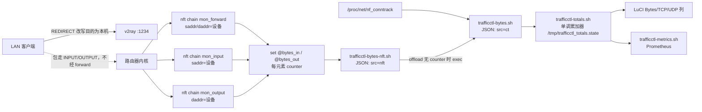
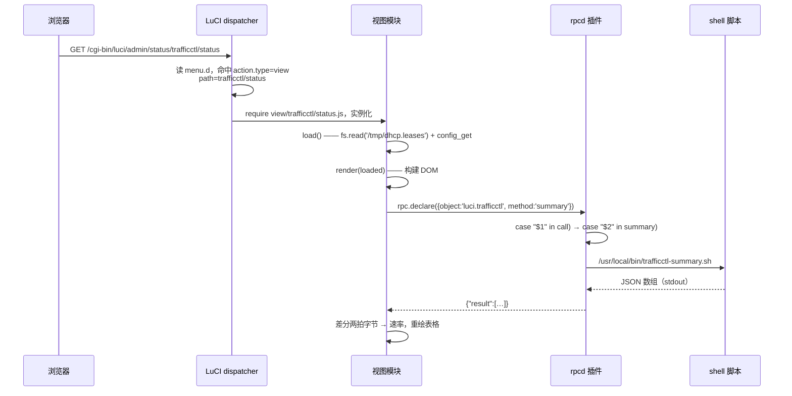
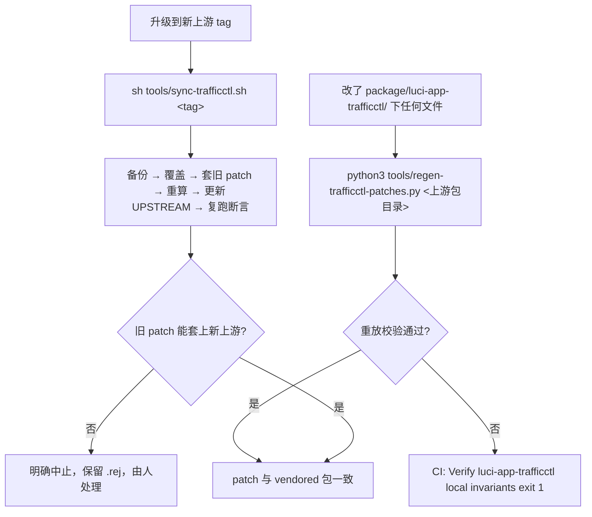

# luci-app-trafficctl —— 流量控制页

本包提供 LuCI 里的「Traffic Control」：按设备看实时速率与累计字节、封禁/解封上网、限速（policer）与整形（tc/HTB）、WiFi MAC 黑名单、全局断网、端口转发入向管控，以及一个 Prometheus 指标端点。

包体是上游 `YusDyr/luci-app-trafficctl` **v1.21.4 的 vendored 副本**（证据：`patches/luci-app-trafficctl/UPSTREAM:1`、`package/luci-app-trafficctl/Makefile:4`），本仓库相对上游的改动固化在 6 个 patch 里（见 §9）。CI 直接 `cp -r` 整个包目录，patch **不参与构建**（证据：`.github/workflows/build-openwrt.yml:161-164`）。

---

## 1. 一句话定位，以及为什么字节计数必须挂三个钩子

它是「谁在用带宽、怎么限住他」的运维面板：前端 4 个视图 + 1 个共用模块，后端 1 个 rpcd 插件（ubus 对象 `luci.trafficctl`，34 个方法），落到 23 个 shell 脚本。

**与 SSR-Plus 的关系决定了它的计数实现**。本固件的透明代理用 REDIRECT 把客户端连接引到路由器本机的 v2ray（`:1234`），目的地址被改写为本机 → 客户端流量因此走 **INPUT/OUTPUT**，**不经 forward**。任何只挂在 forward 链上的「每设备流量」实现都会几乎看不到流量。

实测对照（客户端下载 150 MB，证据：`patches/luci-app-trafficctl/README.md:53-57`，同一组数字复述在 `package/luci-app-trafficctl/root/usr/local/bin/trafficctl-bytes-nft.sh:42-45`）：

| 钩子 | 匹配方向 | 计数 |
|---|---|---|
| `forward` | `saddr=客户端` | 5932 B（几乎为零） |
| `output` | `daddr=客户端` | 157548502 B（完整捕获） |
| `input` | `saddr=客户端` | 1360391 B（客户端小请求） |

所以本仓库重写的 `trafficctl-bytes-nft.sh` 同时挂 `mon_forward` / `mon_input` / `mon_output` 三个钩子，并说明三者对同一数据包互斥、不会重复计数（证据：`package/luci-app-trafficctl/root/usr/local/bin/trafficctl-bytes-nft.sh:39-48`）；CI 断言这三个钩子齐备（证据：`tools/verify-trafficctl-invariants.sh:113-117`）。

同一条链路上还有第二个后果：`output` 钩子会看到路由器自身对 WAN 的连接，只用 `oifname br-lan` 限定仍会把 `1.2.4.8`、`10.x` 等地址写进集合，故必须再用 `@lan` 集合限定地址归属（证据：`trafficctl-bytes-nft.sh:50-54`；断言在 `tools/verify-trafficctl-invariants.sh:118-121`）。



字节来源的选择逻辑在 `trafficctl-bytes.sh`：`offload` 模式为 `none` 或 `*-counter` 时走 conntrack，否则 `exec` 到 nft 版本；只有「无 counter 标志的卸载」才会得到 `degraded:true`（证据：`package/luci-app-trafficctl/root/usr/local/bin/trafficctl-bytes.sh:33-59`）。`degraded` 在累加器里是**粘性**的 —— 一次被污染的样本会让该设备的累计值终身标为下界（证据：`package/luci-app-trafficctl/root/usr/local/bin/trafficctl-totals.sh:46-53`）。

---

## 2. 路由表与请求走向

### 2.1 五条路由（全部在同一个 menu.d 文件里）

| 路径 | title | order | action | 声明行 |
|---|---|---|---|---|
| `admin/status/trafficctl` | `Traffic Control` | 80 | `alias` → `admin/status/trafficctl/status` | `package/luci-app-trafficctl/root/usr/share/luci/menu.d/luci-app-trafficctl.json:2-12` |
| `admin/status/trafficctl/status` | `Devices` | 1 | `view` → `trafficctl/status` | 同上 `:14-24` |
| `admin/status/trafficctl/settings` | `Settings` | 2 | `view` → `trafficctl/settings` | 同上 `:26-36` |
| `admin/status/trafficctl/portfw` | `Port Forwards` | 3 | `view` → `trafficctl/portfw` | 同上 `:38-48` |
| `admin/status/trafficctl/host/*` | **无 `title`** | 4 | `view` → `trafficctl/host` | 同上 `:50-59` |

五条都带 `depends.acl: ["luci-app-trafficctl"]`（证据：同上 `:9-11`、`:21-23`、`:33-35`、`:45-47`、`:56-58`）。

`host/*` 的两个特殊之处，都是路由器上的实测结论：

- 因为路径以 `*` 结尾，路由器生成的 `luci-indexcache` 节点上带的是 **`wildcardaction`** 而不是 `action`（证据：`docs/routes.md:115-124`，其中 `dispatcher.uc:407-410` 是判定依据）。
- 因为**没有 `title`**，LuCI 前端 `ui.menu.getChildren` 会跳过该节点（判定依据是路由器 `/www/luci-static/resources/ui.js` 内 `getChildren` 的 `if(!node.children[k].hasOwnProperty('title')) continue`，证据：`docs/routes.md:125`）。净效果是：该页**可直达、可收藏、可后退，但不进侧边栏**。代码里两处注释明确写了这个意图（证据：`package/luci-app-trafficctl/htdocs/luci-static/resources/view/trafficctl/status.js:184-186`、`htdocs/luci-static/resources/view/trafficctl/host.js:22-23`），patch 文档也把它列为「同步上游时最容易被抹掉」的要点之一（证据：`patches/luci-app-trafficctl/README.md:114-115`）。

### 2.2 一次点击的完整走向



逐层对应的代码位置：

| 层 | 位置 | 说明 |
|---|---|---|
| 菜单声明 | `root/usr/share/luci/menu.d/luci-app-trafficctl.json:14-24` | `action.type=view`，`path=trafficctl/status` |
| 视图模块 | `htdocs/luci-static/resources/view/trafficctl/status.js:1883` | `return view.extend({…})` |
| 生命周期 | `status.js:1916`（`load`）、`status.js:1928`（`render`） | `load` 返回 `Promise.all([fs.read, config_get])` |
| rpc 声明 | `htdocs/luci-static/resources/trafficctl/common.js:40-45` | `decl(method, params, expect)` 统一构造 `{object:'luci.trafficctl', method}` |
| 具体方法 | `common.js:231` | `trafficctl: decl('summary', null, { result: [] })` |
| rpcd 入口 | `root/usr/libexec/rpcd/luci.trafficctl:35-78`（`list)`）、`:79-546`（`call)`） | `call)` 内 `case "$2"` 分派 |
| 分派分支 | `root/usr/libexec/rpcd/luci.trafficctl:81-85` | `summary)` → 打印 `{"result":` + 脚本输出 + `}` |
| 脚本 | `root/usr/local/bin/trafficctl-summary.sh` | 输出 JSON 数组 |

`load`/`render` 的返回值形态很重要：`load` 必须返回 promise，`render(loaded)` 的入参就是它的结果；`status.js` 用 `Promise.all` 把租约文件与路由端配置一起取回，理由是「Poll/Window 的默认值必须在首帧渲染前就知道」，并且 `config_get` **允许失败**（`siteDefaults` 有内置值兜底）（证据：`status.js:1916-1926`、`status.js:1931-1943`）。

---

## 3. 视图 ↔ ubus 方法对照

4 个视图 + 1 个共用模块。`status.js` 的 rpc 声明全部来自 `common.js`（用别名接回原名，正文调用点不变，证据：`status.js:59-89`）；`host.js` 与 `portfw.js` **各自直接** `rpc.declare`（证据：`host.js:49-60`、`portfw.js:17-27`），这是与 `common.js` 收敛策略不一致的一处（见 §10）。

| 视图 | 方法 | 用途 | 视图行号 | rpcd 分派行号 | 脚本 |
|---|---|---|---|---|---|
| `status.js` | `summary` | 全设备汇总表 | `3744` | `81` | `trafficctl-summary.sh:83` |
| `status.js` | `device` | 单设备详情 + 连接表 | `3301` | `86` | `trafficctl-device.sh:94-95` |
| `status.js` | `bytes` | 字节样本（差分算速率） | `3061` | `99` | `trafficctl-totals.sh:111` |
| `status.js` | `ifaces` | 每接口字节（上联概览图） | `2970` | `114` | `trafficctl-ifaces.sh:116` |
| `status.js` | `block` / `unblock` | 封禁/解封上网 | `3846` | `119` / `129` | `trafficctl-block.sh:126` / `trafficctl-unblock.sh:136` |
| `status.js` | `macfilter_add` / `macfilter_remove` | WiFi MAC 黑名单 | `3818` | `139` / `148` | `trafficctl-macfilter-add.sh:145` / `-remove.sh:154` |
| `status.js` | `ratelimit` | 限速（policer） | `2537`、`2704`、`2713`、`2723` | `157` | `trafficctl-ratelimit.sh:173` |
| `status.js` | `ratelimit_stats` | 限速丢弃计数 | `2895` | `176` | `trafficctl-ratelimit-stats.sh:178` |
| `status.js` | `shape_add` / `shape_remove` | 整形（tc/HTB） | `2714`、`2722` | `186` / `200` | `trafficctl-shape.sh:197` / `:207` |
| `status.js` | `shape_stats` | 整形队列统计 | `2933` | `219` | `trafficctl-shape-stats.sh:221` |
| `status.js` | `netify_list` | DPI 应用标签（可选） | `3752` | `236` | `trafficctl-netify.sh list:238` |
| `status.js` | `name_set` | 设备别名 | `205` | `251` | `trafficctl-names.sh:260-262` |
| `status.js` | `config_get` | 路由端默认值（首帧） | `1924`、`4240` | `299` | 直接读 uci |
| `status.js` | `config_set` | 写 Poll/Window/刷新默认值 | `2152` | `321` | 直接写 uci + firewall reload |
| `status.js` | `cut_status` | 全局断网状态（含规则核对） | `4448` | `479` | `trafficctl-cut.sh:485` |
| `status.js` | `cut_set` | 开/关全局断网 | `4285` | `487` | `trafficctl-cut.sh:506`、`:508` |
| `status.js` | `activity_log` | 活动日志尾部 | `4078` | `513` | 直接 `tail` 日志文件 |
| `status.js` | `version` | 页脚版本号 | `4113` | `537` | `opkg info` |
| `status.js` | `network.rrdns` | 反查域名（**非本包 ACL**） | `2246` | — | — |
| `settings.js` | `config_get` / `config_set` | 流量卸载卡片 | `60` / `72` | `299` / `321` | 直接 uci |
| `settings.js` | `newdevice_config_get` / `_set` | 新设备默认限速 | `135` / `168` | `434` / `448` | 直接 uci + 台账 seed |
| `settings.js` | `logging_config_get` / `_set` | 日志与持久化 | `226` / `236` | `381` / `402` | 直接 uci |
| `host.js` | `device` | 单主机连接详情 | `398` | `86` | `trafficctl-device.sh:94-95` |
| `host.js` | `network.rrdns` | 反查域名（**非本包 ACL**） | `306` | — | — |
| `portfw.js` | `portfw_list` | 端口转发表 | `73`、`186` | `274` | `trafficctl-portfw.sh list:276` |
| `portfw.js` | `portfw_ctl` | pause/resume/limit | `79` | `279` | `trafficctl-portfw.sh:289`、`:292` |

`common.js` 一共导出 26 个 `luci.trafficctl` 声明 + 1 个 `network.rrdns` 声明（证据：`common.js:231-265`；全文件 `decl(` 出现 27 次 = 1 处函数定义 `common.js:40` + 26 处调用，另有 1 处 `rpc.declare` 在 `common.js:260` 声明 rrdns）。其中 `subnets` 只有别名没有调用点 —— 实际调用在 v0.6.9 已随目标选择一并删除（证据：`status.js:71`、`status.js:2582-2585`）。`shape_status`、`rdns`、`netify_status`、`netify_collect`、`names_list`、`name_clear` 六个方法前端根本没有声明（见 §10.11）。

四个视图都把 `handleSaveApply` / `handleSave` / `handleReset` 设为 `null`（证据：`status.js:4486-4488`、`settings.js:294-296`、`host.js:454-456`、`portfw.js:68-70`），所以这些页面**没有 LuCI 的保存按钮** —— 所有改动即时生效。设置页在页面顶部显式写了「changes are saved automatically」（证据：`settings.js:283`）。

---

## 4. rpcd 34 个方法完整表

插件入口是 `root/usr/libexec/rpcd/luci.trafficctl`。`list)` 块声明签名（证据：`:35-78`），`call)` 块分派实现（证据：`:79-546`），未命中时返回 `{"error":"unknown method"}`（证据：`:542-544`）。脚本根目录常量是 `SCRIPTS="/usr/local/bin"`（证据：`:8`），`label` 参数一律过 `sanitize_label`（只留 `a-zA-Z0-9_.-`，证据：`:11`）。

| 方法 | 入参 | 分派目标 | 分派行号 |
|---|---|---|---|
| `summary` | 无 | `trafficctl-summary.sh` | `81` |
| `device` | `ip`, `proto` | `trafficctl-device.sh <ip> [--proto tcp\|udp]` | `86` |
| `bytes` | 无 | `trafficctl-totals.sh` | `99` |
| `ifaces` | 无 | `trafficctl-ifaces.sh` | `114` |
| `block` | `ip`, `label` | `trafficctl-block.sh` | `119` |
| `unblock` | `ip`, `label` | `trafficctl-unblock.sh` | `129` |
| `macfilter_add` | `ip` | `trafficctl-macfilter-add.sh` | `139` |
| `macfilter_remove` | `ip` | `trafficctl-macfilter-remove.sh` | `148` |
| `ratelimit` | `ip`, `rate_kbit`, `label`, `mode`, `rate_kbit_up` | `trafficctl-ratelimit.sh` | `157` |
| `ratelimit_stats` | 无 | `trafficctl-ratelimit-stats.sh` | `176` |
| `subnets` | 无 | `trafficctl-subnets.sh` | `181` |
| `shape_add` | `ip`, `rate_kbit`, `label`, `rate_kbit_up` | `trafficctl-shape.sh add` | `186` |
| `shape_remove` | `ip`, `label` | `trafficctl-shape.sh remove` | `200` |
| `shape_status` | `ip` | `trafficctl-shape.sh status` | `210` |
| `shape_stats` | 无 | `trafficctl-shape-stats.sh` | `219` |
| `rdns` | `ip` | `trafficctl-rdns.sh` | `224` |
| `netify_status` | 无 | `trafficctl-netify.sh status` | `233` |
| `netify_list` | 无 | `trafficctl-netify.sh list` | `236` |
| `netify_collect` | `secs` | `trafficctl-netify.sh collect <secs\|3>` | `241` |
| `names_list` | 无 | `trafficctl-names.sh list` | `246` |
| `name_set` | `ip`, `name` | `trafficctl-names.sh set\|remove` | `251` |
| `name_clear` | `ip` | `trafficctl-names.sh remove` | `265` |
| `portfw_list` | 无 | `trafficctl-portfw.sh list` | `274` |
| `portfw_ctl` | `action`, `scope`, `proto`, `ip`, `port`, `rate_kbit` | `trafficctl-portfw.sh pause\|resume\|limit` | `279` |
| `config_get` | 无 | **不调脚本**：`uci -q get` 拼 JSON | `299` |
| `config_set` | `enabled`, `default_mode`, `sw`, `hw`, `poll_interval`, `avg_window`, `refresh_interval` | **不调脚本**：`uci set` + `tctl_commit`，改 offload 时 `firewall reload` | `321` |
| `logging_config_get` | 无 | **不调脚本**：`uci -q get` 拼 JSON | `381` |
| `logging_config_set` | `enabled`, `log_file`, `max_lines`, `syslog`, `log_blocks`, `log_ratelimits`, `log_shapes`, `log_config` | **不调脚本**：`uci set` + `tctl_commit` + `tctl_log` | `402` |
| `newdevice_config_get` | 无 | **不调脚本**：`uci -q get` + `tctl_seen_count` / `tctl_seen_ready` | `434` |
| `newdevice_config_set` | `enabled`, `limit_kbit`, `limit_mode` | **不调脚本**：`uci set` + 首次开启时 `tctl_seen_seed` | `448` |
| `cut_status` | 无 | `trafficctl-cut.sh status` | `479` |
| `cut_set` | `active`, `duration`, `persist` | `trafficctl-cut.sh engage\|release` | `487` |
| `activity_log` | `lines` | **不调脚本**：`tail -n` + awk 转 JSON 字符串 | `513` |
| `version` | 无 | **不调脚本**：`opkg info luci-app-trafficctl` 取 `Version:` | `537` |

**不带脚本的共 8 个**：`config_get`、`config_set`、`logging_config_get`、`logging_config_set`、`newdevice_config_get`、`newdevice_config_set`、`activity_log`、`version`。它们直接读写 uci / 日志文件 / opkg 元数据，代码位置见上表行号。

### 4.1 `bytes` 为什么把两个脚本折成一个方法

这是本包最重要的一个设计决定，代码里写了两段注释（证据：`root/usr/libexec/rpcd/luci.trafficctl:99-113`）：

- `trafficctl-totals.sh` 内部会调用 `trafficctl-bytes.sh`，两者是同一份数组、同一对 `bytes_in`/`bytes_out`（速率图差分用的就是它），外加 `*_total` 终身累计字段（Bytes/TCP/UDP 三列显示的）。
- 之所以不给累加器单独一个方法，是因为**每多一个方法就多读一遍 `/proc/net/nf_conntrack`**；而轮询档位最低 1 秒，重复读的代价是实打实的。
- 注释自陈一个反直觉之处：`bytes` 在 **read ACL** 里，却会**写** tmpfs 累加器。理由是没有这次写，用户盯着页面时计数器就不会前进；指标抓取一直是同样的行为。

### 4.2 参数校验的几个具体约定

| 约定 | 实现 | 证据 |
|---|---|---|
| `rate_kbit_up` 缺省或 `0` 一律归一为「与下行相同」，不是「禁止上传」 | `[ "$rate_up" = "0" ] && rate_up=""` | `:169`、`:193` |
| `poll_interval` 只允许 `0`（关闭）或 `1..300` | 非数字与越界各自返回 `{"ok":false,…}` | `:336-345` |
| `avg_window` 只允许 `2..3600` | 同上 | `:349-358` |
| `refresh_interval` 只允许 `0` 或 `1..3600`（本仓库新增项） | 同上 | `:362-371` |
| `logging.max_lines` 只允许 `20..100000`，`log_file` 必须落在 `/tmp/trafficctl/` 或 `/var/log/` | `tctl_validate_log_file` | `:409-427` |
| `cut_set` 的 `duration` 必须是数字；engaged 状态**从不写 uci**，只记偏好 | 只有 `default_duration`/`persist` 落盘 | `:492-506` |
| `activity_log` 的 `lines` 非数字回落到 50，上限 1000 | `[ "$lines" -gt 1000 ] && lines=1000` | `:515-520` |
| 每次 `uci commit trafficctl` 后重新 `chmod 0600` 配置文件 | `tctl_commit()` | `:16-19` |

---

## 5. ACL 与权限面

`root/usr/share/rpcd/acl.d/luci-app-trafficctl.json` 定义唯一一个 ACL 名 `luci-app-trafficctl`（证据：`:2`）。

| 面 | 内容 | 行号 |
|---|---|---|
| read · ubus | `luci.trafficctl` 的 **17** 个方法：`version`、`summary`、`device`、`bytes`、`ifaces`、`ratelimit_stats`、`shape_stats`、`rdns`、`subnets`、`portfw_list`、`names_list`、`netify_status`、`netify_list`、`shape_status`、`config_get`、`logging_config_get`、`newdevice_config_get` | `:6-14` |
| read · ubus | `file` 的 `read`（`fs.read` 走这条路） | `:15` |
| read · uci | `trafficctl`、`wireless`、`network` | `:17` |
| read · file | `/tmp/dhcp.leases` | `:18-20` |
| write · ubus | `luci.trafficctl` 的 **17** 个方法：`block`、`unblock`、`macfilter_add`、`macfilter_remove`、`ratelimit`、`shape_add`、`shape_remove`、`portfw_ctl`、`name_set`、`name_clear`、`netify_collect`、`config_set`、`logging_config_set`、`activity_log`、`newdevice_config_set`、`cut_status`、`cut_set` | `:24-33` |
| write · uci | `trafficctl` | `:35` |

17 + 17 = 34，与 rpcd `list)` 声明的 34 个方法**完全对齐**：ACL 列出的方法全部在 list 块内，反向差集为空（核对方式见 §11）。

### 5.1 `network.rrdns` 不在本 ACL 内（隐式耦合）

两个前端位置声明并调用了 `network.rrdns.lookup`：

- `htdocs/luci-static/resources/trafficctl/common.js:260-265`（`networkRrdnsLookup`）
- `htdocs/luci-static/resources/view/trafficctl/host.js:55-60`（同名局部声明）

调用点分别是 `status.js:2246`（设备表批量反查）与 `host.js:306`（详情页按需反查）。但本包 ACL **只列了 `luci.trafficctl`**，没有 `network.rrdns`。

这条权限在路由器上由**别的包**授予：`luci-app-nlbwmon.json` 与 `luci-mod-status.json`（这是路由器侧观察结论，仓库内没有这两个文件，故本仓库无法自证）。后果是：**如果哪天不装 nlbwmon 或该模块的 ACL 变了，反查会静默失败**（`.catch` 里把结果记为 `null` 并继续渲染，证据：`host.js:312-316`、`status.js:2246-2250`），表现为「域名列一直 `—`」而不是报错。

### 5.2 只读会话会踩到的两处写方法

`cut_status` 与 `activity_log` 只出现在 **write** ACL（证据：`:32`、`:30`），但两者都在**首屏渲染**就被调用（证据：`status.js:4448`、`status.js:4078`）。只读会话（`readonly`）下这两处会失败。`cut_status` 被放进 write 是有理由的：它不是纯观察 —— 会核对自动回滚截止时间、并唤醒已停摆的 keeper（证据：`root/usr/libexec/rpcd/luci.trafficctl:480-485`；keeper 逻辑在 `trafficctl-cut.sh:553-556`）。`activity_log` 则看不出必须写权限的技术理由。

---

## 6. CGI 指标端点

`root/www/cgi-bin/trafficctl-metrics`（100755）是一个 uhttpd CGI，不是 LuCI 路由。

| 步骤 | 行为 | 行号 |
|---|---|---|
| 读 token | `TOKEN=$(uci -q get trafficctl.metrics.token)` | `:10` |
| 开关 | `trafficctl.metrics.enabled` 必须为 `1`，否则 `403` + `trafficctl metrics disabled` | `:19-20` |
| token | 非空时要求 `QUERY_STRING` 命中 `&token=<TOKEN>&`（`QUERY_STRING` 是原生 Prometheus 抓取配置唯一能传的通道） | `:22-29` |
| 响应头 | `Content-Type: text/plain; version=0.0.4; charset=utf-8` | `:31` |
| 正文 | `exec /usr/local/bin/trafficctl-metrics.sh` | `:32` |

`deny()` 统一返回 `403 Forbidden` + `text/plain`（证据：`:12-17`）。

UCI 侧的相关开关在 `root/etc/config/trafficctl:104-117`：`enabled '0'`（默认关，理由是它会在没有 LuCI 会话的情况下暴露设备名、地址与流量）、`token ''`（空 = 不校验）、`state '1'`（每设备 gauge，代价是每次抓取跑一遍 summary）、`portfw '1'`、`apps '0'`（设备 × 应用是基数陷阱，默认关）。

`trafficctl-metrics.sh` 自身也会再判一次开关，关闭时只打印一行注释而不是报错（证据：`root/usr/local/bin/trafficctl-metrics.sh:24-31`）。它导出的指标名共 19 个：

`trafficctl_device_bytes_total`、`trafficctl_device_conntrack_bytes`、`trafficctl_device_bytes_degraded`、`trafficctl_device_connections`、`trafficctl_device_blocked`、`trafficctl_device_blocked_bytes`、`trafficctl_device_wifi_blocked`、`trafficctl_device_limit_kbit`、`trafficctl_device_info`、`trafficctl_portfw_bytes`、`trafficctl_portfw_clients`、`trafficctl_portfw_connections`、`trafficctl_portfw_enabled`、`trafficctl_portfw_limit_kbit`、`trafficctl_portfw_paused`、`trafficctl_app_bytes`、`trafficctl_app_flows`、`trafficctl_rdns_cache`、`trafficctl_up`（证据：`trafficctl-metrics.sh` 全文的指标名出现处，例如 `:46` 消费 `trafficctl-totals.sh --all`、`:87` 消费 `trafficctl-summary.sh`、`:154` 消费 `trafficctl-portfw.sh list`、`:204` 消费 `trafficctl-netify.sh list`）。

同一个脚本还能当 node_exporter 的 textfile 用（写到 stdout，由 cron 重定向即可），这是它「只写 stdout」的原因（证据：`trafficctl-metrics.sh:4-6`）。

---

## 7. 服务与钩子

### 7.1 `root/etc/init.d/trafficctl-cut`

procd 服务，`START=95`、`STOP=10`、`USE_PROCD=1`（证据：`:18-20`），单个实例 `cut` 跑 `/usr/local/bin/trafficctl-cut.sh keeper`，stdout/stderr 都转发（证据：`:22-28`）。

两个刻意的设计（注释在 `:3-14`）：

- **不随开机启用**：断网的 engaged 状态存在 tmpfs，重启后本来就没东西要守；唯一会跨重启的情况（操作者勾了「重启后保留」）由 ifup-lan 钩子自己把这个服务拉起来。
- **不设 respawn**：循环的语义是「断网结束时它就该退出」，respawn 型会永远重启进一个空状态。它死掉时由 `trafficctl-cut.sh status` 发现并另起一个（证据：`trafficctl-cut.sh:553-556`），期间截止时间由 status 自己核对。

断网规则放在**自己的表** `inet tctl_cut`，不放 `inet fw4`：fw4 每次 reload 会拆掉并重建自己的表，而恢复钩子只在 `ifup lan` 触发，一次裸 `fw4 reload` 就会让规则消失且无人补回（证据：`trafficctl-cut.sh:13-29`）。钩子在 prerouting 而非只 forward，理由与 §1 同源：TPROXY 在 prerouting 就把包交给本机，客户端的流量既不是 forward 也不是 output（证据：`trafficctl-cut.sh:31-40`）。

### 7.2 `root/etc/hotplug.d/dhcp/99-trafficctl-newdevice`

dnsmasq 的 DHCP 事件钩子，做「新设备默认限速」。守卫链（证据：`:11-19`）：

1. `ACTION` 必须是 `add`；
2. `MACADDR` 必须非空；
3. `trafficctl.newdevice.enabled` 必须是 `1`；
4. `limit_kbit` 必须存在且 `> 0`。

台账（seen-MAC）语义是这段代码的关键：台账没就绪时**只建基线、一条限速都不打**，因为 seed 读的是租约 + 邻居表，开机早期两者都可能很薄，缺失的设备会被误判成「新」（证据：`:23-37`）。标记**在动作之前**写入，避免限速失败后每次租约续期都重试、与手工设置的限速抢（证据：`:41-44`）。已有手工限速的设备一律放过（证据：`:51-55`）。`limit_mode` 决定走 `trafficctl-shape.sh add` 还是 `trafficctl-ratelimit.sh`（证据：`:60-73`）。

Telegram 新设备通知分支已于 v0.7.0 移除，此处只剩默认限速一家（证据：`:6-9`），CI 断言它不得再写 `telegram_known.json`（证据：`tools/verify-trafficctl-invariants.sh:262-268`）。

### 7.3 `root/etc/hotplug.d/iface/99-trafficctl-shapes`

LAN 接口事件钩子。两条分支：

| 事件 | 行为 | 行号 |
|---|---|---|
| `ifdown` + `lan` | `nft delete table inet trafficctl_mon`（清掉陈旧计数器），随即 `exit 0` | `:8-11` |
| `ifup` + `lan` | 继续执行恢复流程 | `:13` |

恢复流程按顺序做五件事：

1. 等网络栈就绪（`tc qdisc show` 最多试 20 次、每次 0.5 秒）（证据：`:19-24`）。
2. 从 `/etc/trafficctl/shapes.json` 逐条重建整形规则；`rate_kbit_up` 缺失时按「与下行相同」处理（证据：`:27-40`）。
3. `tctl_persist_enabled` 为真时，从 `/etc/trafficctl/rules.json` 重建 `block` / `ratelimit` / `pfw_pause` / `pfw_limit` 四类规则；`pfw_*` 的 `ip` 字段是复合键 `scope/proto/ip|local/port`（证据：`:43-90`）。
4. 若存在 `/etc/trafficctl/cut.state`，调 `trafficctl-cut.sh restore` 恢复全局断网。守卫用的是断网**自己的** opt-in 文件存在性，**不是** `persist_rules` —— 后者是给每设备限速用的，从它继承一个持续断网等于用无关决定把操作者锁在门外（证据：`:92-103`）。
5. 软件卸载模式下后台预热 nft 监控表（证据：`:105-108`）。

### 7.4 `root/lib/upgrade/keep.d/luci-app-trafficctl`

单行：`/etc/trafficctl/`（证据：`:1`）。该目录里放的是 `shapes.json`、`rules.json`、`names`、`cut.state` 等运行时状态，跨 sysupgrade 保留。Makefile 注释说明了为什么这些不进 conffiles：它们是脚本创建的运行时状态（证据：`package/luci-app-trafficctl/Makefile:43-45`）。

---

## 8. 23 个脚本的职责

全部在 `package/luci-app-trafficctl/root/usr/local/bin/`，除 `trafficctl-fw.sh` 是被 source 的函数库外，其余都是可执行入口。`trafficctl-fw.sh` 先探测后端：有 `nft` 且 `nft list tables` 非空则 `TCTL_FW="nft"`，否则 `TCTL_FW="iptables"`（证据：`trafficctl-fw.sh:7-10`），之后所有脚本都走这层抽象。

| 脚本 | 职责 | 被谁调用 | 关键输出契约 |
|---|---|---|---|
| `trafficctl-fw.sh` | 防火墙抽象层：nft vs iptables 探测、限速/封禁/整形/持久化/台账/日志的公共函数（1150 行） | 被其余 22 个脚本 source | 不输出；导出 `TCTL_FW` 与 `tctl_*` 函数（证据：`:7-10`，函数清单如 `tctl_ratelimit_add:121`、`tctl_block_add:318`、`tctl_persist_enabled:843`、`tctl_log:1080`、`tctl_get_offload_mode:1124`） |
| `trafficctl-summary.sh` | 全设备汇总；防火墙/tc/conntrack 状态**一次性**取回后在循环里复用，避免每设备 fork | rpcd `summary`、`trafficctl-metrics.sh:87` | JSON 数组，每设备一条（证据：`:3-11`） |
| `trafficctl-device.sh` | 单设备详情 + 连接列表，`--proto tcp\|udp\|all`，`--rdns` | rpcd `device`、`host.js` | JSON，含 `connections[]`；回复方向元组提供 `sport`/`wan`/分开的 `bytes_up`/`bytes_down`（证据：`:3`、`:396-399`） |
| `trafficctl-bytes.sh` | 从 `/proc/net/nf_conntrack` 算每设备字节（供速率） | `trafficctl-totals.sh:80` | `[{ip,bytes_in,bytes_out,bytes_tcp,bytes_udp,src:"ct",degraded}]`（证据：`:3-21`） |
| `trafficctl-bytes-nft.sh` | nftables 每元素计数器；三钩子 + `@lan` 限定 + 单事务原子重建 | `trafficctl-bytes.sh:40` 的 `exec` | `[{ip,bytes_in,bytes_out,bytes_tcp:-1,bytes_udp:-1,src:"nft",degraded:false}]`；协议拆分为 `-1` 表示「无法拆分」而非 0（证据：`:3-20`） |
| `trafficctl-totals.sh` | 单调字节累加器：把两个来源的差分累成终身值并持久化 | rpcd `bytes`、`trafficctl-metrics.sh:46` | 在 bytes 数组上追加 `bytes_in_total`/`bytes_out_total`/`bytes_tcp_total`/`bytes_udp_total`/`total_since`/`live`；`--all` 保留已离场设备的系列（证据：`:35-53`） |
| `trafficctl-ifaces.sh` | 每接口字节（bmon 风格上联概览）；热路径只读一次 `/proc/net/dev`，角色映射带 TTL 缓存 | rpcd `ifaces` | `[{dev,label,role,tunnel,primary,defroute,enslaved,up,rx_bytes,tx_bytes}]`；不在此算速率（证据：`:3-22`） |
| `trafficctl-block.sh` | 封禁单设备上网 | rpcd `block` | `{"ok":bool,"msg":…}`（证据：`:3`、`:12`） |
| `trafficctl-unblock.sh` | 解封 | rpcd `unblock` | 同上（证据：`:3`） |
| `trafficctl-ratelimit.sh` | 限速 policer；`target` 可为单机/CIDR/`all`，`mode` 为 `each` 或 `shared`，`rate_kbit=0` 移除 | rpcd `ratelimit`、`99-trafficctl-newdevice:69` | `{"ok":…}`（证据：`:3-14`） |
| `trafficctl-ratelimit-stats.sh` | 限速丢弃统计；同一 target 的计数跨多条链求和（多网桥下每桥一份规则） | rpcd `ratelimit_stats`、`trafficctl-fw.sh:1008` | `[{ip,mode,rate_kbit,packets,bytes,pass_packets,pass_bytes}]`（证据：`:3-12`） |
| `trafficctl-shape.sh` | tc/HTB 整形；上行在 IFB 设备上做（WAN 出口已被 MASQUERADE，源地址匹配不到客户端） | rpcd `shape_add`/`shape_remove`/`shape_status`、`99-trafficctl-newdevice:63`、`99-trafficctl-shapes:36` | `{"ok":…}`；状态存 `/etc/trafficctl/shapes.json`（证据：`:3-16`） |
| `trafficctl-shape-stats.sh` | 整形队列统计；`classid` 与 IP 的映射取自 shapes.json（minor 是分配的，不能反推） | rpcd `shape_stats`、`trafficctl-fw.sh:1010` | `[{ip,rate_kbit,bytes,packets,backlog,drops,overlimits,requeues,lended,borrowed,ecn_mark,new_flows,old_flows,target_us,memory_used}]`（证据：`:3-8`） |
| `trafficctl-subnets.sh` | 列出可作限速目标的网段；`kind` 为 `lan`（直连）或 `routed`（经 LAN 下一跳或 `extra_subnets`） | rpcd `subnets` | `[{cidr,device,kind}]`；这份清单恰好是「限速能被强制执行」的集合（证据：`:3-17`） |
| `trafficctl-names.sh` | 手工别名（IP→名），优先于租约名与 PTR | rpcd `names_list`/`name_set`/`name_clear` | 存储 `/etc/trafficctl/names`，一行 `IP NAME`；名字过 `sanitize_name` 截到 32 字符（证据：`:3-19`） |
| `trafficctl-rdns.sh` | 单 IP 反查 | rpcd `rdns` | `{"ip":…,"host":…}`（证据：`:3-5`） |
| `trafficctl-rdns-refresh.sh` | 批量反查并填缓存，**脱离 summary 轮询异步跑**（解析慢，不能阻塞设备表） | `trafficctl-summary.sh:475` 后台调用 | 缓存 `/tmp/trafficctl_rdns_cache`，格式 `IP HOST TIMESTAMP`，`-` 表示无记录（证据：`:3-15`） |
| `trafficctl-netify.sh` | netifyd DPI 集成（可选）；遥测取自 socket **SINK** 而非 `netifyd.sock`（v5 的 unix socket 是请求/响应式，从不推流） | rpcd `netify_status`/`netify_list`/`netify_collect`、`trafficctl-summary.sh:210`、`trafficctl-metrics.sh:204` | `status` 返回 `{enabled,installed,running,socket,endpoint,reader,readable,cache_age}`；`collect` 返回 `{"ok":…,"devices":N}`（证据：`:3-20`、`:111`、`:222`） |
| `trafficctl-portfw.sh` | 端口转发与 WAN 开放端口的入向管控；规则在自有表 `inet tctl_pfw`，优先级 `-190`（DNAT 之后、flowtable 之前） | rpcd `portfw_list`/`portfw_ctl`、`99-trafficctl-shapes:80`、`:84`、`trafficctl-metrics.sh:154` | `list` 返回数组；动作返回 `{"ok":…}`（证据：`:3-20`、`:469`、`:476`） |
| `trafficctl-macfilter-add.sh` | 把设备 MAC 加进所有接口的 WiFi 拒绝列表；uci `maclist` 是持久半边，hostapd 运行时半边免 reload | rpcd `macfilter_add` | 报告运行时半边到底走到哪一步（`enforcement` 字段）（证据：`:3-9`） |
| `trafficctl-macfilter-remove.sh` | 从 WiFi 拒绝列表移除 | rpcd `macfilter_remove` | 同上（证据：`:3-9`） |
| `trafficctl-cut.sh` | 全局断网 keeper：engage/release/status/restore/tick/keeper 六个子命令 | rpcd `cut_status`/`cut_set`、`init.d/trafficctl-cut:24`、`99-trafficctl-shapes:101` | `status` 返回含 `active`/`rule_present`/`supported`/`coverage`/`expires_at`/`remaining`/`keeper_running` 等字段的 JSON（证据：`:3-11`、`:520`） |
| `trafficctl-metrics.sh` | Prometheus/OpenMetrics 导出；只写 stdout，同时服务 CGI 与 textfile 两条投递路径 | CGI `root/www/cgi-bin/trafficctl-metrics:32` | OpenMetrics 文本，19 个指标（见 §6） |

**其中 18 个能被 rpcd 直接触达**（`summary`、`device`、`totals`、`ifaces`、`block`、`unblock`、`macfilter-add`、`macfilter-remove`、`ratelimit`、`ratelimit-stats`、`subnets`、`shape`、`shape-stats`、`rdns`、`netify`、`names`、`portfw`、`cut`）；另外 5 个是间接的：`fw.sh`（被 source）、`bytes.sh`（由 totals/metrics 调）、`bytes-nft.sh`（由 bytes.sh `exec`）、`rdns-refresh.sh`（由 summary 后台调）、`metrics.sh`（由 CGI `exec`）。

---

## 9. 构建与打包

### 9.1 Makefile 关键变量

| 变量/段 | 值 | 行号 |
|---|---|---|
| `PKG_NAME` | `luci-app-trafficctl` | `:3` |
| `PKG_VERSION` | `1.21.4` | `:4` |
| `PKG_RELEASE` | `1` | `:5` |
| `PKG_LICENSE` | `Apache-2.0` | `:7` |
| `LUCI_DEPENDS` | `+conntrack +luci-base +rpcd +curl +tc +iw` | `:38` |
| `LUCI_PKGARCH` | `all` | `:39` |
| `conffiles` | 仅 `/etc/config/trafficctl` | `:46-48` |
| `postinst` | `chmod 0600` 配置 + `rpcd restart` + 清 Telegram 残留 | `:62-94` |
| `prerm` | `trafficctl-cut.sh release`（失败即放行，避免把全局断网留在盘上） + 停 Telegram 服务 | `:104-116` |

`+hostapd-utils` 已从依赖中移除，理由在 Makefile 里写了 24 行注释（证据：`:14-37`）：该符号在 lede 里声明为 `DEPENDS:=@<某个 hostapd/wpad 变体>` + `VARIANT:=*`，即**只有选中变体时才存在**；本目标是 x86_64 且无 WiFi 硬件 → 永远不可满足 → kconfig 把 `luci-app-trafficctl` **整包**判为不可选，连带 `luci-i18n-trafficctl-zh-cn`（`DEPENDS:=$(PKG_NAME)`）一起从 `.config` 消失。症状是构建成功、界面变英文、只有 i18n 断言会挂。CI 有反向断言禁止它被加回去（证据：`.github/workflows/build-openwrt.yml:810-820`、`tools/verify-trafficctl-invariants.sh:855-860`）。

`postinst` 里的 `rpcd restart` 是必需的：rpcd 只在启动时加载插件，不重启则每个 ubus 调用都落到 `Object not found` (-32000)（证据：`Makefile:50-61`），并且用 `IPKG_INSTROOT` 守卫，避免在「往镜像里解包」时去跟一个不存在的 rpcd 说话（证据：`:60-66`）。

### 9.2 六个 patch 各自负责什么

patch 由 `tools/regen-trafficctl-patches.py` 生成，**不参与构建**，作用是记录差分 + 让 CI 能验证「从 `UPSTREAM` 记录的 tag 克隆上游 → 重放全部 patch → 与 vendored 包逐字节一致」（证据：`patches/luci-app-trafficctl/README.md:5-14`；重放逻辑在 `tools/verify-trafficctl-invariants.sh:902-1013`）。分组表在 `tools/regen-trafficctl-patches.py:26-96`。

| patch | 覆盖内容 | 分组定义 |
|---|---|---|
| `0001-rewrite-bytes-nft-for-this-kernel.patch` | 重写 nft 字节计数后端（语法 + 三钩子 + `@lan` + 原子重建） | `regen:27-29` |
| `0002-ui-tabs-default-refresh-and-layout.patch` | `Makefile` 去 `hostapd-utils`、默认自动刷新、`refresh_interval` 端到端、卡片布局 | `regen:30-40` |
| `0003-add-zh-cn-translation.patch` | 新增 `po/zh-cn/` + 同步 pot 模板 | `regen:41-44` |
| `0004-host-connection-detail-page.patch` | 主机实时连接详情页（13 列）+ conntrack 回复方向字段 | `regen:45-53` |
| `0005-settings-tab-and-layout-cleanup.patch` | 设置独立成 tab + 共用 `common.js` + 设备页去重 | `regen:54-68` |
| `0006-remove-telegram.patch` | Telegram 全链路移除（含**删除** 3 个上游实现文件） | `regen:72-95` |

`0006` 是唯一一个既改文件又删文件的组：`root/etc/init.d/trafficctl-telegram`、`root/usr/local/bin/trafficctl-telegram.sh`、`root/usr/local/bin/trafficctl-telegram-test.sh` 必须显式列入删除清单（证据：`regen:88-95`）。注释还特意标了一个反例：`telegram.js` 是本仓库新增的视图、上游没有，**不能**写进删除清单，否则「删除一个不存在的文件」会让 patch 套用失败（证据：`regen:90-92`）。

### 9.3 重算与升级流程



`regen-trafficctl-patches.py` 的两个关键细节：

- 文件模式必须从**本仓库 git 索引**取，不能信文件系统 —— Windows 挂载点会把所有文件报成可执行，导致 patch 里出现大量伪 `mode` 变更（证据：`tools/regen-trafficctl-patches.py:120-142`、`:145-182`、`:184-192`）。CI 另有一条断言「patch 里不得含 `old mode`/`new mode` 行」（证据：`tools/verify-trafficctl-invariants.sh:894-898`）。
- 子进程必须显式 `encoding='utf-8'`，否则中文 Windows（GBK）上读含非 GBK 字节的 `git diff` 会在读取线程里抛 `UnicodeDecodeError`，最终报的却是 `data must be str, not NoneType`（证据：`tools/regen-trafficctl-patches.py:99-109`）。

`tools/sync-trafficctl.sh` 的顺序是「备份 → 覆盖 → 套旧 patch → 重算 → 更新 UPSTREAM → 复跑不变量」，并在前置检查里要求工作树干净（证据：`tools/sync-trafficctl.sh:48-58`、`:68-141`、`:143-152`）。它保留 `LICENSE`、`README.md`、`po/zh-cn/luci-app-trafficctl.po` 三个上游仓库根/本地新增文件（证据：`:75-100`）。

### 9.4 CI 里的相关步骤

| 步骤 | 作用 | 行号 |
|---|---|---|
| `Add luci-app-trafficctl (本地包，含中文翻译)` | `cp -r ../openwrt-build/package/luci-app-trafficctl package/`（CI 直接用 vendored 副本，不联网） | `.github/workflows/build-openwrt.yml:161-164` |
| `Verify invariants script is POSIX sh (dash) compatible` | 先 `sh -n` 做纯解析检查，把「bash 专有语法」在日志里明确成一句话 | 同上 `:520-536` |
| `Verify luci-app-trafficctl local invariants` | `sh tools/verify-trafficctl-invariants.sh` | 同上 `:538-556` |
| `Enable required packages` | `CONFIG_PACKAGE_luci-app-trafficctl=y` + `CONFIG_PACKAGE_luci-i18n-trafficctl-zh-cn=y` | 同上 `:648`、`:675-676` |
| 显式依赖 | `CONFIG_PACKAGE_iw=y`、`CONFIG_PACKAGE_conntrack=y`（`hostapd-utils` 不再写入） | 同上 `:740-757` |
| `Verify SQM / i18n enabled…` | 断言 `iw`/`conntrack` 为 `y`、反向断言 `LUCI_DEPENDS` 无 `hostapd-utils`、断言本体与语言包都进了 `.config` | 同上 `:796-855` |

`chmod +x` 清单里**没有**本包的脚本：`package/luci-app-trafficctl/` 的执行位靠 git 索引里的 `100755` 生效（这一点写在 `AGENTS.md` 红线 4 里；CI 的 chmod 步骤只处理 `files/` overlay，证据：`.github/workflows/build-openwrt.yml:978-992`）。

---

## 10. 已知不一致 / 陷阱

### 10.1 `patches/luci-app-trafficctl/README.md` 有三处陈述已过时

| # | README 的说法 | 实际 | 证据 |
|---|---|---|---|
| 1 | 标题「五个 patch 各自为什么存在」，文件清单表只列 5 个 | 目录里是 **6** 个 patch（多 `0006-remove-telegram.patch`） | `patches/luci-app-trafficctl/README.md:16-23`、`:25` vs 目录实际内容（`0001`…`0006`） |
| 2 | `:137` 写页面级 tab 为「设备 \| 设置 \| Telegram机器人 \| 端口转发」 | Telegram 已全链路移除，`menu.d` 只有 status/settings/portfw/host 四项，**没有 Telegram 页** | `README.md:137` vs `package/luci-app-trafficctl/root/usr/share/luci/menu.d/luci-app-trafficctl.json:2-59`；移除说明在 `root/etc/config/trafficctl:99-102`、`Makefile:67-91` |
| 3 | `:78` 描述 0002 patch 的 tab 为 `Display & Table / Devices / Telegram Bot` | 同上，且 `status.js` 已无内层 tab（CI 断言禁止 `tc-settings-tabs`/`tc-stab`/`selectSettingsTab` 出现） | `README.md:78` vs `tools/verify-trafficctl-invariants.sh:202-208` |

同一份 README 内部还自相矛盾：`:219-220` 写的是正确的「设备 \| 设置 \| 端口转发」，与 `:137` 冲突。

另一处过时数字：`:104` 说 pot 模板「上游只带了 121 条，实际需要 **425 条**」，而当前实际是 **376** 条界面字符串、pot 376 条、po 502 条（实测，见 §11）。这 124 条差额全部是**孤儿 msgid**（`po` 有、`pot` 没有），来源分两类：Telegram 时代的字符串（`Bot commands:`、`Chat ID`、`Paste bot token`、`Inline keyboard preview:` 等），以及后来删掉的界面文案（`Display & Table`、`Target:`、`Share:`、`Software flow offloading is active.` 等）。它们不影响构建与运行时，只是翻译文件里的历史残留。

### 10.2 `network.rrdns` 依赖其他包的 ACL

见 §5.1。本包 ACL 不含 `network.rrdns`，但 `common.js:260-265` 与 `host.js:55-60` 都声明并调用了它（调用点 `status.js:2246`、`host.js:306`）。路由器上由 `luci-app-nlbwmon.json` 与 `luci-mod-status.json` 授予 —— 这是仓库外的隐式耦合，本仓库无法自证；一旦不成立，反查静默降级为「域名列一直 `—`」。

### 10.3 `bytes` 是 read ACL 方法却写 tmpfs 累加器

见 §4.1。这是刻意设计（代码注释自陈），但它意味着「只读会话」也会产生副作用写盘。审计时需要知道这一点，否则会当成越权。

### 10.4 `host/*` 无 `title` —— 不能「顺手补上」

见 §2.1。补上 `title` 会让侧边栏多出一个永远点不开的菜单项（它的真实路径需要 IP 参数）。CI 与 patch 文档都把这条列为「同步上游时最容易被抹掉」的要点（证据：`patches/luci-app-trafficctl/README.md:114-115`、`docs/routes.md:134`）。

### 10.5 只读 ACL 缺两个首屏就会调用的方法

`cut_status`（`ACL:32`）与 `activity_log`（`ACL:30`）只在 write 面，但首屏就调（`status.js:4448`、`:4078`）。只读会话下这两块会失败。

### 10.6 `logging_config_set` 的 ubus 签名缺 `persist_rules`

签名只有 8 个字段（证据：`root/usr/libexec/rpcd/luci.trafficctl:72`），实现却读 `@.persist_rules`（证据：`:428-429`），前端也发这个参数（证据：`common.js:248-250`、`settings.js:244`）。缺签名时 ubus 仍会放行（参数不受类型校验），与 `config_get`/`config_set` 的对称性被破坏。

### 10.7 `shape_remove` 取出了 `label` 却没传给脚本

`label` 在 `:203` 被 `jsonfilter` 取出，但 `:207` 只传 `"$ip"`。`label` 在这里是死变量。

### 10.8 `curl` 是声明依赖但没有消费者

`LUCI_DEPENDS` 含 `+curl`（证据：`Makefile:38`），但 `root/` 下 23 个脚本与 1 个 CGI **无一处**调用 `curl`。全包搜索 `curl` 只命中三处：`Makefile:17`（被注释掉的上游原依赖行）、`Makefile:38`（当前依赖行）、以及上游原文 `package/luci-app-trafficctl/README.md:190`、`:413-414`、`:442-443` 的安装说明（`apk add curl` / `opkg install curl`）。上游时代它服务于 Telegram bot 的长轮询；v0.7.0 移除 Telegram 后应已成遗留项（这是推断 —— 仓库内没有直接证据说明当初每个调用点）。

### 10.9 文档里的脚本数「21」与实际的 23 不符

`docs/README.md:50` 与 `docs/routes.md:174` 都写「21 个脚本」，实际 `root/usr/local/bin/*.sh` 是 **23** 个（见 §8）。

### 10.10 文件模式断言的头文字与实际断言值不符

`tools/verify-trafficctl-invariants.sh:871` 的步骤标题写「29 × 100755 + 11 × 100644」，而同一段 `:877` 断言的是 `n755 = 26`；实际索引是 26 × 100755 + 17 × 100644（43 个文件）。同一处陈旧数字也出现在 `tools/regen-trafficctl-patches.py:129-130`。这个不一致只是注释/标题层，不影响断言结果。

### 10.11 六个 rpcd 方法在前端没有调用点

`shape_status`、`rdns`、`netify_status`、`netify_collect`、`names_list`、`name_clear` 在 rpcd 与 ACL 里都在册，但 4 个视图里找不到调用（`subnets` 同理，只剩别名 —— 证据：`status.js:71`、`status.js:2582-2585`）。其中 `rdns` 是**被前端绕过**：前端直接调 `network.rrdns`（见 §5.1），后端的 `trafficctl-rdns.sh` 只有 CLI 与 `trafficctl-rdns-refresh.sh` 用。这些是「已实现但界面未接」的能力，不是死代码 —— 脚本仍可被 CLI 或其他消费者调用。

### 10.12 `host.js` / `portfw.js` 各自复制了 rpc 声明

`common.js` 的定位是「rpc 声明集中一处，避免多份漂移」（证据：`common.js:5-25`），但 `host.js:49-60` 与 `portfw.js:17-27` 仍各自 `rpc.declare`。`host.js` 还自带了一份 `fmtBytes`/`fmtSpeed`/`escHtml`（证据：`host.js:65-86`），与 `common.js:87-110` 重复。这是 v0.5.0（host 页）早于 v0.6.0（common.js）留下的顺序问题。

### 10.13 两处脚本注释的计数与实际不符

- `trafficctl-bytes-nft.sh:23` 写「本仓库补丁……**三处**修正」，而同一段注释里实际列了 **5** 个【补丁 N】小标题：`:26`（语法）、`:39`（三钩子）、`:50`（`@lan` 限定）、`:56`（单事务原子重建）、`:63`（结构自检后才重建）。读者按「三处」去核对会漏掉后两处。
- `trafficctl-shape.sh:10-12` 与 `:13-18` 是**互相矛盾的两段**：前一段说「上行整形放在 WAN 出口，这是 LAN→WAN 流量唯一能排队的地方」，后一段说「上行放在 IFB 上做，**不是** WAN 设备，因为包到 WAN 出口时 POSTROUTING 已把源地址 MASQUERADE 成路由器 WAN 地址，按客户端源地址匹配的过滤器什么也匹配不到」。实际代码走的是后一种（`IFB_DEV` 在 `:19-20` 定义、`:164-175` 建 IFB 并把 LAN ingress `mirred` 进去、`:178` 在其上建 HTB），所以前一段是改造前的历史注释、未删除。

### 10.14 `shape.sh` 的 `used_minors` 遍历两个设备是对的，别被注释误导

`used_minors()` 在 `:88` 同时遍历 `"$LAN_DEV" "$IFB_DEV"` 收集已占用的 classid minor —— 这是**正确**的：下行类建在 `LAN_DEV`（`:276`，`match dst`），上行类建在 `IFB_DEV`（`:298`，`match src`），两个设备上各有一批 classid，漏掉任一个都会撞号。之所以把它写进「陷阱」而不是「设计」，是因为紧邻的 `:10-12` 那段过时注释会让人以为上行在 WAN 出口做、进而以为只该有一个设备（见 §10.13 第二条）。

---

## 11. 验证方法

以下命令都在仓库根目录、Windows 的 pwsh 7 下可直接跑。

### 11.1 本地可跑的两条

```sh
sh tools/verify-trafficctl-invariants.sh
python tools/check-trafficctl-i18n.py
```

第一条是 CI 用的同一份逻辑（证据：`.github/workflows/build-openwrt.yml:556`），覆盖：nft 语法与三钩子（`tools/verify-trafficctl-invariants.sh:85-132`）、中文翻译完整性（`:136-154`）、刷新与 tab 结构（`:158-208`）、Telegram 缺席的逐层断言（`:210-294`）、设置页与共用件（`:296-343`）、设备表列契约与布局（`:446-660`）、`LUCI_DEPENDS` 反向断言（`:846-867`）、文件模式（`:869-890`）、无伪 mode 变更（`:892-898`）、patch 重放一致性（`:900-1013`）。退出码 0 才算通过。

**必须用 `sh` 调用**，不能用 bash：runner 的 `/bin/sh` 是 dash，bash 专有语法（进程替换 `<(...)`、`[[ ]]`、数组、`local`）在 dash 里是**解析期**错误 —— 一行未执行即 `exit 2`，编译全部 skipped。CI 为此专门加了一条 `sh -n` 前置守卫（证据：`.github/workflows/build-openwrt.yml:520-536`）。

第二条的实测输出（2026-10-23 本地运行）：

```
界面字符串 376 条；po 502 条；pot 376 条
po 缺失 0；po 空译文 0；pot 缺失 0

中文翻译完整
```

它校验的 5 个 JS 文件是 `status.js`/`portfw.js`/`host.js`/`settings.js`/`common.js`（证据：`tools/check-trafficctl-i18n.py:21-32`）；新增视图必须同步加进这个清单，否则该页缺译不会被发现。

### 11.2 手工核对接口表一致性的方法

本文件 §4 与 §5 的两张表可以这样复核（只读）：

```sh
# rpcd list 块声明的方法
grep -oE '^	printf "\"[a-z_]+\"' package/luci-app-trafficctl/root/usr/libexec/rpcd/luci.trafficctl

# call 块的分派分支（应与上面一一对应）
grep -nE '^\t[a-z_]+\)$' package/luci-app-trafficctl/root/usr/libexec/rpcd/luci.trafficctl

# ACL 授权的方法（read 与 write 各 17 个）
grep -nE '"[a-z_]+"' package/luci-app-trafficctl/root/usr/share/rpcd/acl.d/luci-app-trafficctl.json

# 文件模式（应为 26 × 100755 + 17 × 100644）
git ls-files -s package/luci-app-trafficctl | awk '{print $1}' | sort | uniq -c
```

核对结论（本次实测）：list 块 34 个方法、call 块 34 个分支、ACL read 17 + write 17 = 34，双向差集均为空。

### 11.3 不能在本地验证的部分

- **CI 的 patch 重放**需要联网克隆 `YusDyr/luci-app-trafficctl` 的 `UPSTREAM` tag；离线时可用 `TCTL_UPSTREAM_LOCAL=<本地 clone 路径>` 指向已有副本（证据：`tools/verify-trafficctl-invariants.sh:911-916`）。
- **运行时行为**（nft 三钩子的实际计数、`cut` 的 keeper、CGI 抓取）只能在路由器上验证，本仓库内无对应实现可跑。仓库内的实测数字都标在 `patches/luci-app-trafficctl/README.md:53-57` 与 `trafficctl-bytes-nft.sh:42-45`，属「当时是什么」的快照。
- **`network.rrdns` 的权限来源**在路由器上，仓库内无 `luci-app-nlbwmon.json` / `luci-mod-status.json`，无法自证（见 §5.1）。
