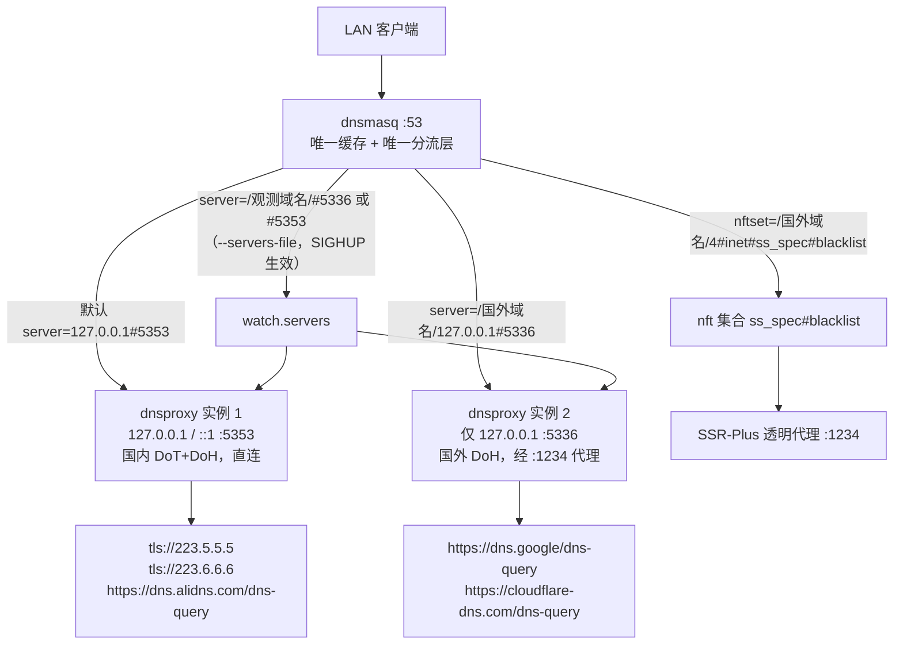

# DNS 分流运行时

本文描述 `dnschain` 框架在路由器上的**实际运行形态**。所有事实以仓库代码为准，每条给出 `路径:行号`；路由器观测值单独标注为「某时点实测」，不当作常量。

框架的定位：**dnsmasq 是唯一的缓存层与唯一的分流层**，dnsproxy 退化为两个不带缓存的加密转发器。

## 1. 实际链路



三件事必须同时成立，缺一条链路就退化：

| 环节 | 代码事实 | 证据 |
|---|---|---|
| 默认上游只有一条 `127.0.0.1#5353` | uci-defaults 先 `delete` 再 `add_list`，并写 `noresolv=1`、`dnsforwardmax=1024` | `files/etc/uci-defaults/99-zz-dnschain:104-107` |
| 国外域名由 dnsmasq 的 `server=` 分流，不用 dnsproxy 的 `[/域名/]` | 分流片段由唯一函数生成，输出 `server=/域名/127.0.0.1#<foreign_port>` | `files/usr/share/dnschain/dnschain.sh:1046-1149`（函数体），`:1107`（数据库国外）、`:1114`（自定义国外）、`:1121`（自定义国内） |
| 解析结果写进代理 IP 集 | `nftset=/域名/4#inet#ss_spec#blacklist`；自定义国内写 `#china` | `dnschain.sh:1109`、`:1116`、`:1123` |

观测域名是**唯一**不写进静态片段的类别：同一个域名若同时出现在静态片段与 `watch.servers` 里，dnsmasq 会把两条 `server=` 当作**候选**而不是覆盖，改道就退化成随机走一条（`files/etc/init.d/dnschain:91-94`、`dnschain.sh:1037-1042`）。

## 2. 两个 dnsproxy 实例的实际参数

两个实例的参数各由一个函数整体生成，逐行 `echo` 到 `*.args`，再由 `dc_args_to_cmdline` 拼成命令行。

### 2.1 国内实例（`:5353`）

| 参数 | 值 | 证据 |
|---|---|---|
| `--listen` | `127.0.0.1` 与 `::1`（各一条 `--listen`） | `dnschain.sh:340-343` |
| `--port` | `main.entry_port`，默认 `5353` | `dnschain.sh:344-345`、`files/etc/config/dnschain:48` |
| `--upstream` | `upstream 'cn'` 的每一条（DoT/DoH 混用） | `dnschain.sh:348-350`、`files/etc/config/dnschain:58-60` |
| `--bootstrap` | `223.5.5.5`、`223.6.6.6` | `dnschain.sh:353-356` |
| `--timeout` | `8s` | `dnschain.sh:358-359` |
| `--upstream-mode` | `parallel` | `dnschain.sh:362-363` |
| `--hosts-file-enabled=true` + `--hosts-files /etc/hosts` | 是 | `dnschain.sh:365-367` |

### 2.2 国外实例（`:5336`）

| 参数 | 值 | 证据 |
|---|---|---|
| `--listen` | **只有** `127.0.0.1`（没有 `::1`） | `dnschain.sh:388-390` |
| `--port` | `main.foreign_port`，默认 `5336` | `dnschain.sh:391-392`、`files/etc/config/dnschain:50` |
| `--upstream` | `upstream 'foreign'` 的每一条（必须是 DoH） | `dnschain.sh:395-397`、`files/etc/config/dnschain:67-68` |
| `--bootstrap` | `223.5.5.5`、`223.6.6.6` | `dnschain.sh:399-402` |
| `--timeout` | `8s` | `dnschain.sh:404-405` |
| `--upstream-mode` | `parallel` | `dnschain.sh:408-409` |
| `--hosts-file-enabled=true` + `--hosts-files /etc/hosts` | 是 | `dnschain.sh:411-413` |

**国外实例不监听 `::1` 是代码事实，不是遗漏的文档**：函数体里只有一条 `--listen 127.0.0.1`（`dnschain.sh:388-390`），与国内实例的两条 `--listen`（`dnschain.sh:340-343`）形成对照。自检第 4 项也只探测国内实例的 `::1`（`files/usr/bin/dnschain-selftest:193`）。

### 2.3 刻意不写的三个参数

`dc_gen_dnsproxy_args` 末尾的注释明确说明**不写** `--cache`、`--fallback`、`--ipv6-disabled`（`dnschain.sh:370`）。三条理由分别是：缓存只允许在 dnsmasq 一层；fallback 是全局的、会在上游不可用时回落到污染上游；`--ipv6-disabled` 是全局开关，会连国内 AAAA 一起砍（`files/etc/config/dnsproxy:46-49`、`:125-140`、`:31-33`）。

自检第 5 项在运行时复查这三点：出现任一即 FAIL（`dnschain-selftest:207-215`）。

## 3. preflight 硬校验

`preflight()` 在启动与 reload 前执行，任一失败即 `return 1`，调用方拒绝启动（`files/etc/init.d/dnschain:161-215`、`:397-400`、`:475-477`）。五条校验逐条列出：

| # | 触发条件 | 判定方式 | 后果 | 证据 |
|---|---|---|---|---|
| 1 | 任一上游 URL 的端口不在 `ss_spec_output` 的 tcp dport 集合内 | 取 `nft list chain inet ss_spec ss_spec_output` 的端口集，逐个 URL 用 `dc_upstream_port` 抽端口后比对 | 打印越界项清单并 `return 1`；**读不到端口集时不阻断**，只记 `WARN` | `init.d/dnschain:169-181`、`dnschain.sh:509-516`、`:1943-1972`、`:1948-1951` |
| 2 | `/usr/bin/dnsproxy` 不存在或不可执行 | `[ -x "$PROG_DP" ]` | 记 `ERROR: 缺少 /usr/bin/dnsproxy` 并 `return 1` | `init.d/dnschain:184` |
| 3 | `entry_port` 与 `foreign_port` 相同 | 两个 `dc_get` 取值比较 | 记「两个实例会抢端口」并 `return 1` | `init.d/dnschain:187-191` |
| 4 | `/var/etc/dnschain/foreign-split.conf` 不存在或为空 | `[ ! -s ... ]` | 记「国外域名会全部走国内上游（污染）」并 `return 1` | `init.d/dnschain:194-198` |
| 5 | 国外上游里有 `tls://` 开头的条目 | `dc_get_list foreign server \| grep -E '^tls://'` | 逐条打印不合规项并 `return 1`（落地节点到 853 不通） | `init.d/dnschain:203-212` |

端口校验的语义细节：端口集由 `sed -n 's/.*tcp dport { \([^}]*\) }.*/\1/p'` 抽取，只取第一条匹配（`dnschain.sh:510-515`）。端口推断规则是 `https→443`、`tls→853`、`quic→853`、`http→80`，带方括号的 IPv6 与 `host:port` 形式都支持（`dnschain.sh:520-552`）。

## 4. procd 三个实例

| 实例名 | 命令 | respawn | jail 挂载 | 证据 |
|---|---|---|---|---|
| `dnsproxy` | `/usr/bin/dnsproxy` + `dnsproxy.args` | `3600 5 5` | `/etc/hosts`、`/etc/ssl/certs/ca-certificates.crt`、`$DNSCHAIN_RUN_DIR` | `init.d/dnschain:274-290` |
| `dnsproxy-foreign` | `/usr/bin/dnsproxy` + `dnsproxy-foreign.args` | `3600 5 5` | 同上 | `init.d/dnschain:302-317` |
| `health` | `/usr/bin/dnschain-health daemon` | `3600 5 5` | 无 jail | `init.d/dnschain:366-381` |

服务元数据：`START=95`、`STOP=10`、`USE_PROCD=1`（`init.d/dnschain:29-31`）。这与固件产物预检期望的 `/etc/rc.d/S95dnschain`、`/etc/rc.d/K10dnschain` 一致（`tools/verify-firmware-artifact.sh:138-139`）。

健康实例有两道前置条件，任一不满足就不建实例：`health.enabled` 必须为 `1`，`health.interval` 必须大于 0（`init.d/dnschain:369-373`）。这两个实例的启动顺序是先两个 dnsproxy、再健康守护（`init.d/dnschain:407-413`），因为探测要求两个端口都在监听（`dnschain.sh:1626-1629`）。

## 5. 一次配置应用只重启 dnsmasq 一次

标记文件是 `/var/run/dnschain/.dnsmasq-dirty`（`init.d/dnschain:342`）。

机制：

1. `reload_dnsmasq()` 先看标记文件是否存在；存在则**只返回 0，不重启**（`init.d/dnschain:344-352`）。
2. `reload_service()` 在入口 `mkdir -p /var/run/dnschain` 并 `: > "$DNSCHAIN_RESTART_FLAG"` 建立标记（`init.d/dnschain:470-471`）。
3. 中途的 `update_dnsmasq_split`、`update_serversfile`、`update_dot_reject` 都不直接重启 dnsmasq。
4. `stop` + `start` 内部各自调用的 `reload_dnsmasq` 命中标记，全部空转（`init.d/dnschain:485-486`）。
5. 收尾先 `rm -f` 标记，再执行**一次** `/etc/init.d/dnsmasq restart`（`init.d/dnschain:489-493`）。

失败路径也必须清标记，否则下一次配置应用会被永久抑制：`generate_all` 或 `preflight` 失败时 `rm -f "$DNSCHAIN_RESTART_FLAG"` 后返回 1（`init.d/dnschain:474`、`:476`）。

用标记文件而不是环境变量的原因写在注释里：procd 的 stop/start 会重新 exec 本脚本，导出的变量跨不过那道边界（`init.d/dnschain:340-341`）。

注意这里用的是 `restart` 而非 `reload`：`reload`（SIGHUP）不重读 conf-dir，新生成的 `nftset` 规则不会被加载（`init.d/dnschain:320-324`）。因此 `reload_service` 的收尾重启是**无条件**的 —— 即使配置实际未变也会重启一次，代价约 3 秒（`init.d/dnschain:490-493`）。

## 6. stop_service 把 watch.servers 清成注释占位

`stop_service()` 做五件事（`init.d/dnschain:422-462`）：

| 动作 | 内容 | 证据 |
|---|---|---|
| 1 | `/etc/nftables.d/15-dnschain-reject-dot.nft` 写成注释占位 | `:425-428` |
| 2 | `/tmp/dnsmasq.d/dnschain-split.conf` 写成注释占位 | `:429-432` |
| 3 | 删除 `/var/run/dnschain/health.state` | `:436` |
| 4 | `watch.servers` 写成注释占位并 `chmod 0644` | `:449-455` |
| 5 | `firewall reload`，随后 `reload_dnsmasq` | `:457-460` |

第 4 步的理由（代码注释原文要点，`init.d/dnschain:438-448`）：`/var/run/dnsmasq/watch.servers` 在 tmpfs、不随 stop 消失，而 `dhcp.@dnsmasq[0].serversfile` 仍指着它。stop 之后重启 dnsmasq 会重读它，里面若有 `server=/github.com/127.0.0.1#5336` 而 `:5336` 已无人监听，这些域名就变成**稳定解析失败**，且日志干净。清成注释而不是删除，是因为文件必须继续存在，否则 dnsmasq 启动时读不到 serversfile 会报错（同 `update_dot_reject` 的理由，`init.d/dnschain:256-262`）。

`nftables.d` 与 `conf-dir` 两处同理：fw4 用 glob include `/etc/nftables.d/*.nft`，目录为空会导致 include 无匹配、fw4 reload 失败（`init.d/dnschain:257-259`；同样理由见 `files/etc/init.d/dnsproxy:233-236`）。

## 7. 853 拒绝片段

文件路径是 `/etc/nftables.d/15-dnschain-reject-dot.nft`（`init.d/dnschain:38`），由 `update_dot_reject()` 生成（`init.d/dnschain:233-269`）。

生成的片段内容（`init.d/dnschain:244-255`）：

- 只有**裸 chain** `dnschain_reject_dot`，没有 `table` 声明；
- `type filter hook prerouting priority -151; policy accept;`
- `iifname "$dev" tcp dport 853 reject`（comment `!dnschain: reject LAN DoT`）
- `iifname "$dev" udp dport 853 reject`（comment `!dnschain: reject LAN DoQ`）

`$dev` 的取值顺序是 `network.lan.device` → `network.lan.ifname` → `br-lan`（`init.d/dnschain:237-239`）。

关闭时（`intercept_dot != 1` 或 `main.enabled != 1`）写注释占位，不删文件（`init.d/dnschain:256-263`），随后触发 `firewall reload` 使规则生效或移除（`init.d/dnschain:265-268`）。

优先级 `-151` 的必要性：`ss_spec_mangle prerouting` 是 `mangle(-150)`，fw4 的 `dns_intercept_lan` 是 `dstnat+1(-99)`，tproxy 会先于 DNS 劫持执行；`-151` 比 `mangle` 更早，才能先拒掉客户机自带的 DoT（`init.d/dnschain:218-232`）。nft 会把它规范化为 `priority mangle - 1`（`init.d/dnschain:226-231`）。

CI 侧的守卫：`grep -c 'priority -151'` 至少 1 条（`.github/workflows/build-openwrt.yml:1313-1319`），另有「裸 chain 无 table 声明」的独立步骤（`build-openwrt.yml:1352-1400`）。

## 8. 域名归属与改道

### 8.1 三个概念

| 概念 | 谁决定 | 存哪 | 证据 |
|---|---|---|---|
| **归属**（class） | 配置 + 名单，静态 | UCI 自定义列表 → `/var/etc/dnschain/custom-*.txt`；数据库 → `db-domains.txt` | `dnschain.sh:559-575`、`:941-947`、`:773-783` |
| **首选**（preferred） | 归属的确定性映射 | 计算得出，不落盘 | `dnschain.sh:892-897` |
| **当前**（active） | 健康探测，动态 | `/var/run/dnschain/health.state` 第 3 段 | `dnschain.sh:611`、`:1473-1482` |

### 8.2 四个归属取值

`dc_domain_class` 只输出四种合法值，外加一种错误值（`dnschain.sh:787`、`:827-887`）：

| 取值 | 判定方式 | 证据 |
|---|---|---|
| `custom-domestic` | `grep -Fqx` **精确**命中 `custom-domestic.txt` | `dnschain.sh:839-840` |
| `custom-foreign` | `grep -Fqx` **精确**命中 `custom-foreign.txt` | `dnschain.sh:841-842` |
| `db-foreign` | 逐级剥最左标签生成候选后缀，**一次** `grep -Fxf` 比对 `db-domains.txt`（后缀匹配，与 `server=/域名/` 语义一致） | `dnschain.sh:867-884` |
| `uncovered` | 以上都不命中 | `dnschain.sh:886` |
| `invalid` | 域名格式校验失败（不是归属，是错误） | `dnschain.sh:831` |

首选映射：`custom-foreign` 与 `db-foreign` → `foreign`；其余（含 `uncovered`）→ `domestic`（`dnschain.sh:893-896`）。「未覆盖 → domestic」是刻意与 dnsmasq 的默认上游保持一致，否则「不配置」与「配置了框架」行为会不同（`dnschain.sh:567-573`）。

自定义列表**只补全归属、不豁免改道**：v0.14.0 起所有观测域名走同一套判定，`dc_domain_custom` 仅表示「归属由用户显式补全」（`dnschain.sh:899-931`、`:1674-1682`）。

### 8.3 状态文件格式

`health.state` 由**唯一**写盘实现 `dc_health_upsert` 生成，一行一个域名，`|` 分隔，**7 段**（`dnschain.sh:1493-1509`，`printf '%s|%s|%s|%s|%s|%s|%s\n'`）：

| 段号 | 含义 | 证据 |
|---|---|---|
| 1 | 域名 | `dnschain.sh:1505` |
| 2 | 首选链 `domestic`/`foreign` | 同上 |
| 3 | 当前链 `domestic`/`foreign` | 同上 |
| 4 | 连续失败计数 `fail` | 同上 |
| 5 | 连续成功计数 `ok` | 同上 |
| 6 | 上次**改道**时刻（epoch） | 同上；语义见 `:1516-1526` |
| 7 | 结果字符串（`OK`/`probe:…`/`switch:…`/`recover-wait:…`/`both-bad:…`/`fallback:…`） | `dnschain.sh:1688`、`:1700-1701`、`:1706`、`:1713`、`:1738`、`:1744`、`:1749` |

⚠️ **`health.state` 没有 `class` 字段**。含 `class` 的是 `dnschain-health status` 的 `ROW` 行，它有 **9 段**：`domain|class|pref|active|fail|ok|last|result|state`（`files/usr/bin/dnschain-health:114-115`，`printf 'ROW %s|%s|%s|%s|%s|%s|%s|%s|%s\n'`），Lua 侧也按 `#f >= 9` 解析（`package/luci-app-dnschain/luasrc/model/cbi/dnschain/dnschain.lua:795-806`）。两者不要混：把 `health.state` 当 8 段或 9 段解析都会错位。

### 8.4 watch.servers 通道

- 路径 `/var/run/dnsmasq/watch.servers`（`dnschain.sh:607`），必须落在 ujail 已挂载目录且 `0644`，否则 dnsmasq（uid 453）读不到且**不报错**（`dnschain.sh:589-606`、`:1214-1228`）。
- 由 `dc_gen_watch_servers` 生成，返回 `changed` 或 `same`（`dnschain.sh:1165-1231`）；每个观测域名按 `active` 写 `server=/域名/127.0.0.1#5336`（foreign）或 `#5353`（domestic）（`dnschain.sh:1200-1203`）。
- 生效方式是 `--servers-file` + SIGHUP，**不重启** dnsmasq（`dnschain.sh:1239-1245`）；UCI 键是 `dhcp.@dnsmasq[0].serversfile`，由 `update_serversfile` 幂等下发（`init.d/dnschain:140-155`）。
- 目录创建必须针对**目标文件所在目录**而不是 RUN_DIR（`dnschain.sh:1172-1184`）。

### 8.5 `dc_health_cycle` 的互斥锁

锁是目录 `/var/run/dnschain/.cycle.lock`，用 `mkdir` 的原子性实现（`dnschain.sh:1631-1645`）：

1. **先**做实例就绪检查（两个端口都在监听），不就绪直接返回、**不取锁**（`dnschain.sh:1626-1629`）；
2. `mkdir` 成功即持锁，`echo $$ > "$lockd/pid"`（`dnschain.sh:1645`）；
3. `mkdir` 失败时读 `$lockd/pid`，`/proc/<pid>` 存在则打印 `SKIP 已有一轮探测在跑（pid=…）` 并返回（`dnschain.sh:1633-1640`）；
4. 持有者已死则 `rm -rf` 清死锁后重新 `mkdir`（`dnschain.sh:1641-1644`）；
5. 正常路径末尾 `rm -rf "$lockd"`（`dnschain.sh:1768`）。

「检查必须在取锁之前」是修过的缺陷：原顺序里那条 `return` 不释放锁，而 daemon 的 `$$` 恒定，于是某轮撞上实例未就绪就永久自锁，改道从此完全停止而日志显示正常 SKIP（`dnschain.sh:1613-1625`）。

### 8.6 一轮的判定

对每个观测域名取 `pref`、`other`、`active`、`fail`、`ok`、`last`（`dnschain.sh:1660-1672`）：

- `active == pref`：`r_pref ∈ {OK, EMPTY}` → 计数清零（`:1687-1691`）；否则探另一条，另一条通则 `fail++`，达 `fail_threshold` 即改道（`:1694-1709`），两条都不通则写 `both-bad:` 且不改道（`:1711-1716`）。
- `active != pref`（已改道）：`r_pref` 通则 `ok++`，满足 `ok >= recover_threshold` **且** `now - last >= min_dwell` 才回切（`:1722-1741`）；等待期间用 `dc_health_write_keep_last` 保留 `last`（`:1744-1745`）；`r_pref` 不通则保持并写 `fallback:`（`:1749-1750`）。
- 有任何改动才重写 `watch.servers` 并 SIGHUP（`:1755-1761`）。

### 8.7 分诊：未知目标走直连还是代理（v0.16.0 起）

改道（8.6）处理的是**观测列表里的 8 个种子域名**；分诊处理的是
**客户机实际访问过、但不在任何归属库里**的目标。两者输入集合不同。

用户定的规则（`files/usr/bin/dnschain-triage` 顶部注释逐字保留）：

```
不在 GFW 名单、不在 blacklist、不在 china、不在任何数据库
                    ↓
             ① 试直连（真的发请求）
                    ↓ 通
              落库：IP → china 集合
                    域名 → dom_domestic
                    ↓ 不通
             ② 试代理（移入 blacklist，再发请求）
                    ↓ 通
              落库：IP → blacklist 集合
                    域名 → dom_foreign
                    ↓ 不通
             ③ 标记 dead（两个集合都不加）
```

**v0.16.2 关键修正：污染/名单优先判定在「试直连」之前。**

实测故障：`www.google.com` 曾被判 `domestic` → 写进 `dom_domestic`
→ `watch.servers` 指向 `:5353`（国内链）→ 解析出 `185.45.5.35` /
`2001::1`（污染值）→ 自检第 10 项 FAIL。

原因：**污染 IP 本身能连通** —— 它就是本地劫持者的地址，直连返回 302，
于是「试直连」判定为通。但正确结论恰恰相反：被污染说明**必须走代理**，
让国外 DoH 拿到干净答案。

所以现在的判定顺序是：

| 顺序 | 判据 | 结论 |
|---|---|---|
| ⓪ | 域名在 GFW 名单里（含父域回溯） | **强制 proxy** |
| ⓪ | 解析出已知污染值 | **强制 proxy** |
| ① | 试直连通 | direct |
| ② | 试代理通 | proxy |
| ③ | 都不通 | dead |

**IP 段落库（v0.16.2）**：落库的不是单个 IP，而是按归属算出的 CIDR：

- 已知网段表（`CN_SEGS` / `OVERSEAS_SEGS`）优先，这些是逐个核实过
  归属的云厂商/大厂实际分配段
- 无匹配退化为 `/24`
- 特殊段（`127/8`、`169.254/16`、`224/4`、私网）**绝不外扩**

实测：`47.76.188.58` → `47.76.0.0/16`；`8.8.8.8` → `8.8.8.0/24`；
`192.168.3.1` → `192.168.3.1`（不扩）。

**持久化**：`china` / `blacklist` 由上游 SSR-Plus 每次 start 时
`flush set` 重建，故两处重放 —— `dnschain-reconcile` 每轮收敛 +
`99-zz-dnschain` 首刷。域名写 **UCI**（`dnschain.dom_domestic.domain`），
不能直接写 `custom-domestic.txt`（那是 UCI 的运行时副本，
`dc_gen_custom_lists()` 会覆盖它）。

## 9. 自检 20 项

`dnschain-selftest` 的每一项都以 `emit <序号> <PASS|FAIL|SKIP> <名称> — <证据>` 输出（`files/usr/bin/dnschain-selftest:31-42`）。20 个名称与首处 emit 行号：

| # | 项目名 | emit 行 |
|---|---|---|
| 1 | 客户机 DNS 路径可达 | `:119` / `:121` |
| 2 | 框架分流规则正确 | `:141` / `:153` / `:158` |
| 3 | dnsmasq 唯一默认上游 | `:184` / `:186` |
| 4 | dnsproxy 在监听 | `:195` / `:197` / `:200` |
| 5 | dnsproxy 参数一致 | `:208` / `:210` / `:212` / `:214` / `:217` |
| 6 | 无 chinadns-ng 残留 | `:228` / `:230` |
| 7 | 端口所有权无冲突 | `:246` / `:248` / `:250` / `:252` |
| 8 | 国内 A 正确 | `:258` / `:260` |
| 9 | 国内 AAAA 保留 | `:267` / `:269` |
| 10 | 国外 A 正确 | `:275` / `:277` / `:279` |
| 11 | 国外 AAAA 保留 | `:289-292` |
| 12 | 国外 DoH 出站 | `:304` / `:306` |
| 13 | 代理与分流在位 | `:315` / `:317` |
| 14 | fw4 规则可加载 | `:357` / `:359` / `:364` / `:367` |
| 15 | 无明文旁路 | `:395` / `:401` |
| 16 | 缓存层唯一 | `:413` / `:415` |
| 17 | 自定义域名列表合法 | `:434` / `:438` |
| 18 | 观测域名不与静态片段重复 | `:460` / `:462` |
| 19 | 改道通道已就绪 | `:485` / `:487` / `:532` / `:535` / `:538` |
| 20 | 改道状态自洽 | `:569` / `:571` / `:573` |

关键判据摘要：

- 第 1 项测的是 **LAN 地址上的 :53**（`network.lan.ipaddr`，回落 `127.0.0.1`），不是回环（`:89-94`、`:117`）；`OK` 或 `EMPTY` 都算通过（`:118`）。
- 第 3 项从 dnsmasq 进程的 `-C` 参数取**真正在用**的配置文件，避免 `/var/etc/dnsmasq.conf.*` 通配匹配到多个旧文件（`:164-180`）。
- 第 7 项读 `shadowsocksr.pdns_enable`、`shadowsocksr.ipv6_support`、`dhcp.@dnsmasq[0].filter_aaaa` 三个键，期望 `0/7`、`1`、`0`（`:241-253`）。
- 第 11 项期望 `OK`（v0.10.0 起国外 AAAA 保留），`EMPTY` 判 FAIL（`:282-293`）。
- 第 12 项无活跃连接时输出 **SKIP**，不算失败（`:303-307`）。
- 第 14 项按输入文件 mtime 指纹缓存 `fw4 check` 结论（`:335-369`），`DNSCHAIN_FW4_NO_CACHE=1` 可强制重算。
- 第 19 项要求三件事同时成立：UCI 配了 `serversfile`、该文件可读、生效的 dnsmasq 配置里有 `servers-file=<该路径>`，且目录在 ujail 白名单内（`:482-541`）。

### 9.1 退出码与缓存

- 退出码：`_fail_n > 0` 时返回 **1**，否则返回 **0**（`:654-671`）；`SKIP` 不影响退出码（头注释 `:9` 与实现一致）。
- `SUMMARY` 行由 `main` 从捕获的输出里**重新统计**得出（`PASS_CNT` 等变量在 `$( )` 子 shell 里，父 shell 读不到）（`:626-645`）。
- 缓存文件 `/var/run/dnschain/selftest.cache`，TTL **60 秒**（`:595-596`）。命中条件有两个：文件年龄小于 TTL **且** 指纹相同（`:602-617`）。
- 缓存写入用 `.new` + `mv` 原子替换，首行是 `#FP=<指纹>`（`:680-694`）。
- 指纹覆盖：`entry_port`、`foreign_port`、两个端口的 owner PID、`:1234` 是否监听、`ss_spec` 表是否存在、`main.enabled`、`dhcp.filter_aaaa`、`shadowsocksr.ipv6_support`、gfw 源行数、两条链上游的「条数+首项」（`:698-740`）。
- 强制重算的开关是 `-f` / `--force`（`:598-600`）。

## 10. 已知的代码内部不一致

以下每条都能用行号证明。它们不是「设计选择」，是同一事实存在两处不同表述。

### 10.1 `filter_aaaa` 被写成 `1`，但最终生效 `0`

- `files/etc/uci-defaults/99-gaming-optimize:796-799` 写 `filter_aaaa='1'` 并记录日志 `filter_aaaa=1 (reject set = …)`。
- `files/etc/uci-defaults/99-zz-dnschain:75-80` 写 `'0'`；`files/usr/bin/dnschain-reconcile:97-98` 也归一为 `'0'`。
- `uci-defaults` 按文件名排序执行，`99-gaming-optimize` < `99-zz-dnschain`（实测 `LC_ALL=C sort` 结果；CI 也有同一断言 `.github/workflows/build-openwrt.yml:1212-1218`），故后者覆盖前者，**最终生效 `'0'`**。
- 附带影响：`99-gaming-optimize:765-799` 的整段注释（含「`'0'` 会让被墙域名拿到真实 AAAA 并在 IPv6 上直连被 RST」）与 v0.10.0 之后的实际取值相反，读注释会得出错误结论。

### 10.2 `pdnsd_enable=4` 与 `tunnel_forward_mosdns` 仍被写入

- `files/etc/uci-defaults/99-gaming-optimize:303-306` 写 `pdnsd_enable='4'` 和 `tunnel_forward_mosdns='https://dns.google/dns-query,https://cloudflare-dns.com/dns-query'`。
- `files/etc/uci-defaults/99-zz-dnschain:45-50` 把 `pdnsd_enable` 覆盖为 `'0'`。
- 但 `tunnel_forward_mosdns` **没有**被覆盖：`99-zz-dnschain:82-83` 明确「不删除该键，只是不再写入」。结果是该键保留着 MosDNS 的上游串，而 MosDNS 已不在默认链路上（`files/etc/config/dnschain:198-200` 要求 `ssr.mode=0`）。

### 10.3 生成的仍是 `dnsmasq restart`，不是 `reload`

- `files/etc/uci-defaults/99-gaming-optimize:503` 在补丁文本里 `printf '\t\t\t/etc/init.d/dnsmasq restart >/dev/null 2>&1\n'`，插进 `shadowsocksr` 的 `stop()`。
- 同文件 `:436-457` 的注释只解释了「restart 场景下跳过这次重启」，并没有说要改成 `reload`；而 AGENTS §4.4 记录路由器实况是 `reload`。即**仓库 overlay 与固件实况漂移**：下一次刷机会把 `reload` 改回 `restart`。
- 同一处还引用了 `echolog "restart: skip dnsmasq restart in stop()"` 这条日志（`:501`），断言 `grep -c 'dnsmasq restart'` 为 0 会命中该文本而永久误报（AGENTS §4.4 已记录）。

### 10.4 `dnschain-health` 头部列 7 个子命令，`main()` 有 8 个

- 头注释列出 `cycle`、`daemon`、`status`、`explain`、`check`、`reset`、`apply`（`files/usr/bin/dnschain-health:16-23`）。
- `main()` 的 `case` 分支多一个 `flush`（`:350-358`），用法串里也含 `flush`（`:360`）。

### 10.5 `check` 的「页面保存前预检」用途已不存在

- `files/usr/bin/dnschain-health:21` 与 `:130` 都写「供页面保存前预检」。
- 页面侧该按钮已被移除：`package/luci-app-dnschain/luasrc/model/cbi/dnschain/general.lua:1272-1284` 的注释说明「校验自定义列表」按钮已移除。
- 该注释的最后一句「`ds.check_domains()` 仍保留在模型层」**已过期**：`dnschain.lua` 里既无定义也无调用（搜索 `check_domains` 在 `package/luci-app-dnschain/` 下只命中这条注释），而 `tools/check-dnschain-lua.py:876-880` 的断言恰好要求「`function M.check_domains` 不得存在」。
- 仓库内唯一实际调用点是 `files/usr/bin/dnschain-selftest:428`（自检第 17 项）。`grep -rn "health check" package/luci-app-dnschain` 无命中。

### 10.6 `cycle` 不由 init.d 的守护循环调用

- `files/usr/bin/dnschain-health:17` 写「`cycle` … 由 init.d/dnschain 的守护循环调用」。
- 实际 init.d 启动的是 `daemon`：`files/etc/init.d/dnschain:376` `procd_set_param command /usr/bin/dnschain-health daemon`。
- `daemon` 内部直接调 `dc_health_cycle`，不经过 `cycle` 子命令（`dnschain-health:334-337`）。`cycle` 只被页面「立即探测一轮」使用（`package/luci-app-dnschain/luasrc/model/cbi/dnschain/dnschain.lua:858`）。

### 10.7 「立即重新自检」实际不传 `-f`

- `files/usr/bin/dnschain-selftest:591` 注释写「页面上的「立即重新自检」按钮传 `-f` 强制刷新」。
- 实际页面调用是 `sys.exec("/usr/bin/dnschain-selftest 2>&1")`，不带参数（`package/luci-app-dnschain/luasrc/model/cbi/dnschain/dnschain.lua:508`）。
- 后果：在 60 秒 TTL 内点该按钮会拿到缓存结果。页面层的 `invalidate("selftest")` 只清 Lua 侧请求级缓存（`dnschain.lua:477-479`），不影响 shell 侧磁盘缓存。

### 10.8 `capabilities/dnschain-filter.json` 无消费者

- 文件存在且授予 `CAP_NET_ADMIN`、`CAP_NET_BIND_SERVICE`、`CAP_NET_RAW`（`files/etc/capabilities/dnschain-filter.json:1-27`）。
- 全仓库对它只有三处引用：`CHANGELOG.md:2388`（新增记录）、`docs/adr/0004-dns-chain-verification.md:47`、`tools/verify-firmware-artifact.sh:141`（产物存在性预检）。**没有任何 procd 实例引用它**：`files/etc/init.d/dnsproxy:319` 用的是 `dnsproxy.json`，`files/etc/init.d/dnschain` 全文无 `capabilities` 字样（`grep -n capabilities files/etc/init.d/dnschain` 无输出）。
- 它服务的对象 chinadns-ng 已于 v0.10.0 移除（`files/etc/config/dnschain:14-24`、`docs/adr/0005-remove-chinadns-ng.md`）。

### 10.9 CI 里 `chinadns-ng` 同时「必须有」和「不再要求」

- `.github/workflows/build-openwrt.yml:684-687` 写 `CONFIG_PACKAGE_chinadns-ng=y`，注释称「dnschain 运行时依赖」。
- 同文件 `:864-870` 明确「v0.10.0：不再要求 `CONFIG_PACKAGE_chinadns-ng`」，且 `:1131-1158` 断言库脚本不得再有 `dc_gen_filter_args`。
- 结果：`.config` 里仍会带上该包，但框架不依赖它；`build-openwrt.yml:687` 的注释与实现意图相反。

### 10.10 本次核对新发现

- **`health.state` 的段数与两处文档口径不一致**：代码写 7 段（`dnschain.sh:1505-1506`），`status` 的 `ROW` 是 9 段（`dnschain-health:114-115`）。仓库内没有 8 段格式，按 8 段解析会错位（详见 §8.3）。
- **`dnschain-reconcile` 里 `profile` 是死变量**：`local … profile …` 在 `:52` 声明、`:57` 赋值 `dc_get main profile primary`，此后全文件不再使用（`grep -n profile files/usr/bin/dnschain-reconcile` 仅 `:52`、`:57` 两行）。而 `dnschain.sh:58-64` 的注释明确说 `main.profile` 这个键「配置文件里没有」，即该赋值恒为空串。
- **`files/etc/config/dnsproxy:88-91` 的注释指向已不存在的产物**：注释称框架启用时分流由 `/var/etc/dnschain/upstreams-domains.txt` 承担，但库脚本里已无该文件的生成函数（`dnschain.sh:236-247` 是「为什么不用 `[/域名/]`」的历史说明，`:1046-1149` 生成的是 `dnschain-split.conf`）。
- **CI 注释里的断言条数已过期**：`build-openwrt.yml:440` 写「断言较多（88 条）」，实际脚本 `tools/verify-dnschain-domains.sh` 现在输出 **129 条 OK**（本次实跑，见 `docs/operations/verification.md` §1.1）。
- **`/tmp/.dc-selftest.out` 是固定路径且无锁**：`dnschain-selftest:652`、`:662`、`:684-693` 用它做中间落盘，两个 selftest 并发时会互相覆盖（脚本没有针对该文件的互斥）。

## 11. 路由器实测基线

以下为**某时点只读取证**的观测值（OpenWrt 24.10.5 / 内核 6.18.55），随名单更新与配置变化会漂移，**不要当常量**。取证方式见 `docs/operations/verification.md` §2。

### 11.1 端口归属

`netstat -lnup` 显示：

| 监听地址 | 进程 |
|---|---|
| `127.0.0.1:5353` | dnsproxy（国内实例），1 个 |
| `127.0.0.1:5336` | dnsproxy（国外实例），1 个 |
| `127.0.0.1:53`、`192.168.3.254:53` | dnsmasq |
| `:1234` | v2ray |

与代码一致：国内实例只绑回环（`dnschain.sh:340-343`），国外实例只绑 `127.0.0.1`（`dnschain.sh:388-390`）。

### 11.2 `/var/etc/dnschain/` 的产物

| 文件 | 当时规模 | 是否有消费者 |
|---|---|---|
| `dnsproxy.args` | 存在 | 有（`init.d/dnschain:277`） |
| `dnsproxy-foreign.args` | 存在 | 有（`init.d/dnschain:305`） |
| `foreign-split.conf` | 23714 行 | 有（preflight 的非空判据 `init.d/dnschain:194`、页面统计） |
| `db-domains.txt` | 23715 行 | 有（归属判定 `dnschain.sh:867`） |
| `custom-domestic.txt` | 0 字节 | 有（`dnschain.sh:839`） |
| `custom-foreign.txt` | 0 字节 | 有（`dnschain.sh:841`） |
| `watch.servers` | 存在 | 有（`--servers-file`） |
| `upstreams-domains.txt` | 837038 字节 | **无**（生成函数已删除） |
| `filter.args` | 122 字节 | **无**（chinadns-ng 已移除） |
| `idna-bypass.conf` | 2530 字节 | **无**（v0.10.0 起不过滤 `xn--`） |
| `fw4-check.cache` | 存在 | 有（自检第 14 项缓存 `dnschain-selftest:335`） |

后三个是历史残留，代码里已无生成者与读取者：在 `files/` 下搜索 `upstreams-domains` / `filter.args` / `idna-bypass`，只命中两处注释 —— `dnschain.sh:236`（解释为什么不用 `[/域名/]` 的历史说明）与 `files/etc/config/dnsproxy:90`（同样过期的说明）。两处都是文字，没有生成代码。

### 11.3 dnsmasq 侧

- `/tmp/dnsmasq.d/dnschain-split.conf`：`server=` **23714** 条、`nftset=` **23714** 条。两者相等说明当时 `ss_spec` 的 `blacklist` 集合存在（`dnschain.sh:1077-1080`）。
- `/var/etc/dnsmasq.conf.cfg01411c`：`server=127.0.0.1#5353` **恰好 1 条**、`servers-file=/var/run/dnsmasq/watch.servers`、`dns-forward-max=1024`、`conf-dir=/tmp/dnsmasq.d`。这四项分别对应自检第 3 项（`dnschain-selftest:180-187`）、第 19 项（`:482-541`）、uci-defaults（`99-zz-dnschain:107`）、分流片段加载路径（`dnschain.sh:25`）。

### 11.4 `health.state`

8 行，字段形如 `github.com|foreign|foreign|0|0|1792740583|OK` —— **7 段**，与 `dnschain.sh:1505-1506` 的 `printf` 一致（§8.3）。

### 11.5 SSR-Plus 生成物（仓库内没有）

- `/etc/ssrplus/gfw_list.conf`：47488 行、`server=` 23744 条。该文件由 SSR-Plus 生成，框架**只读不写**（`dnschain.sh:173-178`、`files/usr/bin/dnschain-reconcile:12-18`）。

### 11.6 `ss_spec_output` 的端口集

`nft list chain inet ss_spec ss_spec_output` 的端口集为 `{ 22, 80, 143, 443, 465, 587, 853, 993, 995, 9418 }` —— **不含 53**。这与 preflight 第 1 条的校验对象一致（`dnschain.sh:509-516`），也与「53 不得进 tproxy 端口列表」的约束一致（`files/etc/uci-defaults/99-gaming-optimize:527-569`、`files/usr/bin/dnschain-reconcile:198-207`）。

### 11.7 IPv6 流量代理确实存在

- `ip -6 rule` 有 `999: from all fwmark 0x53535250 lookup 999`；`ip -6 route show table 999` 为 `local default dev lo`。
- `nft list table inet ss_spec` 含 10 条链：`ss_spec6_tcp`、`ss_spec6_redirect`、`ss_spec6_prerouting`、`ss_spec6_output`、`ss_spec6_udp`、`ss_spec6_udp_proxy`、`ss_spec6_mangle`、`ss_spec6_udp_output`、`ss_spec6_udp_mark`、`ss_spec6_udp_local`。

即 **IPv6 流量代理是真实存在的**，不是「只有 DNS 重定向」。这与 `files/etc/config/dnschain:26-33` 的描述一致，也是「国外 AAAA 不再抑制」的前提（`dnschain.sh` 无 AAAA 抑制逻辑；自检第 11 项期望 `OK`，`dnschain-selftest:282-293`）。

⚠️ `AGENTS.md:553` 里「IPv6 侧只有 DNS 重定向，没有任何 TPROXY/REDIRECT」是 v0.10.0 之前的旧结论，与上述实测不符；`files/etc/config/dnschain:26-33` 与 `files/etc/uci-defaults/99-zz-dnschain:59-63` 都已按「IPv6 流量代理启用」重写。以代码与实测为准。
